When your first AI agent throws an error at 2am, Sentry is the right tool to open. It shows you the stack trace, the user context, the exact line of code that failed. If you already use Sentry for your web app, the instinct to plug it into your agent pipeline is natural — and it works.

The problem isn't Sentry. The problem is that exception monitoring covers maybe 10% of what running AI agents in production actually requires. The other 90% is invisible to it entirely.

## What Sentry Does Well

Sentry is a mature, well-designed tool. If you're running agents on any production codebase and you haven't wired up error monitoring yet, you should.

- **Exception capture**: Full stack traces, breadcrumbs, and source context for every crash
- **Performance tracing**: Distributed traces across services, latency breakdowns, database queries
- **Alert routing**: Native integrations with PagerDuty and Slack, configurable thresholds, on-call escalation
- **Issue grouping**: Smart deduplication so one broken loop doesn't generate 10,000 alerts
- **Release tracking**: Know exactly which deploy introduced a regression
- **Session replay and profiling**: Replay for frontend errors, CPU profiling for backend hotspots

For a traditional web app or API, this covers most of what you need. For AI agents, it covers the crashes. The rest of what matters to teams managing agents is completely outside Sentry's model.

## The Core Limitation for AI Agent Teams

AI agents don't mostly fail by throwing exceptions. They fail by producing wrong output, running longer than they should, costing more than you planned for, and completing tasks that needed human review before moving forward.

Sentry can't tell you:

- Which agent produced a hallucinated summary that passed downstream without any error being raised
- That an agent spent $22 on a single task because it retried 14 times with full context each run
- That 7 of your 18 agents are idle because something upstream broke the task assignment flow
- That a deliverable has been sitting in "completed" for four days and nobody has read it
- That two agents are waiting on each other's output and the whole pipeline has stalled

None of these are exceptions. There's no stack trace. Sentry doesn't log them because from the application's perspective, nothing crashed. But from your team's perspective, the agent fleet is not working.

A team running a research pipeline had zero Sentry alerts for six weeks. Agents were completing tasks, marking them done, performance metrics looked normal. When an engineer finally read a batch of outputs, half of them were generic summaries that hadn't incorporated the specific context passed in the task description. The agent ran. The work was poor. No exception was ever thrown. Sentry had nothing to say about it.

That gap is exactly what a [control plane for AI agents](/features/agent-monitoring) is built to close.

## Feature Comparison

| Feature | Sentry | AgentCenter |
|---|---|---|
| Exception tracking | Yes | Via Sentry or equivalent |
| Real-time agent status | No | Yes — online, working, idle, blocked |
| Task board and queue | No | Yes — Kanban across all agents |
| Per-task cost tracking | No | Yes — LLM cost per agent, per task |
| Deliverable review gates | No | Yes — approval workflows before output moves forward |
| Team @mentions and threads | No | Yes — per-task discussion and handoffs |
| Agent-to-agent coordination | No | Yes — dependency mapping and blocked states |
| Multi-project support | No | Yes — 3 to 50 projects depending on plan |
| Recurring task automation | No | Yes — Pro+ and above |
| Pricing | Free tier; Team $26/mo per member | $14–$79/mo flat, not per seat |
| Built for AI agents | No — built for apps and APIs | Yes |

The pricing model difference matters at team scale. Sentry's Team plan charges per developer seat. AgentCenter charges a flat monthly rate by agent count. For a 6-person team managing 15 agents, AgentCenter's Pro plan at $29/month is considerably cheaper than $156/month in Sentry seats for the same team.

## Workflow Comparison: An Agent Goes Wrong in Production

```mermaid
graph TD
    subgraph "Sentry only"
        A["🔴 Agent throws exception"] --> B["📧 Alert fires in Sentry"]
        B --> C["🔍 Engineer reads stack trace"]
        C --> D["🔧 Fix deployed"]
        D --> E["❓ Silent failures continue<br/>No task state or cost visibility"]
    end

    subgraph "AgentCenter"
        F["🔴 Agent blocked or task fails"] --> G["📊 Status updates on dashboard<br/>in real time"]
        G --> H["🔔 Team notified via @mention<br/>on the specific task"]
        H --> I["🔍 Engineer sees task context,<br/>prior output, and cost spent"]
        I --> J["✅ Task reassigned or restarted<br/>with full history intact"]
    end
```

**With Sentry alone:**

1. Agent throws an unhandled exception
2. Sentry fires an alert to your on-call channel
3. Engineer opens Sentry, reads the stack trace, traces the error
4. Fixes the code, deploys, closes the alert
5. No view of what other agents are doing or what tasks are stuck

**With AgentCenter:**

1. Agent hits a blocked state, fails a task, or a cost threshold is crossed
2. Dashboard reflects the change in [real-time status](/features/agent-dashboard)
3. Engineer opens the specific task, sees the full context, what was tried, what it cost
4. Reassigns, updates the task spec, or flags the deliverable for review
5. Team sees the resolution without needing a separate alert system

The meaningful difference is that Sentry tells you an exception happened. AgentCenter tells you where in the work queue it happened, what the agent was doing, what the deliverable looked like, and what's still blocked downstream.

## Can You Use Both?

Yes, and the combination is sensible.

Sentry handles unhandled exceptions, performance regressions, and release tracking. That's infrastructure-level plumbing your agent code still needs, and Sentry is good at it. AgentCenter handles task state, deliverable review, team coordination, and cost visibility. The two layers don't overlap much.

The teams that run into trouble are the ones who install Sentry and assume they have agent management covered. They find out otherwise when an agent completes tasks with no exceptions raised and produces low-quality output for three weeks before anyone notices.

Using both means you have a safety net for crashes and a control plane for everything else. That's the right setup once you're past a handful of agents.

## Bottom Line

Sentry is a production necessity for catching application errors, and it does that well. But it was built before AI agents existed as an operational category. It doesn't model task state, output quality, cost per run, deliverable review, or agent coordination — the things that actually make running agents in production difficult. For those, you need a tool built specifically for the job.

---

*Sentry is good at catching what breaks. AgentCenter manages what runs. [Start your 7-day free trial](/pricing) — no lock-in.*
