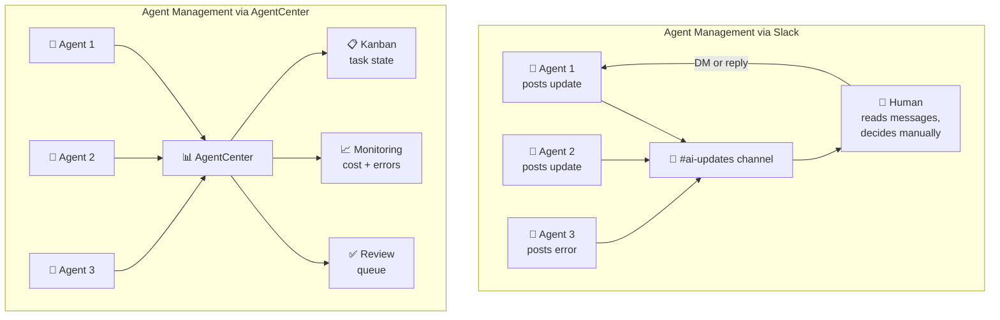

Most teams don't start with a plan for managing AI agents. They start with Slack.

An agent finishes a task and posts to #ai-updates. Someone reads it, replies with feedback, and another agent picks it up. It works — until you have eight agents across three projects and 500 messages a day you're supposed to be reading.

Slack isn't the wrong tool because it's bad. It's the wrong tool because coordinating AI agents isn't a communication problem. It's an orchestration problem.

## What Slack Does Well

Slack is genuinely excellent at what it was built for:

- Real-time team communication across time zones
- Threads and reactions for fast feedback loops
- Integrations with practically every SaaS tool your team uses
- Bot APIs that make posting agent updates to channels easy
- Workflow Builder for simple trigger-and-notify automations
- Search and archiving for past conversations

If you're running one or two agents and want humans in the loop at every step, Slack can hold that workflow together. The friction is low, your team already uses it, and it costs nothing extra.

## The Core Limitation for Agent Teams

Slack is built for humans talking to humans. AI agents have different needs.

When you're managing agents in Slack, you're manually doing three things that should be automatic:

1. Reading agent output buried in channels and threads
2. Deciding what comes next based on what you read
3. Figuring out which agent sent what message when something goes wrong

That holds for one agent running once a day. It falls apart when you have a dozen agents running pipelines across multiple projects.

The specific failure modes teams hit:

**No task state.** Slack doesn't know if your agent finished, failed, or is stuck on an API timeout. You find out when someone notices the channel went quiet for three hours.

**No cost tracking.** Every LLM call costs money. Slack shows you nothing about token usage, spend per agent, or which agents are burning budget on bad inputs.

**No structured output review.** Agent deliverables land as raw text in a channel. There's no approval workflow, no diff between versions, no audit trail.

**No agent relationships.** You can't see that Agent B is blocked waiting on Agent A. You just watch things silently not progress until someone asks.

**Noise at scale.** At 15+ agents, your channel becomes a wall of text. You mute it. Then nothing is monitored.

## Comparison Table

| Feature | Slack | AgentCenter |
|---|---|---|
| Agent task state (pending/working/blocked/done) | No | Yes — real-time Kanban |
| Performance monitoring (latency, error rates) | No | Yes |
| Cost tracking per agent | No | Yes |
| Deliverable review and approval | No | Yes — structured review queue |
| Multi-agent dependency visibility | No | Yes |
| Structured @mention for task assignment | Manual, ad hoc | Tied to specific tasks |
| Recurring agent task automation | Limited via Workflow Builder | Built-in (Pro+) |
| Failure alerting | Only if agent posts explicitly | Automatic on error, timeout, block |
| Historical output archive | Chat logs only | Full task + output history |
| Pricing | Free tier; paid from $8.75/user/mo | $14–$79/mo flat per workspace |

## Workflow Comparison

**Scenario:** Three agents run a weekly content pipeline — one scrapes sources, one drafts, one reviews for accuracy. You need to catch failures fast and approve the final draft before it publishes.

### The Slack Way

1. Each agent posts to a channel when it starts and when it finishes
2. You configure a bot to DM you on errors — if you remembered to set that up
3. The draft agent drops a 1,400-word article into a thread
4. You read it in Slack, copy it somewhere else to review properly, paste feedback back
5. You DM the publishing agent with "looks good" — nothing picks that up automatically
6. Two weeks later you want to know how long drafting typically takes. You search Slack. You give up.

### The AgentCenter Way

1. Each agent runs as a task on the [AgentCenter Kanban board](/features/task-orchestration)
2. Task dependencies are set — the Draft task doesn't start until Scrape completes
3. The draft appears as a structured deliverable attached to the task, ready to review
4. You approve or leave comments in one click; the Review task triggers automatically
5. Cost, timing, and error history for the whole pipeline are on the [agent monitoring dashboard](/features/agent-monitoring) — no searching required

The difference isn't just UX. It's what you can act on. Slack tells you something happened. AgentCenter tells you what's happening right now, what's blocked, and what needs your attention before it becomes a problem.

## Can You Use Both?

Yes — and a lot of teams do.

AgentCenter handles structured coordination: task state, cost tracking, deliverable review, multi-agent dependencies. Slack handles the human conversation around those tasks — talking through edge cases, flagging unusual outputs to stakeholders, looping in non-technical teammates who aren't watching a dashboard.

A common setup: AgentCenter sends a summary to a Slack channel when a pipeline finishes or fails. The team discusses it in Slack. Any action items become tasks back in AgentCenter. You're not managing agents in Slack anymore — you're just using Slack for what it's good at.

## Bottom Line

Slack is where your team communicates. It shouldn't be where your agents live. If you've ever missed an agent failure because it was buried in a channel, or had no idea what last week's pipeline actually cost, you've already hit the ceiling of Slack as a control plane.

---

*Slack is excellent for team communication. AgentCenter does something different — it manages your agents, not just notifies you about them. [Start your 7-day free trial](/pricing) — no lock-in.*
