Splunk is genuinely good software. If you're running enterprise infrastructure and need to aggregate logs from hundreds of services, write complex event correlation queries, and alert on anomalies across distributed systems — Splunk delivers. Security teams bet compliance programs on it. Platform engineers use it to debug production incidents. That reputation is earned.

When teams start running AI agents in production, reaching for Splunk feels natural. "Just pipe the agent logs to Splunk" sounds like the sensible first move. The problem shows up about three weeks in.

## What Splunk Does Well

Splunk was built for log intelligence at scale. The things it genuinely excels at:

- **Log ingestion from anything**: Servers, containers, APIs, cloud services, network appliances — structured or unstructured, Splunk ingests it
- **SPL search power**: Splunk Processing Language is flexible. You can correlate events across sources, build complex aggregations, and write queries that most other tools can't match
- **Dashboards and alerting**: Threshold alerts, anomaly detection, rich visual dashboards — the tooling is mature
- **Security and compliance**: SIEM use cases, audit trails, long-term retention, compliance reporting — Splunk has years of investment here
- **Enterprise scale**: It was built for large-scale infrastructure. If you have terabytes of logs and a dedicated Splunk admin, it handles the volume

## The Core Limitation for Teams Managing AI Agents

Logs are a symptom surface. They tell you what happened, not what's happening. AI agents need something different.

When you're managing even a small fleet of agents, the real questions aren't "what errors occurred?" They're:

- Which agent is currently running and what task is it working on right now?
- How much has this task cost so far in token spend?
- Did the agent's output actually meet the acceptance criteria, or did it just complete without producing something useful?
- Why is Agent B waiting — is it blocked by Agent A, or is Agent A stuck?
- Who owns this task when something goes wrong?

Splunk can help with some of this — if you've already instrumented every agent to emit the right structured events, written the SPL queries, and built dashboards that surface the right signals. Most teams spend two to four weeks getting there, and still end up with gaps around task ownership and deliverable quality.

More importantly, Splunk has no concept of a task, a deliverable, or an approval gate. It sees events on a timeline. AgentCenter sees work — active tasks with owners, blocked handoffs, pending reviews, and per-task cost running up in real time.

## AgentCenter vs Splunk: Feature-by-Feature

| Feature | Splunk | AgentCenter |
|---|---|---|
| Real-time agent status | Requires custom events + dashboard build | Built-in: online, working, idle, blocked |
| Task assignment and tracking | Not applicable — no task model | Kanban board, @mentions, due dates |
| Deliverable review and approval | Not applicable | Built-in review gates per task |
| Cost per agent or per task | Requires custom cost events + calculation | Tracked natively per task |
| Error alerting | Yes, via SPL threshold alerts | Yes, via task status escalation |
| Agent coordination and sequencing | Not applicable | Multi-agent workflow ordering |
| @Mentions and per-task threads | No | Yes |
| Time to first visibility | Days to weeks (instrumentation + setup) | Minutes after connecting agents |
| Pricing | Enterprise pricing; typically $150+/month | Starter $14/mo, Pro $29/mo, Scale $79/mo |

## Workflow Comparison: When an Agent Fails

Here's what an agent failure looks like through each tool.

```mermaid
graph TD
    subgraph "Splunk Path"
        A1["🔴 Agent fails"] --> B1["📝 Error logged<br/>(if instrumented correctly)"]
        B1 --> C1["🔍 Engineer opens Splunk<br/>writes SPL queries"]
        C1 --> D1["📊 Reconstructs context<br/>from log events"]
        D1 --> E1["⏰ 2-4 hours later:<br/>root cause identified"]
    end

    subgraph "AgentCenter Path"
        A2["🔴 Agent fails"] --> B2["🚨 Task status:<br/>blocked or error"]
        B2 --> C2["📣 Task owner<br/>@mentioned immediately"]
        C2 --> D2["🔎 Task detail:<br/>full context, cost, output"]
        D2 --> E2["⏰ Minutes later:<br/>root cause identified"]
    end
```

**The Splunk path:**
1. Agent fails. If you've instrumented it to emit structured error events, Splunk gets the event.
2. Your SPL alert fires when the error count crosses your threshold.
3. An engineer logs into Splunk and starts writing queries to understand what the agent was doing before it failed.
4. If you've built good dashboards, you can reconstruct context. If not, you're reading raw logs.
5. You find the root cause — after a meaningful delay and significant manual work.

**The AgentCenter path:**
1. Agent fails. The task status immediately shows `blocked` or transitions to an error state.
2. The task owner receives an @mention notification with the task context.
3. You click into the task — you see exactly what the agent was working on, token spend to date, the output it produced before failing, and the workflow step where it broke.
4. You reassign or fix and resume from that point, without losing progress.

The difference is more than speed. Splunk is organized around events and time series. AgentCenter is organized around tasks and outcomes. When something breaks, you need task context, not event streams.

## Can You Use Both?

Yes, and for enterprise teams, the combination often makes sense.

Splunk handles the infrastructure layer: platform health, security monitoring, compliance logging, network events. If your ops team already runs Splunk, it doesn't go away just because you added AI agents.

AgentCenter handles the agent-specific layer: task status, deliverable review, cost tracking per task, team coordination, and workflow sequencing. It's the [control plane for agent work](/features/agent-monitoring), not a replacement for log aggregation.

The teams that get the most out of both use Splunk for infrastructure-level concerns and AgentCenter for day-to-day agent operations. They answer different questions and don't step on each other.

That said, if you're a small team choosing your first monitoring tool for AI agents, Splunk's cost and setup overhead don't make sense for this use case. AgentCenter's [pricing plans](/pricing) start at $14/month and give you task-level visibility in minutes.

## Bottom Line

Splunk is an excellent log intelligence platform. It wasn't designed for AI agent management, and it shows when you try to use it for that job. If you need real-time task visibility, per-task cost tracking, and deliverable review gates, you need a tool built for those problems.

---

*Splunk is good at what it does. AgentCenter does something different — it manages your agents, not just records what they did. [Start your 7-day free trial](/pricing) — no lock-in.*
