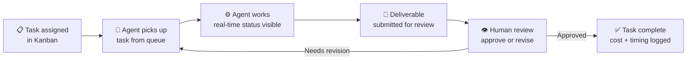

Stack AI is genuinely one of the fastest ways to ship an AI workflow. You can connect GPT-4 to a PDF parser, add a decision branch, and have it outputting to Slack in 20 minutes — no code required. For teams that need to ship a working agent quickly, it delivers.

The problem most teams hit four weeks in: the agent is running, but nobody can tell you what it produced yesterday, whether it finished, or what it cost. That's not a Stack AI failure. It's a scope mismatch. Stack AI is a builder. AgentCenter is an operator.

This post is about understanding the difference before you find out the hard way.

## What Stack AI Does Well

Stack AI is built for the construction phase of the agent lifecycle. It handles that job well.

- **Visual workflow editor:** Drag-and-drop canvas to connect models, tools, and APIs without writing code
- **Fast iteration:** Go from a blank canvas to a working agent in hours, not days
- **Pre-built integrations:** 80+ connectors to common tools — Notion, Slack, HubSpot, Google Drive, and more
- **Shareable apps:** Generate a public URL or embed a working UI for non-technical stakeholders to use directly
- **Multi-LLM support:** Works with OpenAI, Anthropic, Mistral, Google, and other providers
- **Template library:** Pre-built workflows for common use cases so you're not starting from scratch every time

If you're evaluating whether to build an agent at all, Stack AI is a reasonable place to prototype and validate the idea quickly.

## The Limitation Once Agents Go Live

Stack AI is not designed for operating agents at scale. The gap shows up gradually.

You've built three agents: a research agent, a content drafting agent, and a QA agent. They run on a schedule. Outputs go to a shared Google Doc and a Slack channel.

Two weeks in:
- The research agent ran last night but the output looks wrong. You don't know when it started, when it finished, or what inputs it received.
- The QA agent ran but you're not sure if it reviewed the latest draft or an older version.
- Someone on the team wants to see what the content agent produced this week. There's no task log — you have to scroll through Slack.
- One agent has been failing silently for three days. The only reason you know is because the downstream output is missing.

None of this is unusual. It's what happens when you manage production agents with a tool designed for building them.

Teams running Stack AI long-term typically bolt together a stack: Zapier for error notifications, a shared doc for output tracking, a Jira board for task assignment. That works at two agents. At eight, the seams show.

[AgentCenter's agent monitoring](/features/agent-monitoring) is built for exactly this phase. Real-time status for every agent, full task history with timing and cost, deliverable review with version control, and a Kanban board where the whole team can see what's running and what's waiting.

## AgentCenter vs Stack AI: Feature Comparison

| Feature | Stack AI | AgentCenter |
|---|---|---|
| Visual workflow builder | Yes — drag-and-drop canvas | No — manages existing agents |
| Real-time agent status | No persistent status view | Yes — online, working, idle, blocked |
| Task queue and Kanban board | No | Yes — full [task orchestration](/features/task-orchestration) |
| Deliverable submission and review | No | Yes — submission, approval, version history |
| Per-agent cost tracking | Basic LLM usage display | Per-agent, per-task cost attribution |
| Multi-agent coordination | Within a single workflow only | Across independent agents and projects |
| @Mentions and task threads | No | Yes — threaded comments per task |
| Recurring task automation | Via triggers | Native recurring tasks (Pro+ plan) |
| Audit trail | Limited | Full audit log with search |
| Human-in-the-loop review gates | No | Yes — approval workflows built in |
| Pricing | Free tier, then $49–$99/mo | Starter $14/mo, Pro $29/mo, Scale $79/mo |
| Primary use case | Building AI workflows | Managing AI agents in production |

## Workflow Comparison: Managing a Research Agent

### The Stack AI approach

1. Agent is triggered manually or on a schedule from the Stack AI editor
2. Runs through the workflow and writes output to a connected service (Google Doc, Slack, etc.)
3. You check the destination manually to see what was produced
4. No permanent task record in Stack AI — the history lives wherever the integration sends it
5. No review gate — whatever the agent produces goes directly to the destination
6. Errors surface only if you set up a separate notification via Zapier or a webhook

### The AgentCenter approach

1. Task is created in AgentCenter and assigned to the agent
2. Agent picks it up and status updates to "Working" — visible to the whole team
3. Agent submits the deliverable to AgentCenter when done
4. A human or lead orchestrator reviews before anything goes downstream
5. Cost, timing, and output history are stored and searchable
6. If the agent fails or gets stuck, it's visible immediately — not days later

The operational difference is significant once you have more than a handful of agents running. Every task has an owner, a status, a cost, and a review gate. Nothing runs invisibly.

## Can You Use Both?

Yes. This is actually a reasonable setup.

Stack AI handles the construction phase well: designing agent logic, connecting APIs, validating that the workflow produces the right output. Once the agent is working and ready for production, you bring it into AgentCenter's control plane for ongoing management.

Different stages of the agent lifecycle need different tools. Build and validate in Stack AI. Operate and coordinate in AgentCenter.

The teams that run into trouble are the ones trying to use Stack AI as their permanent operations layer. Output goes directly to Slack, tasks are tracked in Notion, errors get noticed by accident. That works until you have enough agents that the overhead of checking every destination manually becomes untenable.

If you're planning to run more than five agents on any ongoing basis, you'll want a dedicated control plane before you need it, not after. Adding monitoring after your first quiet failure is more expensive than setting it up beforehand.

## Bottom Line

Stack AI is a fast, capable tool for building AI workflows. If your goal is to get from zero to a working agent quickly, it's a good choice. AgentCenter is what you reach for once those agents are live and you need visibility into what they're actually doing — task by task, cost by cost, deliverable by deliverable.

---

*Stack AI is good at what it does. AgentCenter does something different — it manages your agents, not just builds them. [Start your 7-day free trial](/pricing) — no lock-in.*
