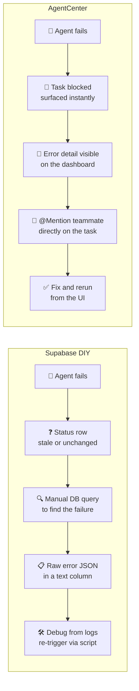

Supabase is one of the most popular backend platforms in the developer ecosystem. Open source, Postgres under the hood, a clean dashboard, real-time subscriptions, and auth built in. If you're building something fast and need a backend, it's the obvious pick.

So when teams start running AI agents and need somewhere to track what those agents are doing, Supabase feels natural. Log outputs to a table. Write a query to check status. Wrap a small API around it. That gets you through week one.

Here's the problem: getting started isn't the same as managing agents. The gap between "we have data somewhere" and "we actually know what our agents are doing" is where teams quietly lose weeks of engineering time.

## What Supabase Does Well

To be fair:

- **Postgres-backed storage** — structured agent outputs store cleanly in relational tables, and you can query them however you need
- **Real-time subscriptions** — listen to table changes and build live views without polling
- **Row Level Security** — auth controls mean different teams only see their own data
- **Auto-generated APIs** — REST and GraphQL generated from your schema, so agents can write results without a custom endpoint layer
- **Edge Functions** — small serverless functions triggered on row changes, which can look a lot like event-driven agent coordination
- **Open source and self-hostable** — good for teams with data residency requirements or on-prem constraints

Supabase is a solid backend platform. That's not in question.

## The Core Limitation for Teams Managing AI Agents

Storing agent data and managing agents are two different jobs.

When you run five agents and one fails, Supabase shows you rows in a table. It won't tell you which agent is blocked, which task is stuck in a retry loop, or why agent three's output broke agent four's input validation. That context lives in your head, your Slack thread, or nowhere.

You can build monitoring on top of Supabase. Teams do it. But here's what that actually means:

- A custom status enum for agent states, plus the logic to keep it updated
- A job queue, because Supabase isn't one
- A scheduler for recurring agent tasks
- Failure notifications (Supabase has no built-in alerting for agent errors)
- A dashboard to see which agents are running right now
- API endpoints to trigger, pause, or cancel agents
- Cost tracking per agent, per task, per run
- A way for teammates to comment on a specific task output without starting a Slack thread that loses context in two days

None of that is Supabase's fault. Supabase was never trying to be a control plane. But teams often don't realize they're building one until they're three weeks deep in custom infrastructure and someone asks "why didn't we just use a tool for this?"

Once you've shipped all of that, you've built a slower, less complete version of something that already exists. And you're now the one responsible for maintaining it.

## When Supabase Works Fine for Agent State

There are cases where Supabase is genuinely the right call. If you have two agents, each producing structured output that downstream systems query, and you're not trying to coordinate them or monitor their costs, Supabase is fine. You don't need a control plane for that.

The calculus changes when you cross three or four agents, when failures start happening in production, when you have teammates who need visibility, or when you need to track what things cost. That's when the DIY approach starts costing more than a dedicated tool.

## AgentCenter vs Supabase: Feature Comparison

| Feature | Supabase | AgentCenter |
|---|---|---|
| Agent status tracking | Manual (custom schema and update logic) | Built in: online, working, idle, blocked |
| Task management | You build it | Kanban board, priorities, assignments |
| Real-time agent monitoring | Possible with subscriptions | Native: performance, cost, errors per agent |
| Job queue and scheduling | Not included | Recurring task automation (Pro+) |
| Team communication per task | Not included | @Mentions and threaded comments |
| Multi-agent workflow coordination | Manual event triggers | Native orchestration |
| Deliverable review and approval | Not included | Built in |
| Cost tracking per agent | You build it | Native per-agent analytics |
| Agent error alerting | Not included | Built in |
| Pricing (entry tier) | Free tier; Pro at $25/mo | Starter at $14/mo for 5 agents |
| Setup time for agent management | Weeks of custom dev | Same day |

## Workflow Comparison: When an Agent Fails

Here's what actually happens when one of your agents hits an error, in both setups.

**With Supabase (DIY path):**

1. Agent fails on step 3 of 5
2. Your status column updates, if you wrote that logic
3. Someone notices the expected output is missing, hours later
4. You query the database looking for rows in an error state
5. The error message is a JSON blob you have to parse manually
6. You fix the agent and re-trigger it from a local script
7. Your teammates don't know any of this is happening

**With AgentCenter:**

1. Agent fails on step 3 of 5
2. Task surfaces as blocked immediately on the [agent monitoring](/features/agent-monitoring) dashboard
3. Error detail is visible without querying anything
4. You @mention a teammate directly on the task to loop them in
5. Fix and rerun from the UI, no terminal required

The issue isn't that Supabase is bad at this. It's that Supabase wasn't designed to do this. You're asking a database to act as a control plane, and databases are very good at not being that.

## Can You Use Both?

Yes, and some teams do exactly that.

AgentCenter handles the operational layer: task management, agent status, monitoring, team coordination, and deliverable review. Supabase handles the data layer: storing agent outputs, domain records, and anything your agents read and write as part of their work.

These aren't competing for the same job. If your agents write structured data that needs to live in a relational database, Supabase is a reasonable place to keep it. AgentCenter is where you manage the agents that produce that data.

The mistake is asking Supabase to do both. Once you've built scheduling, status management, and monitoring on top of Postgres, you've spent significant engineering time on infrastructure instead of agent capabilities. And that infrastructure gets harder to maintain as your agent count grows.

See the [multi-agent workflows](/features/multi-agent-workflows) page for how coordination works in AgentCenter compared to a manual event-trigger approach.

## Bottom Line

Supabase is a backend platform. It stores and serves data well. AgentCenter is a control plane. It runs and coordinates agents.

Teams that use Supabase as their agent management layer usually hit the same wall: no real-time status, no built-in coordination, no failure alerting, and weeks of custom tooling to fill in what's missing. The teams that avoid that wall pick the right tool for each job from the start.

Check [AgentCenter's pricing](/pricing) to see which plan fits your current agent count.

---

*Supabase is good at what it does. AgentCenter does something different — it manages your agents, not just stores their data. [Start your 7-day free trial](/pricing) — no lock-in.*
