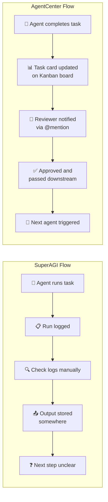

SuperAGI is one of the more honest open-source projects in the AI agent space. It doesn't try to be everything. It's a framework for building and running autonomous agents, and it ships with a UI so you're not stuck reading logs in a terminal.

If you're a solo developer or small team exploring what autonomous agents can actually do, SuperAGI gives you a working starting point without a monthly bill. That's a real thing, and it matters for a lot of teams.

But there's a question that comes up every time a team moves from "exploring agents" to "running agents in production": where do your tasks actually live? Who reviews the output? When an agent fails at 2am, how do you find out? That's where the comparison gets interesting. You can also see our [full SuperAGI breakdown](/compare/vs-superagi) if you want the deeper feature-by-feature view.

## What SuperAGI Does Well

SuperAGI deserves a fair look before the comparison:

- **Open-source and self-hostable** — you own your deployment, your data, and your infrastructure costs
- **Marketplace** — pre-built agents and tools you can run or fork without starting from scratch
- **Multi-model support** — works with OpenAI, Anthropic, Google, and local models via Ollama
- **Basic agent UI** — you can see what your agents are doing without writing a custom dashboard
- **Agent scheduling** — run agents on a cron-like schedule without an external orchestrator
- **Performance telemetry** — basic token usage and run time tracking per agent

For a team in early evaluation mode, that's a solid starting point.

## The Core Limitation for Teams Managing AI Agents

SuperAGI was built for developers who want to run agents. AgentCenter was built for teams who are already running agents and need to manage them.

That's not a subtle difference. When you have one agent, you can watch the terminal. When you have 14 agents running different workflows for different teams, you need more:

- Which agent is currently working, idle, or blocked?
- Who reviews the output before it goes downstream?
- What did Agent 7 do on Tuesday, and why did it stop mid-task?
- Which agents are burning through your LLM budget fastest this week?

SuperAGI's UI shows agent runs. It doesn't give you a task board, review gates, or team coordination tools. There's no concept of "a human needs to approve this output before the next step runs."

For production deployments where multiple people are involved — developers, reviewers, stakeholders — that gap becomes a real operational problem. You end up with a spreadsheet tracking agent status, a Slack channel for approvals, and no single place where anyone can see the full picture.

## Comparison Table

| Feature | SuperAGI | AgentCenter |
|---|---|---|
| Primary purpose | Build and run autonomous agents | Manage and coordinate agents in production |
| Agent runtime | Built-in (SuperAGI framework) | OpenClaw-compatible agents |
| Task management | Agent run history | Kanban board with full task lifecycle |
| Real-time status | Basic run status | Online, working, idle, blocked per agent |
| Multi-agent coordination | Sequential chains | Cross-agent task orchestration |
| Deliverable review | None | Built-in approval workflows |
| Cost tracking | Token usage per run | Cost per agent, per task, per project |
| Team collaboration | None | @Mentions and chat threads per task |
| Deployment | Self-hosted only | Managed cloud |
| Open source | Yes (MIT) | No (SaaS) |
| Pricing | Free (self-hosted infra costs apply) | $14/mo Starter, $29/mo Pro, $79/mo Scale |
| Free trial | No | 7-day free trial on all monthly plans |

## Workflow Comparison

Here's what it looks like when an agent completes a task in each system.

With SuperAGI, you see that an agent ran and what it returned. With AgentCenter, you see the task status update in real time on the [task board](/features/task-orchestration), a reviewer gets notified, and nothing moves forward until a human signs off.

For a personal project, the SuperAGI flow is fine. For a production workflow where a wrong answer costs money or erodes trust, the AgentCenter flow is what you actually need.

**Step-by-step comparison for a content review agent:**

**SuperAGI way:**
1. Agent runs, output is stored in the run log
2. You check the output file or logs manually
3. You route it to the right person via email or Slack
4. They approve outside the system — no record in the agent run history
5. Next agent starts without any confirmation the previous output was actually reviewed

**AgentCenter way:**
1. Agent completes task, card moves to "Review" on the Kanban board
2. @Mention notifies the right reviewer directly in the task thread
3. Reviewer approves or sends it back with notes — all tracked in the same card
4. Next agent task triggers automatically after approval is confirmed
5. Full audit trail stays in AgentCenter, visible to the whole team

The difference isn't just cleaner UX. It's accountability. When something goes wrong in production, you need to know exactly what was reviewed and when. SuperAGI doesn't give you that. AgentCenter does.

## Real-Time Monitoring

Another gap worth calling out: [agent monitoring](/features/agent-monitoring) in production.

SuperAGI tracks token usage and run time per agent. That's useful for rough cost estimates, but it doesn't tell you which agents are currently stuck, which have been idle longer than expected, or where bottlenecks are forming across your fleet.

AgentCenter shows you real-time status per agent: online, working, idle, or blocked. When an agent stops responding, you see it immediately on the dashboard rather than finding out when a downstream task fails an hour later.

If you're running agents in any kind of production capacity — even just 5 or 6 agents doing real work for your team — that visibility matters more than most teams realize until they don't have it.

## Can You Use Both?

Yes, but the overlap is mostly at the infrastructure level.

SuperAGI handles agent definition, tooling, and execution. If your team is building custom autonomous agents and you want an open-source runtime you fully control, SuperAGI's framework has real value.

AgentCenter sits on top of your OpenClaw agents as the control plane: task board, approvals, monitoring, cost tracking. It doesn't replace how you build agents; it replaces how you manage the work they do.

If you're already running OpenClaw agents and want production-grade management, you don't need SuperAGI's framework. If you've built on SuperAGI and want better team coordination and review workflows, migrating to OpenClaw and AgentCenter gives you what SuperAGI's UI doesn't provide today.

## Bottom Line

SuperAGI is a capable open-source option for developers who want to explore autonomous agents without starting from zero. AgentCenter is a production control plane for teams past the exploration phase that need visibility, coordination, and review workflows.

They solve different problems. Which one you need depends on where you are in that journey. See [pricing](/pricing) if you want to know what AgentCenter costs for your team size.

---

*SuperAGI is good at what it does. AgentCenter does something different — it manages your agents once they're live, not just runs them. [Start your 7-day free trial](/pricing) — no lock-in.*
