Taskade is genuinely useful. If you want a shared workspace where AI agents help your team draft documents, brainstorm, and manage projects, it covers that well. The interface is clean, the onboarding is fast, and the built-in agents feel native to the workflow.

But here's the question most teams hit after a few months: what happens when your agents are running on their own, 24 hours a day, hitting external APIs, generating deliverables your team needs to review, and occasionally failing in ways you can't easily see? That's where Taskade hits a wall. It wasn't built for that.

## What Taskade Does Well

- **Collaborative workspace**: Tasks, docs, wikis, and chat all in one place — good for team coordination
- **Built-in AI agents**: Agents can summarize, draft, extract, and respond directly inside tasks
- **Templates**: Hundreds of workflow templates that get teams running fast
- **Mobile-first UX**: The app is well-built and the experience is consistent across devices
- **Affordable for small teams**: Pricing is accessible for freelancers and small groups
- **Project hierarchy**: Folders, workspaces, and nested tasks map well to most teams' mental models

If you need a smart team collaboration tool with AI baked in, Taskade is solid.

## The Core Limitation for Agent Teams

Taskade treats AI as a feature inside a workspace. You write a task, an agent helps with it, you move on. That's a great model for human-AI collaboration in a shared document.

It's not designed for running autonomous agents in production. When you have 8 agents pulling data, transforming files, calling APIs, and posting results on a schedule, you need different things:

- **Live agent status** — is agent 6 running, blocked, or dead?
- **Cost visibility per task** — which agent spent $40 this week?
- **Deliverable review workflows** — someone needs to approve outputs before they go anywhere
- **Cross-agent coordination** — if agent 2 finishes, agent 5 should start
- **Error history** — what failed, when, and what was the last thing it tried?

Taskade doesn't surface any of that. It's a workspace, not a control plane.

## AgentCenter vs Taskade: Side-by-Side

| Feature | Taskade | AgentCenter |
|---|---|---|
| Primary purpose | Team workspace + AI assistant | AI agent operations control plane |
| Agent status monitoring | None | Real-time (online, working, idle, blocked) |
| Cost tracking per agent | None | Per-task and per-agent cost visibility |
| Deliverable review workflows | Manual (move card) | Built-in approval and review flows |
| Multi-agent coordination | No | Task dependencies and handoffs |
| Agent error history | No | Full error log with task context |
| Kanban for agent tasks | Basic task board | Agent-native Kanban with status tracking |
| @Mentions on tasks | Yes | Yes, with task threads |
| Recurring agent tasks | Workarounds only | Native recurring task automation (Pro+) |
| OpenClaw integration | No | Native — built for OpenClaw agents |
| Pricing | $8–$16/user/mo (team plans) | $14–$79/mo flat (by agent count, not seats) |
| Free trial | Free plan available | 7-day free trial on paid plans |
| Best for | Teams using AI to assist human work | Teams running autonomous agents in production |

## Two Workflows, One Problem: Agent Goes Silent

Here's a concrete example. You have a competitor monitoring agent that runs every weekday morning. It scrapes 20 sources, summarizes changes, and posts a report to Slack. One morning it doesn't post anything. What happens next?

```mermaid
graph TD
    subgraph "Taskade"
        A1["🤖 Agent configured<br/>in workspace"] --> B1["🔇 No report<br/>posted to Slack"]
        B1 --> C1["😕 Someone notices<br/>hours later"]
        C1 --> D1["🔍 Manual investigation<br/>begins in logs"]
        D1 --> E1["⏰ 4+ hours to<br/>diagnose root cause"]
    end

    subgraph "AgentCenter"
        A2["🤖 Agent running<br/>via OpenClaw"] --> B2["🔴 Status flips<br/>to Blocked instantly"]
        B2 --> C2["🔔 Notification<br/>sent to task thread"]
        C2 --> D2["📋 Error log shows<br/>which API call failed"]
        D2 --> E2["⚡ 15 minutes to<br/>fix and re-run"]
    end
```

In Taskade, the silence is invisible. The agent either ran or it didn't, and there's no built-in signal either way unless you've added external tooling.

In AgentCenter, the agent's status changes to blocked the moment it hits an error. The task thread gets a notification. You open the task, read the error log, fix the problem, and re-run.

Same problem. Four hours versus 15 minutes.

## Workflow Comparison: Reviewing Agent Deliverables

Say your content agent produces 10 blog draft summaries overnight. Someone on your team needs to approve the good ones and reject the rest before they go to the writer queue.

**Taskade way:**
1. Manually scroll through task cards looking for completed outputs
2. Copy deliverable content from the AI chat into a doc or comment
3. Leave a comment or move the card to "approved" manually
4. No tracking of who approved what or when
5. No way to see which agent produced which output

**AgentCenter way:**
1. Open the deliverables review screen for the content agent
2. Each deliverable is queued automatically when the agent marks it complete
3. Approve or reject with one click; rejection sends feedback back to the agent task
4. Full audit trail: who reviewed, what action was taken, timestamp
5. Cost per deliverable is visible next to each item

The difference isn't small. When you're reviewing 50 agent outputs per day, that workflow gap compounds fast.

## Can You Use Both?

Yes, and some teams do. Taskade handles the human-facing project management and document collaboration. AgentCenter runs the autonomous agents in the background.

If your AI agents mostly help humans do work inside a doc editor, Taskade fits. If your agents run autonomously, connect to external systems, and produce outputs other people depend on, you need a dedicated control layer.

The two tools don't overlap much in practice. Taskade is where people work. AgentCenter is where agents work.

## Bottom Line

Taskade is a strong collaborative workspace that happens to include AI agent capabilities. AgentCenter is purpose-built for teams running OpenClaw agents in production. If your agents are mostly AI-assisted humans, Taskade is the better fit. If you're operating autonomous agents at any real scale, you need the visibility and control that AgentCenter provides. See [all features at a glance](/features) and [compare plans](/pricing) if you're evaluating the switch.

---

*Taskade is good at what it does. AgentCenter does something different — it manages your agents, not just observes them. [Start your 7-day free trial](/pricing) — no lock-in.*
