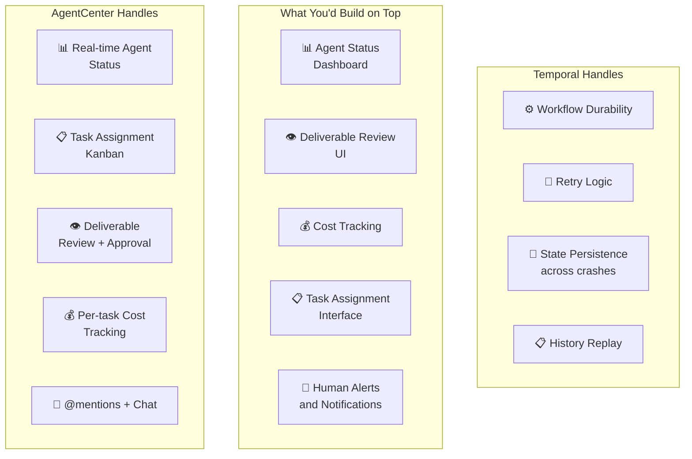

Temporal is one of the most technically impressive workflow platforms available. If you need workflows that survive process crashes, handle retries automatically, and guarantee at-least-once execution across distributed systems, Temporal delivers. It's used at companies running mission-critical workflows at massive scale.

That's the context you need to evaluate whether Temporal belongs in your AI agent stack.

## What Temporal Does Well

- Durable workflow execution: workflows survive crashes and restarts
- Built-in retry policies with configurable backoff
- Long-running workflow support (days, weeks)
- History replay for debugging workflow execution
- Strong consistency guarantees for distributed workflows
- Good SDK support (Go, Java, Python, TypeScript)

Temporal is excellent infrastructure for workflows that need durability guarantees. If a step fails, Temporal retries it. If the process crashes, the workflow resumes from where it left off. That's genuinely powerful for certain classes of problems.

## The Core Limitation for AI Agent Teams

Temporal is infrastructure. It handles workflow durability. It does not handle:

- Showing a human team "what are my agents doing right now"
- Routing deliverables to a review queue before the next step starts
- Tracking cost per task
- @mentions and collaboration around agent work
- A Kanban view of tasks across multiple projects

Building all of that on top of Temporal is possible. It's also a significant engineering project. You're building a management plane on top of a workflow engine.

More fundamentally: Temporal workflows are code. Your engineers write them. Non-engineers can't assign a task to an agent, review a deliverable, or check agent status without going through developer tooling.

## Comparison Table

| Feature                    | Temporal            | AgentCenter     |
| -------------------------- | ------------------- | --------------- |
| Durable workflow execution | Excellent           | Not applicable  |
| Crash recovery / resume    | Yes                 | No              |
| Agent status dashboard     | No (build it)       | Yes, built-in   |
| Deliverable review UI      | No (build it)       | Yes, built-in   |
| Cost per task tracking     | No                  | Yes             |
| Non-engineer accessible    | No (code-first)     | Yes (dashboard) |
| Task assignment UI         | No                  | Kanban board    |
| @mentions / team chat      | No                  | Yes             |
| Self-hosting               | Yes                 | Yes             |
| Pricing                    | Open source + cloud | $14-$79/mo      |

## Workflow Comparison

**Running a multi-step agent workflow with Temporal:**

1. Write workflow code defining steps, retries, timeouts
2. Write worker code that executes each step
3. Deploy and run
4. Check Temporal UI for workflow execution history
5. If agent output needs review: write a human task activity, build UI for it
6. Maintain all of this as requirements change

**Running the same workflow with AgentCenter:**

1. Create tasks in project
2. Agents pick up tasks, execute
3. Deliverables go to review queue automatically
4. Reviewers approve or send back via dashboard
5. Next agent starts after review
6. Full status visible without writing code

## Can You Use Both?

Yes, for different layers. Temporal is excellent for workflows where you need crash-proof durability and strong execution guarantees — financial transactions, data pipeline coordination, anything where "exactly once" matters and the consequences of failure are severe.

AgentCenter handles the human-facing layer: task assignment, status visibility, deliverable review, team coordination. If you have Temporal handling your critical backend workflows and AI agents handling content, analysis, or support tasks, AgentCenter manages the agent layer that Temporal wasn't designed for.

## Who Should Choose What

**Choose Temporal when:** You're an engineering team building durable, distributed workflows where crash recovery and execution guarantees are non-negotiable. You have the engineering resources to build and maintain the management UI layer on top.

**Choose AgentCenter when:** You need a team-accessible control plane for AI agents. You want task management, review workflows, and cost tracking without building a custom operations platform. You're running agents doing content, research, support, or analysis — not financial transactions.

## Bottom Line

Temporal is excellent infrastructure for durable distributed workflows. AgentCenter is a management platform for AI agent teams. They address different layers of the problem. The comparison only matters if you're evaluating whether to build your own agent management plane on top of Temporal — which is a significant investment compared to using a purpose-built tool.

_Temporal is good at what it does. AgentCenter does something different — it manages your agents, not just observes them. [Start your 7-day free trial](/pricing) — no lock-in._
