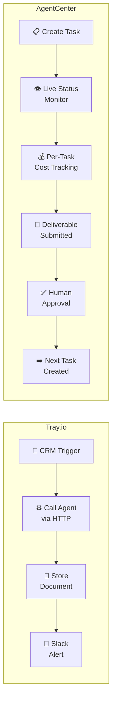

Tray.io has been moving enterprise workflows for years. If you need to sync Salesforce with HubSpot, route support tickets through a chain of conditions, or fire off Slack messages when a database row changes, it handles that well.

But here's where teams run into trouble: when the "step" in your workflow is an AI agent that thinks, decides, and produces outputs that need review before anything continues downstream, Tray.io stops being the right tool. At that point, you're managing a worker, not a data pipe.

## What Tray.io Does Well

Fair is fair. Tray.io has real strengths worth naming:

- **Broad connector library** — 600+ pre-built connectors for enterprise SaaS tools: Salesforce, Workday, ServiceNow, Snowflake, and most things you'd find in a mid-to-large company's tech stack
- **Enterprise-grade iPaaS** — authentication, error handling, retry logic, and audit logs are built in, not bolted on
- **Low-code workflow builder** — non-engineers can build and modify automation flows without writing code
- **Conditional branching** — complex if/then logic across multiple systems works well
- **Scalable trigger handling** — processes large volumes of webhook-triggered events without you managing infrastructure
- **IT governance** — role-based access, SSO, audit trails, compliance-friendly logging

If your use case is moving structured data between SaaS systems, Tray.io makes sense. It was purpose-built for that problem and it solves it well.

## The Real Problem When AI Agents Enter the Picture

The moment you put an AI agent in a workflow, the problem changes in a fundamental way.

AI agents are not deterministic steps. They don't receive input A and reliably produce output B every single time. They reason. They make decisions. They sometimes get stuck, loop, produce half-finished work, or return results that look correct but aren't. The failure modes are soft, not hard.

Tray.io assumes every step either succeeds or fails in a way you can catch with a retry or an error branch. AI agents break that assumption constantly. They produce plausible-but-wrong output. They slow down as context grows. They hallucinate tool calls. They get blocked waiting for credentials they were never given. And often, the step status says "completed" while the actual output sitting in your document storage is unusable.

None of that surfaces in a workflow status field.

With 3 AI agents running, you can absorb this. You catch issues during review. At 10 or 15 agents, you're regularly missing failures you don't know happened. At 25 agents, problems have already propagated downstream before anyone notices.

What teams need is not a smarter error branch — they need a control plane that shows them what each agent is doing, what it produced, and whether that output is ready to act on. That's what AgentCenter is built for. Not automating triggers, but giving teams the visibility and coordination layer that AI agents require to run safely in production.

Tray.io manages pipelines. AgentCenter manages teams where the team members happen to be agents.

## AgentCenter vs Tray.io — Feature Comparison

| Feature | Tray.io | AgentCenter |
|---|---|---|
| Primary purpose | SaaS workflow automation | AI agent control plane |
| Agent task management | No | Yes — Kanban board per agent |
| Real-time agent status | No | Yes — online, working, idle, blocked |
| Deliverable review and approval | No | Yes — built-in approval workflow |
| @Mentions and task threads | No | Yes — per-task communication |
| Agent cost monitoring | No | Yes — per-agent cost tracking |
| Multi-agent coordination | Limited (sequential steps only) | Yes — cross-agent task handoffs |
| Recurring agent tasks | No | Yes (Pro+ plans) |
| Pricing | Enterprise / contact sales | From $14/mo |
| Free trial | Demo only | 7-day free trial |
| Best for | SaaS data pipelines | Teams running AI agents in production |

## Workflow Comparison: Processing Research Reports

Here's a concrete example. Say you're running an agent that pulls company data, generates a research report, and routes it to your team before passing anything to sales.

**The Tray.io approach:**

1. Trigger fires when a new company is added to the CRM
2. HTTP action calls your AI agent endpoint
3. Wait for a response (if it times out, hit an error branch)
4. Output piped to document storage
5. Slack notification sent: "Report ready"

You get the notification. You open Slack. You click through to the document. You have no idea if the report is good, whether the agent used the right data, or if it sat blocked for 40 minutes because an API key expired without logging anything useful.

**The AgentCenter approach:**

1. Task created for the research agent via the [task orchestration dashboard](/features/task-orchestration)
2. Agent status visible in real time — you watch it move from idle to working
3. Cost tracked per task as it runs
4. Agent submits the deliverable when done
5. Approval workflow triggers — reviewer gets notified in-platform
6. Reviewer approves or sends back with comments in the task thread
7. Downstream task created only after approval clears

The Tray.io path tells you a step completed. The AgentCenter path tells you what your agent actually produced and whether it's ready to use.

## Can You Use Both?

Yes, and some teams do.

Tray.io works as the event layer — it catches triggers from external systems and creates tasks in AgentCenter via API. Tray.io handles "something changed in Salesforce, start an agent." AgentCenter handles everything after that: the agent runs, the output gets reviewed, the task closes, costs get tracked.

That combination makes sense if you already have Tray.io running enterprise automations and want to add AI agents without replacing your existing trigger infrastructure.

That said, wiring both systems together adds complexity. If you're starting fresh, the question is just: what work are you actually managing? If you're automating structured data movement between SaaS tools and occasionally calling an AI endpoint, Tray.io is fine on its own. If AI agents are doing meaningful work that needs oversight — reviewing outputs, tracking costs per agent, coordinating tasks between agents — you need a [dedicated control plane](/features/agent-monitoring), not an adapter layer on top of an iPaaS.

## Bottom Line

Tray.io is solid enterprise automation software built for deterministic, event-driven workflows. It wasn't designed for AI agent management, and adapting it for that purpose means building all the visibility and oversight tooling yourself. AgentCenter starts from agent management as the core problem — task tracking, status visibility, cost monitoring, and approval workflows are part of the product, not custom extensions you have to build.

---

*Tray.io is good at moving data between systems. AgentCenter does something different — it manages your agents, not just connects endpoints. [Start your 7-day free trial](/pricing) — no lock-in.*
