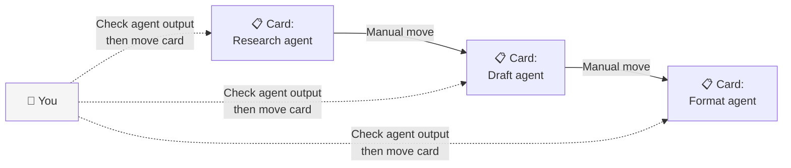
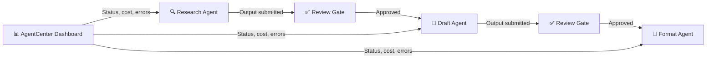

Trello is one of those tools you reach for without thinking. Cards go in columns. Columns represent stages. You drag things across the board. It's so intuitive that teams use it for sprint planning, content pipelines, client work, and personal to-do lists.

So when teams first try to coordinate AI agents, someone opens Trello. That's not a bad instinct. You have tasks. You have things doing work. You want to track progress. Trello exists for exactly that.

The problem shows up around agent 4 or 5.

## What Trello Does Well

Trello has earned its place in the dev toolkit. It works because it's visual, lightweight, and flexible:

- **Card-based tasks**: Each card holds context — notes, attachments, comments, due dates, and checklists in one place
- **Kanban flow**: Drag cards from To Do to In Progress to Done, or any column structure you define for your workflow
- **Team collaboration**: Assign cards to people, mention teammates, leave comments, and see changes in the activity log
- **Low barrier to entry**: No onboarding overhead. You can invite someone and they're productive in minutes
- **Butler automation**: Basic rule-based automations for card movement, label assignment, and due date reminders
- **Integrations**: Connects to Slack, GitHub, Google Drive, and dozens of other tools via Power-Ups

For human teams working on human-paced tasks, this is genuinely good software. If you're managing a content team, tracking a bug backlog, or running a project across a few contributors, Trello works.

## The Core Limitation for Teams Managing AI Agents

The issue isn't that Trello is bad. It's that Trello is built around humans doing work.

AI agents are software. They run continuously. They produce outputs at machine speed. They fail silently. And they don't update their own cards.

When you have 8 or 10 agents running in parallel, a Trello board can't tell you:

- Which agent is currently running versus stuck versus blocked waiting on something upstream
- What the agent actually produced (not just "Done" but the actual deliverable, its quality, and whether it needs review)
- How much that task cost in tokens and compute
- Whether errors occurred and how many times the agent retried before giving up
- When an agent loops on the same bad output without making progress

You end up manually checking agent status, copying outputs into card descriptions, and finding out about failures only when you go looking. That's not managing agents. That's babysitting them.

We ran 14 agents against a document processing pipeline for three weeks using a Trello board as the tracking layer. By the end of week one, we had three agents that had quietly completed their tasks days earlier with nobody noticing, one agent stuck looping on a malformed input, and two agents blocked waiting on outputs that never arrived. The board showed "In Progress" across all of them.

## AgentCenter vs Trello: Side by Side

| Capability | Trello | AgentCenter |
|---|---|---|
| Real-time agent status | None — you check manually | Live: running, idle, blocked, error |
| Task assignment to agents | Manual card creation | Direct task dispatch to specific agents |
| Output / deliverable review | Paste output into card | Built-in review and approval workflow |
| Error visibility | None — you find out when you check | Flagged automatically in the activity feed |
| Token and compute cost tracking | Not available | Per-agent, per-task cost breakdown |
| Agent-to-agent handoffs | Not supported | Native multi-agent coordination |
| Recurring task scheduling | Butler rules (limited) | Built-in recurring tasks, Pro and up |
| Approval gate before downstream work | Not available | Deliverable approval before next stage runs |
| Human collaboration layer | Comments, mentions, assignees | @Mentions, threaded discussion per task |
| Pricing | Free to $17.50/user/month | $14 to $79/month flat, not per user |

## How the Same Pipeline Runs in Each Tool

Imagine a 3-stage pipeline: one agent pulls and summarizes source material, another drafts a report, a third formats and exports.

### The Trello Way

1. Create three cards: Research, Draft, Format
2. Agent runs — you check its output separately, outside of Trello
3. Paste or link the output into the card description
4. Move the card to Done manually
5. Kick off the next agent manually
6. If the research agent produced bad output, the draft agent might already be running on it by the time you notice

No error alerts. No cost visibility. No gate between stages. You're the coordination layer.

### The AgentCenter Way

1. Create a task and assign it to your research agent via the [AgentCenter dashboard](/features/agent-dashboard)
2. Live status updates as the agent runs — no manual checks needed
3. When the research agent finishes, its deliverable goes into a review queue
4. You approve it (or flag it for rework) before the draft agent runs
5. Cost is tracked per task, per agent. Errors surface automatically in the feed
6. The format agent only runs when clean input exists

The difference is who carries the coordination burden. With Trello, it's you. With AgentCenter, it's the platform.

## Can You Use Both?

Yes, and some teams do.

A practical setup: use AgentCenter for [agent monitoring](/features/agent-monitoring) and task management — the actual work the agents do, their outputs, costs, and errors. Use Trello for the broader project context that humans own: editorial decisions, stakeholder approvals, sprint planning.

The Trello board shows the project. AgentCenter shows the agents.

That split works well when the human side of the work and the agent side of the work are actually separate. Where it breaks down is if you try to track both in Trello. You can't get real-time agent status in a Trello card. You can't review deliverables without leaving Trello. You can't see what a failed run cost you.

## Bottom Line

Trello is the right tool for human teams tracking human work. If your agents need actual management — status visibility, cost tracking, error detection, output review before downstream tasks run — a Kanban board won't get you there. See [AgentCenter's task orchestration and agent monitoring features](/features/task-orchestration) before your next silent failure costs you a week of rework.

---

*Trello is good at what it does. AgentCenter does something different — it manages your agents, not just tracks them. [Start your 7-day free trial](/pricing) — no lock-in.*
