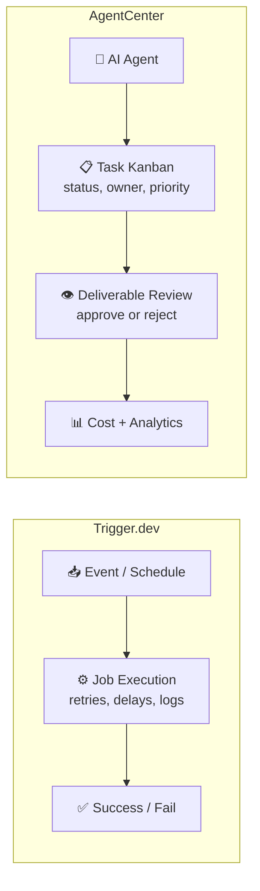

Trigger.dev is genuinely useful. If you're running long-running background tasks in TypeScript — LLM calls, document processing, webhook handlers that can't time out — it handles the hard parts well. Retries, delays, real-time logs, scheduling. It's built for engineers who need reliable job execution and don't want to babysit a task queue.

But here's the question it doesn't answer: once your agents are running tasks, who's watching them?

That's the gap. Trigger.dev is an execution layer. AgentCenter is a management layer. They solve different problems, and teams often discover they need both — after they've spent a month wiring things together and wondering why they still can't tell which agent failed.

## What Trigger.dev Does Well

To be fair, Trigger.dev does a lot of things right:

- **Reliable execution**: Tasks retry automatically on failure. You set the retry policy, it handles the rest.
- **Long-running support**: No timeout limits on tasks. Good for LLM chains that run for minutes.
- **Real-time logging**: You can watch a job run live in the dashboard. Useful for debugging.
- **TypeScript-first**: Native types, first-class DX. If your team lives in TypeScript, this fits.
- **Scheduled and event-triggered jobs**: Cron jobs and webhook triggers, both well-implemented.
- **Self-hosting option**: Open-source core, so you can run it on your own infra.

If your problem is "I need to run code reliably in the background," Trigger.dev is a solid pick.

## The Core Limitation for Agent Teams

When you start managing AI agents in production, the problem shifts. You're no longer asking "did this job succeed?" You're asking:

- Which agent is working on what right now?
- Did the output actually meet the requirements, or did it just return 200 OK?
- Who on the team needs to review this before it goes out?
- Which agent ran up a $47 bill last week and why?

Trigger.dev doesn't answer those questions. It tells you that a task ran and whether it threw an error. That's the engineering view. What you also need is the operational view — the thing a product team, an ML engineer, or a team lead can actually use to stay on top of 15 agents running in parallel.

Trigger.dev has no kanban board for agent tasks. No deliverable review flow. No per-agent cost tracking. No @mentions to loop in a teammate when an agent gets blocked. It assumes the engineer is the only person who needs to see what's happening, and that checking logs is a normal part of the workflow.

That assumption breaks down fast once you're past 3 or 4 agents.

## How They Compare

| Feature | Trigger.dev | AgentCenter |
|---|---|---|
| Primary purpose | Background job and workflow execution | AI agent management and control plane |
| Task visibility | Job run logs and status | Kanban board with real-time agent status |
| Deliverable review | No built-in review flow | Review and approval workflows |
| Multi-agent coordination | Trigger chained jobs in code | Task dependencies, @mentions, hand-offs |
| Per-task cost tracking | Not available | Per-agent LLM cost per task |
| Agent status | Running / success / failed | Online, working, idle, blocked |
| Team collaboration | No built-in collaboration | @mentions and threaded task comments |
| Recurring tasks | Yes — cron and event triggers | Recurring tasks (Pro+ plan) |
| Pricing | Free up to 5k runs/month, $20+/mo paid | Starter $14/mo, Pro $29/mo, Scale $79/mo |
| Self-hosting | Yes (open source) | Cloud-hosted |
| Agent runtime | You bring your own | Works with any OpenClaw-compatible agent |
| Best for | Engineers running reliable background jobs | Teams managing AI agent fleets in production |

## How the Same Workflow Looks in Each

Say you have a research agent that monitors competitor pricing daily, writes a summary, and needs a human to approve it before it goes into your CRM.

**With Trigger.dev:**

1. Define a cron job that triggers the agent at 8am
2. The job runs, calls your LLM, returns a result
3. Result is logged to Trigger.dev's dashboard
4. Someone has to check the logs, find the output, decide if it's good
5. You wire up a separate Slack notification, a manual review step, a separate storage layer for outputs
6. If the agent fails, you get an email; you dig through logs to understand why

That's workable if you have one or two agents. At 10, you're spending half your morning in log dashboards.

**With AgentCenter:**

1. Task shows up on the [kanban board](/features/task-orchestration) automatically — assigned to your research agent
2. Agent picks it up, status updates to "working" in real time
3. Output lands in the task as a deliverable — flagged for review
4. You or a teammate gets notified via @mention, reviews it in the same interface
5. Approve or request changes — the agent gets the feedback
6. Cost and performance data rolls up per agent on the [monitoring dashboard](/features/agent-monitoring)

No log-diving. No duct-tape Slack integration. Everything in one place.

## Can You Use Both?

Yes, and this is actually the most common setup.

Trigger.dev handles execution: it makes sure the code runs, retries on failure, and doesn't time out. AgentCenter handles operations: it makes sure the humans on your team can see what's happening, review outputs, and catch problems before they compound.

Think of it like this — Trigger.dev is your job scheduler, AgentCenter is your agent control room. You can run your OpenClaw agents with Trigger.dev handling the background execution, and AgentCenter providing the task management and visibility layer on top.

That said, you don't always need Trigger.dev. If your agents are already handling their own scheduling and retries through OpenClaw, you might only need AgentCenter. The choice depends on how much custom execution logic you're managing at the infrastructure level versus what you're managing at the workflow level.

## Bottom Line

Trigger.dev is a background job platform. It's excellent at what it does. AgentCenter is an agent control plane — it manages what's happening across your agent fleet once the jobs are running.

If your problem is "my jobs time out and I hate managing retries," reach for Trigger.dev. If your problem is "I have no idea what my agents are doing, who's reviewing their output, or why one cost $120 last week," that's what [AgentCenter](/features) is for. For most teams past the 5-agent mark, you'll eventually need both layers.

---

*Trigger.dev is good at what it does. AgentCenter does something different — it manages your agents, not just runs them. [Start your 7-day free trial](/pricing) — no lock-in.*
