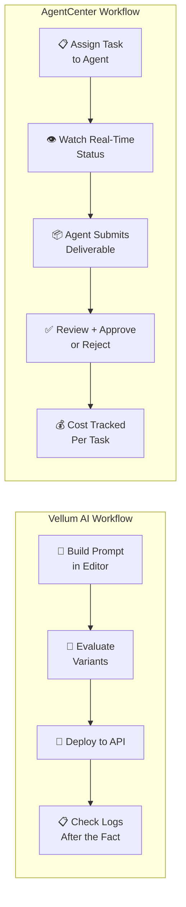

Vellum AI has a well-designed product. Prompt versioning, side-by-side evaluations, workflow chaining, deployment management — it covers the engineering side of building LLM-powered applications thoughtfully. If you're a team that needs to iterate on prompts, test model variants, and deploy LLM workflows, Vellum gives you real tooling for that.

The question is what happens after you deploy. When your AI agents are running in production, handling real tasks, costing real money, and producing outputs that real people depend on — what do you need then?

That's where the comparison gets interesting.

## What Vellum AI Does Well

Before the critique, the honest summary:

- **Prompt versioning and rollback**: You can track every change to a system prompt, compare versions, and revert if a new version underperforms. This is genuinely useful when you have multiple people iterating on agent prompts.
- **Side-by-side evaluation**: Run the same inputs through different prompt variants and compare outputs before you ship. Catches regressions in controlled conditions.
- **Workflow builder**: Chain LLM calls with conditional logic, pass context between steps, and deploy a full pipeline as an API endpoint. Good for multi-step LLM workflows.
- **Human labeling and scoring**: Add quality scores and reviewer labels to LLM outputs during development. Useful for building eval datasets.
- **Deployment API**: Wrap your Vellum workflow in an API call your application can hit. Manages model versions behind a stable interface.

These are development-time capabilities. They help you build better agents. That's the job Vellum is designed to do.

## The Core Limitation for Agent Teams

Vellum is built for prompt engineers in the build phase. Once your agents are live in production, it stops being the tool you reach for.

Here's what a production agent team actually needs to manage: 20 tasks assigned to 8 agents across 3 projects, with 4 humans reviewing outputs and 1 on-call engineer watching for failures. You need to know what each agent is working on right now, what it produced yesterday, whether any of it was approved, and how much it cost.

Vellum can't tell you any of that.

There's no concept of a task assigned to a specific agent. No Kanban board showing which agent is working, blocked, or idle. No real-time status feed. No deliverable submission and review flow. If an agent produces a bad output at 2am, Vellum won't surface it. If two agents are waiting on each other, Vellum won't show you the deadlock. If your most active agent suddenly costs 4x its baseline, there's no alert.

This isn't a criticism of Vellum — it's just not what the product is for. Vellum manages LLM deployments. AgentCenter manages the agents that use those deployments in production.

## AgentCenter vs Vellum AI: Side-by-Side

| Feature | Vellum AI | AgentCenter |
|---|---|---|
| Prompt versioning and rollback | Yes | No |
| Side-by-side prompt evaluation | Yes | No |
| LLM workflow builder | Yes | No |
| Task assignment to specific agents | No | Yes |
| Real-time agent status (working, idle, blocked) | No | Yes |
| Deliverable review and approval flow | No | Yes |
| @Mentions and task-level team threads | No | Yes |
| Per-task and per-agent cost tracking | Dev-time only | Yes (production) |
| Multi-agent coordination and dependencies | No | Yes |
| Error detection and failure alerts | No | Yes |
| Pricing | Contact sales | $14 / $29 / $79 per month |
| Free trial | Demo only | 7-day free trial, cancel anytime |

## Workflow Comparison

The difference is clearest when you trace how each tool handles a day of agent work.

**The Vellum path:**

1. Build your LLM workflow in Vellum's editor
2. Run evaluation sets against prompt variants
3. Pick the winner and deploy to Vellum's API
4. Your app calls the endpoint when it needs the agent to run
5. Check Vellum logs after the fact if something breaks

This is correct for the build phase. It's how you ship a better agent.

**The AgentCenter path:**

1. Create a task and assign it to a specific agent
2. Track real-time status — the agent shows as "working" in your Kanban board
3. Agent submits a deliverable when it finishes
4. Reviewer gets notified via @mention, reviews and approves or rejects
5. Cost gets attributed to the task, agent, and project automatically
6. If the agent errors, the failure surfaces immediately on the dashboard

This is what you need when agents are running. Not after. Now.

The gap shows up most painfully at scale. If you have 5 agents running in parallel and one goes silent, Vellum can't tell you it stopped. AgentCenter will show it as blocked. If a reviewer needs to flag output quality issues across 30 tasks, there's no workflow for that in Vellum. In AgentCenter, that's what the review queue is for.

## Can You Use Both?

Yes. They complement each other.

If you're already using Vellum to manage the prompts and model deployments that power your OpenClaw agents, keep doing that. Vellum handles the model layer — prompt versioning, evaluation, API endpoints. AgentCenter handles the operations layer — what those agents do in production, what they cost, who reviews their work, and how tasks flow through a team.

You'd call the Vellum API from within your agent. AgentCenter tracks what the agent does with the response.

The same way you might use Datadog to monitor your infrastructure and AgentCenter to manage your agents — the tools operate at different levels. See the [full AgentCenter feature overview](/features) if you want to understand the production management side.

## Bottom Line

Vellum AI is built for building. It's excellent at prompt engineering, model evaluation, and LLM workflow deployment. If your team is still in the development phase of your AI agent work, Vellum gives you the right tools.

AgentCenter is built for operating. Once those agents are live and your team is coordinating around their outputs every day, you need task boards, real-time status, deliverable review, cost tracking, and team coordination — none of which Vellum provides. Check the [AgentCenter pricing page](/pricing) to find the right plan for your team size.

If you're doing both — still building and iterating while operating in production — you'll probably end up using both tools, at different stages and for different purposes.

---

*Vellum AI is good at what it does. AgentCenter does something different — it manages your agents, not just the models they run. [Start your 7-day free trial](/pricing) — no lock-in.*
