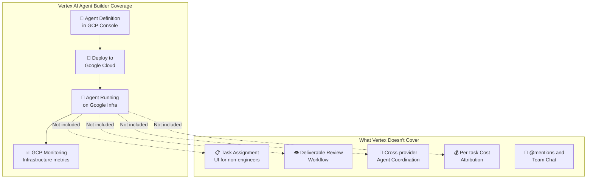

Vertex AI Agent Builder is Google's fully managed platform for building and deploying AI agents. If you're already deep in Google Cloud and using Gemini models, it's a reasonable starting point. Google handles the infrastructure. You define the agent behavior. It deploys into your existing GCP environment.

The catch, as with most cloud vendor AI products, is lock-in — and the operational gaps that exist even after you've deployed.

## What Vertex AI Agent Builder Does Well

- Fully managed infrastructure within Google Cloud
- Native Gemini model integration
- Datastore connectors for RAG-based agents
- Google Cloud IAM integration for access control
- No infrastructure management for GCP teams
- Extensions for grounding agents with Google Search, Maps, and other Google services

For teams that are already committed to Google Cloud and want to build Gemini-based agents without managing infrastructure, Vertex provides a low-setup path.

## The Core Limitation for Multi-Provider Teams

Vertex AI Agent Builder is a Google product. It works best with Google's models, on Google's infrastructure, in Google's ecosystem. If you're using Claude, GPT-4, or any non-Google model, Vertex AI Agent Builder isn't the right tool.

Even for GCP-committed teams, Vertex Agent Builder is primarily a build-and-deploy platform. The operational layer — what are my agents doing right now, are they producing good work, how do I coordinate multiple agents — requires additional tooling.

You can deploy an agent with Vertex. You can't see its real-time status in a shared dashboard. You can't route its deliverables to a review queue. You can't coordinate it with agents running on a different model or provider.

## Comparison Table

| Feature                            | Vertex AI Agent Builder | AgentCenter                   |
| ---------------------------------- | ----------------------- | ----------------------------- |
| Build and deploy agents            | Yes                     | Via API integration           |
| Fully managed infrastructure       | Yes (GCP)               | Cloud VM option (Scale plan)  |
| Native Gemini integration          | Yes                     | Yes (any OpenClaw-compatible) |
| Claude / GPT-4 / other models      | Limited                 | Yes                           |
| Multi-cloud / multi-provider       | No                      | Yes                           |
| Real-time agent status dashboard   | No                      | Yes                           |
| Deliverable review workflow        | No                      | Yes                           |
| Task assignment UI                 | No                      | Kanban board                  |
| @mentions / team coordination      | No                      | Yes                           |
| Cost per task (not infrastructure) | No                      | Yes                           |
| Self-hosting                       | No                      | Yes                           |
| Pricing                            | GCP usage-based         | $14-$79/mo + usage            |

## Workflow Comparison

**Managing a deployed agent with Vertex AI Agent Builder:**

1. Define agent in GCP console
2. Deploy and run
3. Check GCP monitoring for infrastructure metrics
4. No unified view of agent task state
5. No deliverable review workflow
6. No cross-provider agent coordination

**Managing agents with AgentCenter:**

1. Agents (any provider, including GCP) connect via API
2. Tasks assigned from dashboard
3. Real-time status across all agents
4. Deliverables reviewed and approved
5. Costs tracked per task across providers

## Can You Use Both?

Yes, with some integration work. If you're building Gemini-based agents that run on GCP, you can use Vertex to build and deploy the agent logic. Then connect those agents to AgentCenter via the OpenClaw API for operational management — task assignment, status monitoring, deliverable review.

This is the pattern that makes sense for GCP-committed teams: Vertex for build and deployment (taking advantage of the GCP integration), AgentCenter for the operational control plane.

The integration requires that your Vertex-deployed agents implement the OpenClaw API interface to communicate with AgentCenter.

## Who Should Choose What

**Choose Vertex AI Agent Builder when:** You're committed to Google Cloud and Gemini. You want fully managed infrastructure with no ops burden. You're building a single-provider agent setup and don't need cross-provider coordination.

**Choose AgentCenter when:** You need to manage agents across multiple providers. You need operational control — status visibility, deliverable review, task management — not just deployment. You have non-engineers who need to interact with the agent system.

## Bottom Line

Vertex AI Agent Builder is a solid deployment platform for GCP-native, Gemini-based agents. AgentCenter is an operational management platform for any agent regardless of provider. They're solving different problems, and for teams that are both GCP-committed and need operational control, the answer may be both.

_Vertex AI Agent Builder is good at what it does. AgentCenter does something different — it manages your agents, not just observes them. [Start your 7-day free trial](/pricing) — no lock-in._
