Voiceflow has a solid reputation in conversational AI. The visual canvas is one of the more practical tools for designing multi-turn agent flows — you can map branching logic, connect a knowledge base, test in the browser, and ship to web chat or Slack in a few hours. For teams building customer-facing bots, the AgentCenter vs Voiceflow question comes up often, and the honest answer is that they solve different problems.

But scale changes things. Once you're running six agents in production — three customer-facing bots, two back-end processors, one document analyzer — you start asking questions that Voiceflow wasn't built to answer. Which agent failed last night? Which one is costing $40 a day? Which task has been sitting blocked for three hours?

That's not a design problem. That's a management problem.

## What Voiceflow Does Well

Before getting into limits, it's worth being specific about where Voiceflow delivers:

- **Visual conversation design** — the canvas makes it possible to map complex flows, slot-filling, and branching logic without writing code. Non-technical teammates can actually own conversation design.
- **Prototype speed** — you can go from an idea to a working conversational demo in hours. Useful for validating agent concepts before investing engineering time.
- **Built-in testing** — run conversations directly in the browser, watch which step fails, and fix it immediately. The feedback loop is tight.
- **Channel flexibility** — deploy the same agent to web chat, Slack, SMS, and voice with minimal extra work. One design, multiple surfaces.
- **Knowledge base RAG** — attach documents or a URL and the agent can answer questions from that source without custom retrieval code. Lower barrier to building knowledge agents.
- **Team collaboration** — designers and product managers can contribute to agent logic without pulling in engineers for every change.

For building conversational AI prototypes and shipping customer-facing chatbots, Voiceflow is a practical choice.

## The Core Limitation for Teams Managing Agents

Voiceflow is built for the design and launch phase. What it doesn't cover is the day-to-day management phase — and that gap widens as you add more agents.

Once an agent is live, you need operational visibility: which agents are running, what tasks they're on, where handoffs are breaking, what errors look like in real time, and how much each agent is spending. Voiceflow gives you conversation analytics — step completion rates, volume, drop-off points. That's useful for refining a dialog. It doesn't tell you whether your agents are working right now.

A few patterns show up consistently with teams using Voiceflow at scale:

**No cross-agent visibility.** Voiceflow manages each agent as an independent deployment. If you have an intake agent passing tasks to a processing agent passing output to a review agent, you're tracking that handoff chain manually — usually in a spreadsheet or a shared doc.

**No task-level review gates.** When an agent produces output that needs a human to check before it goes to a customer, Voiceflow doesn't have a built-in approval step. Teams build this themselves or skip it entirely.

**Cost tracking is invisible.** Voiceflow doesn't expose per-agent API costs in a way that helps you catch a runaway agent before it burns through your budget. You find out at the end of the month.

Teams at the five-to-ten agent stage often end up building their own management layer on top: Slack bots for alerts, manual cost checks, task tracking in Jira. It works until it doesn't.

## AgentCenter vs Voiceflow — Side by Side

| Feature | AgentCenter | Voiceflow |
|---|---|---|
| Primary purpose | Agent management and coordination | Conversation design and deployment |
| Interface | Kanban board for task and fleet visibility | Visual canvas for conversation flows |
| Real-time agent status | Online, working, idle, blocked | Not available |
| Task management | Full board: create, assign, thread, review | Not built for task tracking |
| Multi-agent coordination | Native cross-agent workflows and handoffs | Agents operate independently |
| Deliverable review | Built-in approval workflows | No approval gates |
| Cost tracking per agent | Per-task cost visibility | No per-agent cost breakdown |
| Pricing | $14 / $29 / $79 per team/month | Free tier; paid plans from ~$50/seat/mo |
| Agent compatibility | Any OpenClaw-compatible provider | Voiceflow-hosted agents only |
| Channel deployment | Control plane only — not a channel layer | Web, Slack, SMS, voice |
| @Mentions and task threads | Yes, per task | No coordination layer |
| 7-day free trial | Yes, all monthly plans | Free tier with limits |

The pricing models reflect different design philosophies. Voiceflow's paid tiers scale with seat count — it's priced as a design and collaboration tool. AgentCenter's tiers scale with agent count, because it's priced for the fleet you're running.

## Workflow Comparison: Handling an Agent Failure in Production

Here's what the same failure scenario looks like with each tool.

```mermaid
graph TD
    subgraph "Voiceflow"
        A["🤖 Agent fails mid-task"] --> B["📊 No real-time alert"]
        B --> C["👤 Someone notices<br/>hours later"]
        C --> D["🔍 Check conversation logs"]
        D --> E["❓ Step drop-off visible<br/>root cause unclear"]
        E --> F["🔧 Edit flow, redeploy<br/>and monitor manually"]
    end

    subgraph "AgentCenter"
        G["🤖 Agent fails mid-task"] --> H["🔴 Task marked Blocked<br/>immediately"]
        H --> I["🔔 @Mention sent to<br/>on-call engineer"]
        I --> J["👤 Engineer sees task,<br/>error, and context"]
        J --> K["✅ Reassign or retry<br/>from the dashboard"]
    end
```

**The Voiceflow path:**

1. Agent fails somewhere in a conversation flow
2. No real-time alert fires — you catch it in analytics later, or a user reports it
3. Step-completion rates show a drop; you dig into conversation logs
4. You identify where the flow broke but have limited context on why
5. Update the flow, redeploy, watch manually for recurrence

**The AgentCenter path:**

1. Agent fails mid-task — status flips to Blocked in the [agent dashboard](/features/agent-dashboard) immediately
2. Dashboard shows which agent, which task, the error, and the task history
3. Automatic @mention goes to the assigned engineer with full context
4. Engineer reviews the task thread — what the agent did, what it attempted, what failed
5. Restart or reassign directly from the dashboard — no log archaeology

The difference gets sharper as agent count grows. Managing one agent's failures manually is annoying. Managing ten that way is a full-time job.

## Can You Use Both?

Yes, and this is common.

Voiceflow handles conversation design and deployment for agents that talk to users. AgentCenter sits above that layer — or alongside it — managing the operational side: which agents are running, what tasks they're on, what costs they're generating, and what outputs need review.

If your Voiceflow bots are OpenClaw-compatible, AgentCenter can track their tasks and status the same way it tracks any other agent in your fleet. If they're not, AgentCenter still covers your other agents while Voiceflow handles conversational deployment separately.

There's not much overlap between the two. Voiceflow answers "how should this conversation flow?" AgentCenter answers "are my agents actually doing useful work right now?" Both are useful questions. They just need different tools.

See the full feature breakdown on our [features page](/features) or check [pricing](/pricing) to see which plan fits your fleet size.

## Bottom Line

Voiceflow is a well-built tool for designing and shipping conversational AI. AgentCenter is what you reach for when you need to manage agents in production — track tasks, coordinate across agent boundaries, catch failures in real time, and keep costs visible.

If you're running more than two or three agents and you're still manually tracking what they're doing, that's the signal you need a control plane.

---

*Voiceflow is good at what it does. AgentCenter does something different — it manages your agents, not just helps you design them. [Start your 7-day free trial](/pricing) — no lock-in.*
