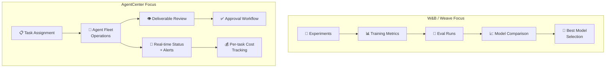

Weights and Biases (W&B) is one of the best ML experiment tracking tools available. If you're training models, running hyperparameter sweeps, or tracking evaluation metrics across experiments, W&B's interface and tooling are hard to beat. A lot of ML teams use it as their primary experimentation platform.

As AI agent teams look for management tooling, W&B's Weave product (their LLM/agent observability layer) gets mentioned as an option. It's worth being precise about what each tool actually does.

## What W&B Does Well

- ML experiment tracking: metrics, parameters, artifacts across training runs
- Visualization of training curves, evaluation results, hyperparameter importance
- Model artifact versioning and lineage
- Weave: LLM call tracing, evals, and prompt versioning for LLM applications
- Team collaboration on experiment results
- Integration with common ML frameworks (PyTorch, TensorFlow, JAX, Hugging Face)

W&B's strength is the ML research and experimentation workflow. Tracking what you tried, what worked, and how models compare.

## The Core Limitation for Production Agent Teams

W&B is designed around experiments, not operations. An experiment has a start, a set of results, and a conclusion. Operations are ongoing. Agents run indefinitely. Tasks flow continuously. The operational questions are different from the experimental ones.

Weave extends W&B toward LLM tracing and evals — which is valuable for debugging and evaluation. But it doesn't cover:

- Task assignment and management
- Real-time agent status across a fleet
- Deliverable review workflows with human approval
- Team coordination via @mentions and chat threads
- Non-ML-engineer accessible interfaces for product managers and reviewers

The audience for W&B is ML engineers doing research and development work. The audience for AgentCenter is any team that needs to coordinate agents doing ongoing production work — which includes non-engineers.

## Comparison Table

| Feature                       | W&B / Weave                  | AgentCenter             |
| ----------------------------- | ---------------------------- | ----------------------- |
| ML experiment tracking        | Excellent                    | No                      |
| LLM call tracing              | Yes (Weave)                  | Task history            |
| Prompt versioning             | Yes (Weave)                  | Via task config history |
| Evaluation framework          | Yes                          | Manual review gate      |
| Agent status dashboard        | No                           | Yes, real-time          |
| Task assignment UI            | No                           | Kanban board            |
| Deliverable review + approval | No                           | Yes, built-in           |
| @mentions and team chat       | No                           | Yes                     |
| Cost per task tracking        | Partial                      | Yes                     |
| Non-engineer accessible       | No                           | Yes                     |
| Self-hosting                  | Yes (W&B Server)             | Yes                     |
| Pricing                       | Free tier, $50+/user/mo Team | $14-$79/mo total        |

## Workflow Comparison

**Tracking agent performance with W&B Weave:**

1. Instrument agent to log calls to Weave
2. View trace data in W&B dashboard
3. Compare runs for debugging
4. No operational control — traces are read-only
5. Separate tooling needed for task management and review

**Managing agent operations with AgentCenter:**

1. Tasks assigned and visible in project
2. Agent status visible in real time
3. Deliverables go to review queue
4. Reviewer approves or sends back with notes
5. Cost tracked per task
6. Full task history available

## Can You Use Both?

Yes. This is probably the clearest case where two tools serve genuinely distinct purposes.

Use W&B during development: experiment tracking, model selection, eval harness, prompt experimentation. That's the R&D layer.

Use AgentCenter in production: task management, agent fleet status, deliverable review, cost tracking, team coordination. That's the operational layer.

W&B answers "which model and prompt should I use?" AgentCenter answers "what are my agents doing right now, and is the work any good?"

## Bottom Line

W&B and Weave are excellent for the ML development lifecycle. They're not designed for production agent operations. If you're building and experimenting, W&B is valuable. If you're operating a fleet of agents doing ongoing work with team review workflows, that's AgentCenter's problem space.

_W&B is good at what it does. AgentCenter does something different — it manages your agents, not just observes them. [Start your 7-day free trial](/pricing) — no lock-in._
