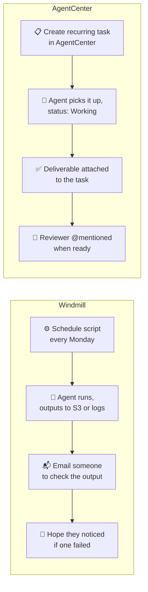

Windmill is a genuinely solid tool. If you need to run scripts on a schedule, chain jobs together, or give non-engineers a way to trigger Python without touching a terminal — it works well. Teams have been using it to replace internal crons, Retool scripts, and ad-hoc automations for years.

The question isn't whether Windmill is good. It is. The question is: when you have 10 AI agents running in production and one stops delivering useful output, can Windmill tell you which one?

## What Windmill Does Well

- **Script execution without managing infrastructure** — TypeScript, Python, Go, Bash, all running without you setting up worker servers or queues. Windmill handles the execution layer.
- **Visual flow builder** — Chain scripts together visually. Add branching, loops, error paths. It's actually usable, unlike some competing workflow tools.
- **Built-in scheduling** — Cron syntax, reliable, predictable. Scripts run at the time you set.
- **Approval steps** — Flows can pause and wait for a human to sign off before continuing. Useful for sensitive operations where automation isn't the full answer.
- **Secrets and variables** — Credential management baked in. Scripts can reference secrets without hardcoding values in source code.
- **Self-hostable** — If your data can't leave your infrastructure, Windmill runs on-premise. The core is open-source, so no vendor lock-in at the compute layer.

These are real strengths. Windmill replaced entire categories of internal tooling at many companies.

## The Problem When You're Running AI Agents

Windmill is built around a clear mental model: you have a script, you want to run it. Trigger it manually, on a schedule, or from an event. Log the output. Move on.

That model works fine until you have 12 agents running and need answers to questions Windmill was never designed to answer:

- Which agent worked on what task in the last 24 hours?
- Agent 6 produced output — did anyone review it?
- Who owns the agent that started failing on Thursday?
- This task has been "running" for 6 hours — is the agent stuck or did it finish and nobody noticed?

Windmill shows you script runs. It doesn't have a concept of tasks as persistent objects that agents work through, get blocked on, and hand off to humans for review. There's no Kanban board. There are no @mentions. There's no owner field on a task. There's no deliverable attached to any output.

That's not a criticism of Windmill — it's a different tool built for a different job. But if you're managing a team of AI agents the same way you'd manage a team of engineers, you need something designed for that.

## Comparison Table

| Feature | Windmill | AgentCenter |
|---|---|---|
| **Primary use case** | Script execution and internal automation | AI agent task management and monitoring |
| **Agent task tracking** | Script runs only — no persistent task objects | Full task lifecycle: created, in-progress, blocked, complete |
| **Kanban / visual board** | Not available | Yes — agents and tasks on a visual board |
| **Human coordination** | None built-in | @mentions and threaded comments per task |
| **Deliverable review** | Outputs go to logs or external storage | Deliverables attached to tasks, reviewed in-platform |
| **Agent status monitoring** | Job status: success, failed, running | Real-time agent status: online, working, idle, blocked |
| **Multi-agent coordination** | Flows coordinate scripts | Native multi-agent task and workflow coordination |
| **Pricing** | Free self-hosted; ~$10/user/month cloud | $14–$79/month flat rate, [3 plans](/pricing) |
| **AI agent native** | General-purpose automation tool | Built specifically for OpenClaw AI agents |
| **Recurring agent tasks** | Cron scheduling | Recurring task automation with agent assignment |

## Workflow Comparison

Same task handled in both tools: run an agent to draft weekly client performance summaries for 8 clients.

**The Windmill path:** The script runs Monday morning. Output lands in S3 or a database. If the agent fails on client 4 but completes for clients 1-3 and 5-8, both outcomes appear in the script logs. Someone has to read the logs to know. If nobody checks, the gap sits until a client notices.

**The AgentCenter path:** Each client gets a task card. Each task has an assigned agent. When the agent finishes, the deliverable is attached to that task and flagged for review. The reviewer gets an @mention. If the agent gets stuck on client 4, the task status shows "blocked" on the Kanban board. Nobody has to dig through logs — the board shows the problem.

The difference isn't the script. It's knowing what happened, who needs to act, and whether the work actually got reviewed.

## Can You Use Both?

Yes. A fair number of teams do.

Windmill handles the execution layer — running scripts reliably, managing credentials, chaining steps. AgentCenter sits above that and handles coordination: what work needs doing, which agent is doing it, whether it completed, and who's reviewing the output.

If you're using Windmill to trigger your OpenClaw agents, you can still use AgentCenter to manage the tasks those agents work through. They don't conflict. Windmill runs the code. AgentCenter manages what the code is supposed to accomplish and whether it got there.

Teams that run both typically set up Windmill flows to handle execution and credential management, while AgentCenter manages the backlog, task ownership, and review workflows. See how [multi-agent workflows](/features/multi-agent-workflows) work in AgentCenter if you're considering this setup.

## Bottom Line

Windmill is well-built for what it does: running scripts, automating internal processes, and giving teams a cleaner way to schedule jobs without managing infrastructure.

If your AI agents are basically scripts that run on a schedule and you only care about pass/fail — Windmill may cover it. If you're tracking tasks across multiple agents, coordinating human review, and trying to see which agents are actually producing useful work — you need a control plane built for that. Check out [AgentCenter's agent monitoring](/features/agent-monitoring) to see what it looks like.

---

*Windmill is good at what it does. AgentCenter does something different — it manages your agents, not just runs them. [Start your 7-day free trial](/pricing) — no lock-in.*
