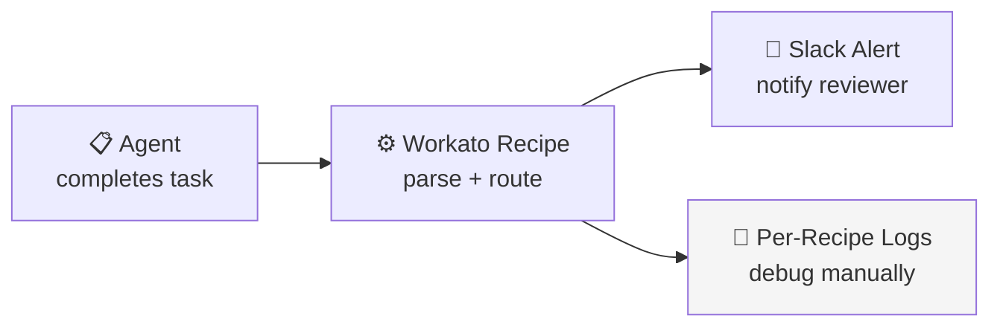
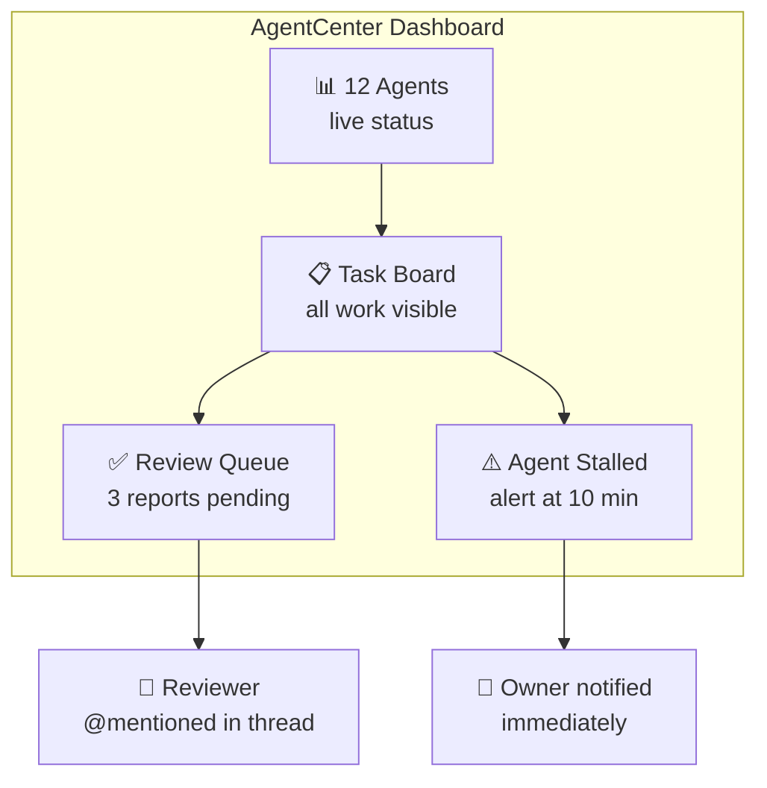

Workato is a serious enterprise tool. If your job is connecting Salesforce to NetSuite, routing support tickets between Zendesk and Jira, or building HR onboarding flows across a dozen SaaS platforms, it works well. The recipe-based model is mature, the integrations are deep, and the governance story is solid enough for large IT teams.

The question for teams running AI agents is different: does AgentCenter vs Workato even belong in the same conversation? The honest answer is that they solve adjacent problems. But when you start using Workato as your agent management layer, you'll hit its limits quickly.

## What Workato Does Well

It's worth being specific here. Workato earns its place in enterprise stacks for real reasons.

- **Integration depth**: Over 1,200 connectors covering the SaaS tools most enterprise teams already use. Salesforce, ServiceNow, Workday, SAP, Slack — they're all there with well-maintained triggers and actions.
- **Reliable recipe execution**: Deterministic workflows run on schedule or trigger, with built-in retry logic and error branching for integration-layer failures.
- **Workbot for Slack**: An AI assistant embedded in Slack that can query data, run actions, and surface information without opening another browser tab.
- **"AI by Workato" features**: The ability to add AI-powered steps inside existing recipes — sentiment analysis, document parsing, generative text — without writing code.
- **Enterprise governance**: SSO, role-based access control, audit logging, data residency options, and compliance certifications that procurement teams actually care about.
- **No-code interface**: Business operations and finance teams can build and maintain recipes themselves without waiting on engineering.

If your problem is moving structured data between systems reliably, Workato is a reasonable answer.

## The Core Limitation for AI Agent Teams

Workato thinks in steps. A recipe runs: trigger fires, step 1 executes, step 2 executes, done. Each step is predictable — input goes in, output comes out, the recipe moves on. That model is exactly right for integration workflows where inputs are structured and outcomes are deterministic.

It breaks when the "step" is an AI agent that might take 90 seconds, produce a draft that needs human sign-off, retry after hitting a rate limit, or stall waiting on another agent upstream to finish its work.

The visibility gap becomes obvious fast. When you have 15 agents running across 4 projects, you need to answer questions like these on a Tuesday morning:

- Which agents are actively working versus idle versus blocked?
- What exactly did agent #9 produce in the last hour?
- Why did this research task take 5x longer than yesterday's identical run?
- Which outputs are waiting on human review before they go downstream?
- How much did agent #3 cost this week versus last week?

Workato's answer is: check your recipe run history and logs. That's functional. But recipe logs were built to debug integration step failures, not to give operational visibility into a fleet of agents running in parallel with shared dependencies.

You also can't track cost per agent in Workato. You don't get a live status view showing all agents at once. Deliverable review is something you'd have to build yourself on top — routing outputs to Slack, building approval flows, tracking who approved what. It's possible, but you're building the management layer yourself rather than having it built for you.

## AgentCenter vs Workato: Side by Side

| Feature | Workato | AgentCenter |
|---|---|---|
| Primary purpose | Enterprise workflow automation (iPaaS) | AI agent management and control plane |
| Agent status visibility | Recipe run history and step logs | Real-time status: working, idle, blocked, error |
| Task management | Steps inside individual recipes | Kanban board across all agents and projects |
| Deliverable review | Not built in — must build yourself | Built-in review and approval workflows |
| Cost per agent | Not tracked | Per-agent, per-task token cost tracking |
| Team coordination | Slack notifications, recipe alerts | @Mentions, task threads, shared project view |
| Multi-agent coordination | Sequential or parallel recipe steps | Native cross-agent task handoffs |
| AI agent compatibility | AI steps inside recipes | Built for OpenClaw agent fleets |
| Pricing | Enterprise contracts, typically $10k+/year | $14–$79/month, 7-day free trial |
| Setup time | Days to weeks (enterprise procurement cycle) | Under an hour |
| Best for | Business process automation across SaaS tools | Teams running AI agents in production |

The pricing difference is significant. Workato is priced for IT procurement with multi-year contracts. AgentCenter starts at [$14/month](/pricing) with a 7-day free trial and no lock-in. If you're a small engineering team running AI agents, the comparison isn't really close on cost.

## How Each Handles the Same Scenario

**Setup:** Your team runs 12 AI agents. Three produce research reports that need human review before they reach clients. One agent keeps stalling partway through its task. You want to know what's actually happening without opening 12 separate log screens.

**With Workato:**

1. Build a recipe for each agent's output: trigger on task completion, parse the response, route it to a reviewer
2. Set up Slack messages per recipe when review is needed
3. When an agent stalls, check the specific recipe's run history and trace the failed step
4. Try to correlate failures across multiple recipe logs to understand whether the stall is an agent problem or a dependency problem
5. Track review status manually (a spreadsheet, a Slack thread, a Notion table — whatever your team improvised)

Every piece of operational infrastructure — alerting, review tracking, cost visibility, cross-agent correlation — is something you build on top of the tool. That's fine if you have time. Most teams don't.

**With AgentCenter:**

1. Connect your OpenClaw agents to AgentCenter
2. Create a project, set up a Kanban board, configure review requirements for report-type task outputs
3. See all 12 agents on one [agent monitoring dashboard](/features/agent-monitoring): who's working, who's idle, who's blocked right now
4. The review queue surfaces the three pending reports automatically
5. @Mention a reviewer directly in the task thread when a report is ready
6. The stalling agent triggers an alert when it hasn't updated in 10 minutes

The visibility is built in. You configure it, not build it. [Task orchestration](/features/task-orchestration) handles the cross-agent coordination without writing custom recipe logic.

## Can You Use Both?

Yes, and this is actually a reasonable setup for some teams. Workato handles the integration layer — data moving between your CRM, your ERP, your ticketing system, your communication tools. AgentCenter handles the agent layer — tracking what your AI agents are doing, reviewing their outputs, and coordinating between them in production.

If your organization already uses Workato for business process automation, you don't replace it when you add AI agents to your stack. You add AgentCenter on top to manage the agent fleet. The tools don't overlap much.

Where things get complicated: if you try to use Workato as your primary agent management layer, you end up building custom monitoring logic on a platform that wasn't designed to provide it. Recipe logs and Slack alerts are functional in small doses. They don't scale to 20 agents with review requirements, cost budgets, and cross-agent dependencies.

## Bottom Line

Workato automates business processes across SaaS tools — it does that job well. AgentCenter manages AI agents in production: what they're working on, what they've produced, when they fail, and what needs review before it ships. If your team runs AI agents at any meaningful scale, the agent management layer isn't optional, and Workato isn't a substitute for it.

---

*Workato is good at what it does. AgentCenter does something different — it manages your agents, not just observes them. [Start your 7-day free trial](/pricing) — no lock-in.*
