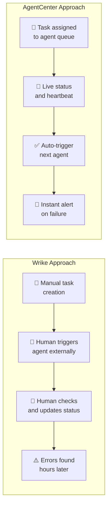

Wrike is used by a lot of engineering and operations teams. You can plan sprints, manage dependencies, assign work to people, and report upward without much friction. If your team runs 20 humans on a project, Wrike handles it fine.

The question is what happens when some of those "workers" are AI agents.

This comes up more than you'd expect. Teams already in Wrike try to extend it — create tasks for agents, track status, review outputs. It works for about a week. Then the cracks show.

## What Wrike Does Well

Wrike is a mature work management platform. It's been around since 2006 and the feature set reflects that.

- Timeline and Gantt views for planning across teams
- Workload management — see who's overloaded at a glance
- Approval flows for multi-step review and sign-off
- Time tracking per task and per person
- Custom dashboards with project-level reporting
- Integrations with Slack, Google Drive, Salesforce, Jira, and 400+ others
- Role-based permissions that scale from 5 people to 5,000

For coordinating designers, developers, project managers, and stakeholders, Wrike works. That's exactly what it was built for.

## The Core Limitation for AI Agent Teams

AI agents are not people. You can assign a task in Wrike to an agent account, but nothing happens automatically. The agent doesn't pick it up. It doesn't report status back. When something fails, no one knows until a human notices the silence.

Most teams hit this wall fast. They set up a Wrike board for their agent pipeline, spend a few hours configuring it, and then realize they're not managing agents — they're managing the notes humans take about what agents might have done.

Here's the structural gap: **Wrike sees tasks as records. AgentCenter sees tasks as live operations.**

When your research agent has been running for 45 minutes and hasn't produced output, Wrike shows "In Progress" because someone set it that way. AgentCenter shows the agent's heartbeat, last activity timestamp, and lets you pause or reassign it without a human manually touching a status field.

The difference gets expensive at scale. If you're running 10 agents across 3 projects, someone has to spend 30-60 minutes a day just keeping the Wrike board accurate. That's not agent management — that's data entry.

Three things Wrike fundamentally can't do for AI agents:

1. **Real-time status monitoring.** Agents don't post updates to Wrike. You can't watch an agent work; you can only read what a human typed about it later.
2. **Cost tracking per task.** LLM token costs vary by task complexity. Wrike has no concept of tracking what a task actually cost to run — it's built for human hours, not compute budgets.
3. **Error detection.** When an agent fails mid-task, Wrike won't know. The task stays "In Progress" until someone checks and updates it. AgentCenter fires an alert the moment something goes wrong.

## AgentCenter vs Wrike

| Feature | Wrike | AgentCenter |
|---|---|---|
| Task assignment and tracking | Yes — for human workers | Yes — wired directly to agent queues |
| Real-time agent status | No | Yes — live heartbeat, idle/working/blocked/error |
| LLM cost tracking per task | No | Yes — per-task token cost visibility |
| Agent error alerts | No | Yes — instant notification on failure |
| Multi-agent task orchestration | Manual only | Yes — auto-trigger downstream tasks on completion |
| Deliverable review workflow | Generic file attachments | Agent-specific output review and approval |
| Kanban for agent pipelines | Generic boards | Boards tied directly to agent task queues |
| @Mentions and task threads | Yes | Yes — with agent context per thread |
| Pricing | From $9.80/user/mo (Business) | From $14/mo (5 agents, 3 projects) |
| Free trial | 14 days | 7 days |
| Built for AI agents | No | Yes |

## Workflow Comparison

Imagine a content pipeline: a research agent pulls sources, a writer agent drafts posts, a QA agent reviews them. Simple three-step chain.

**Running this pipeline with Wrike:**

1. Create three tasks manually — Research, Draft, Review
2. Assign each to a placeholder "agent" user in Wrike (or leave unassigned)
3. Trigger the research agent manually via your agent runner
4. Check back periodically — there's no signal in Wrike when research finishes
5. When research is done, manually update the task status and notify the writer agent externally
6. If the writer agent errors, you find out when the QA agent has nothing to review
7. Every status update requires a human to touch Wrike

**Running the same pipeline with AgentCenter:**

1. Configure research, writer, and QA agents with their task templates in the [agent dashboard](/features/agent-dashboard)
2. Create the research task — it drops into the research agent's queue automatically
3. Research completes, deliverable appears for review; one-click approval triggers the writer task
4. If the writer agent errors mid-run, you see it in real time and can reassign or retry
5. QA task auto-queues when the writer finishes — no human needed to pass the baton

The [task orchestration](/features/task-orchestration) layer is what changes the math here. Each handoff in Wrike costs a human 5 minutes. With 10 tasks a day across 5 agents, that's nearly an hour of coordination work that disappears when you have a tool built for the job.

## Can You Use Both?

Yes, and it makes sense for some teams. If you're using Wrike for human project work — sprint planning, design reviews, stakeholder updates — you don't need to rip it out. AgentCenter covers the agent side; Wrike covers the human side.

Where it breaks: if you try to make Wrike the source of truth for agent activity, you'll end up with a stale board that nobody trusts. Agents don't write to Wrike. A human has to do it. That's a second job nobody signed up for, and it compounds as your agent count grows.

If you're running fewer than 3 agents on ad-hoc tasks, a lightweight Wrike board plus a scratchpad might be fine for now. Once you're past 5 agents or running anything that needs to be reliable overnight, you need something that understands what "agent running" actually means.

See [AgentCenter's pricing](/pricing) — the Starter plan covers 5 agents at $14/month, which is usually enough for a team just making the transition from spreadsheet-and-Wrike to a real control plane.

## Bottom Line

Wrike is a good tool for human teams doing human work. It's not designed for AI agents, and stretching it to cover agents creates maintenance overhead that grows with every agent you add. If you're running agents seriously, you need a platform that tracks what agents are actually doing — not one that waits for a human to type in what they think happened.

---

*Wrike handles your human project work well. AgentCenter does something different — it manages your agents, not just records tasks. [Start your 7-day free trial](/pricing) — no lock-in.*
