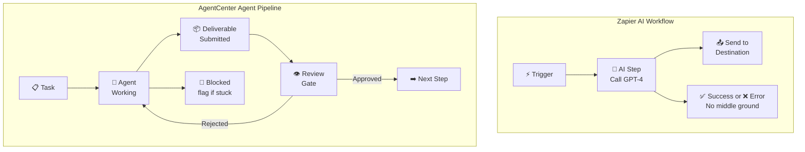

Zapier is one of the most useful products ever built. If you need to move data between apps without writing code, it's hard to beat. The integrations library is massive. The no-code editor is genuinely accessible. Millions of people use it every day for real work.

The problem isn't Zapier. The problem is trying to run AI agents inside it.

## What Zapier Does Well

- Connects 6,000+ apps with no-code triggers and actions
- Reliable execution on a schedule or event trigger
- Accessible to non-technical users
- Good for linear: "when X, do Y, then Z"
- Excellent for moving and transforming data between known systems

If your workflow is deterministic — the inputs are always structured, the steps always succeed or fail cleanly — Zapier is hard to beat on ease of use.

## The Core Limitation for AI Agent Teams

Zapier's model is: trigger fires, steps execute, workflow completes (or fails). That model works for predictable operations. AI agents are not predictable operations.

An agent working on a research task might run for 8 minutes. It might need to ask a question mid-task. It might produce a draft that needs review before the next step. It might get blocked waiting for an external tool. None of these states fit cleanly into Zapier's execute-or-fail model.

When you put AI steps inside a Zap, you can call an OpenAI API. What you can't do is monitor whether the output was any good. You can't see that the agent is stuck. You can't approve a deliverable before continuing. You can't track what the whole thing cost.

We talked to a marketing team that had built a Zapier workflow to draft blog posts using GPT-4. It ran every day. Every day it produced posts. For two months, nobody read them closely. When they did, they found the AI had been hallucinating statistics — confidently citing studies that didn't exist. The Zap completed successfully every time.

## Comparison Table

| Feature                    | Zapier                    | AgentCenter                             |
| -------------------------- | ------------------------- | --------------------------------------- |
| No-code workflow builder   | Yes                       | Kanban + task assignments               |
| AI API calls               | Yes (action step)         | Yes (agent behavior)                    |
| Agent status monitoring    | No                        | Real-time (online/working/idle/blocked) |
| Deliverable review gate    | No                        | Yes, with approval workflow             |
| Multi-agent coordination   | No                        | Yes                                     |
| Cost tracking per task     | No                        | Yes                                     |
| Error visibility           | Step-level pass/fail      | Per-agent with thresholds               |
| @mentions and chat threads | No                        | Yes                                     |
| 6,000+ app integrations    | Yes                       | Via agents and API                      |
| Self-hosting               | No                        | Yes                                     |
| Pricing                    | $20-$140/mo (task limits) | $14-$79/mo (agent limits)               |
| Free trial                 | 14-day trial              | 7-day free trial                        |

## Workflow Comparison

**Publishing a research report with Zapier:**

1. Trigger fires on schedule
2. AI step runs prompt, outputs text
3. Text goes to destination (Notion, email, etc.)
4. Done. No visibility into whether output was accurate.

**Publishing a research report with AgentCenter:**

1. Task created in project
2. Research agent picks up task, runs for 8 minutes
3. Agent submits draft deliverable
4. Editor agent reviews, flags issues
5. Human reviewer approves before publishing
6. Full audit trail of what was produced and by whom

## Can You Use Both?

Yes. Zapier can be your trigger layer — receive a webhook, parse an email, pull data from a spreadsheet — and hand off to an agent via API. The agent does the work in AgentCenter. Zapier handles the routing on either end.

That combination is actually powerful: Zapier's integrations plus AgentCenter's agent management. Where Zapier gets you stuck is when you try to put the agent entirely inside the Zap.

## Bottom Line

Zapier is excellent at connecting apps. It's not designed to manage agents that run over time, produce deliverables for review, or need coordination with other agents. If your AI workflow is truly linear and the outputs don't need human review, Zapier might be enough. If you're running agents doing real work that matters, you need something that treats them as entities to manage.

_Zapier is good at what it does. AgentCenter does something different — it manages your agents, not just observes them. [Start your 7-day free trial](/pricing) — no lock-in._
