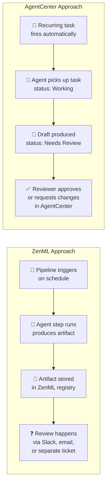

If you're on an ML engineering team that runs ZenML pipelines, this post is for you.

ZenML is good. It solves real problems for teams building reproducible ML workflows. If you're training models, versioning datasets, or moving features through a processing pipeline, it fits the job well. The stack abstraction alone saves hours of infrastructure setup.

But when your pipeline steps start spawning agents — things that make decisions, call APIs, draft content, analyze documents — you're no longer running a pipeline in the traditional sense. You're running a team. That's when ZenML starts showing its limits.

## What ZenML Does Well

ZenML is purpose-built for ML pipeline orchestration. It handles that use case genuinely well:

- **Reproducible runs**: Every pipeline step is versioned and tracked. You can replay any historical run exactly.
- **Artifact management**: Outputs from each step (datasets, models, evaluation reports) are stored, linked, and queryable.
- **Experiment tracking**: Works with MLflow, Weights & Biases, and Neptune out of the box.
- **Stack abstraction**: Swap orchestrators (Airflow, Kubeflow, Vertex AI Pipelines) without rewriting your pipeline logic.
- **Model registry**: Track which model version is deployed in which environment, and when it changed.
- **Active open-source community**: Good documentation, frequent releases, and solid integrations across the ML ecosystem.

If you're running ML training pipelines, ZenML earns its place. The architecture makes sense for that problem.

## The Core Limitation for AI Agent Teams

The mismatch shows up when your pipeline steps become agents.

In a traditional ML pipeline, each step takes input, does something deterministic, and produces output. The step either passes or fails. There's no "task" in the human sense — no deliverable that someone needs to approve, no agent that might loop forever, no output that needs a second set of eyes before it reaches customers.

AI agents are different. When an agent drafts a customer email, analyzes a legal contract, or generates a weekly operations report, a human usually needs to verify it. The agent might produce output that's technically complete but factually wrong. It might succeed by its own metrics while failing yours.

ZenML doesn't have a model for this. It tracks steps, artifacts, and pipeline runs — not tasks, not deliverable states, not review queues. There's no way to mark agent output as "approved" or "needs revision." No place to leave structured feedback. No way to see which agents are stuck, blocked, or idle right now across all your projects.

Teams end up building this on top of ZenML: custom metadata fields, external task trackers, Slack threads, and spreadsheets. Some make it work. Most end up with four different places to check what agents are actually doing.

AgentCenter is the management layer ZenML doesn't provide. Not for replacing your ML pipelines — for managing what the agents inside those pipelines are actually doing and whether their work is any good.

## AgentCenter vs ZenML: Side by Side

| | ZenML | AgentCenter |
|---|---|---|
| **Primary purpose** | ML pipeline orchestration | AI agent task management and coordination |
| **Task tracking** | Pipeline runs and step logs | Per-agent tasks with status, assignee, and priority |
| **Human review** | Not built in | Deliverable approval workflows included |
| **Real-time agent status** | Not available | Online, working, idle, blocked — per agent |
| **Team coordination** | Not designed for it | @Mentions, task threads, and notifications |
| **Cost tracking per task** | Not built in | Per-task and per-agent cost tracking |
| **Recurring task automation** | Scheduled pipeline runs | Native recurring tasks (Pro plan and above) |
| **Pricing** | Open-source free; Pro from $99/mo | Starter $14/mo, Pro $29/mo, Scale $79/mo |
| **OpenClaw agent support** | No native integration | Built for OpenClaw-compatible agents |
| **Visual task board** | No | Kanban board across all agents and projects |
| **Approval audit trail** | No | Full history of reviews, comments, and approvals |

## What the Workflow Actually Looks Like

Say your team runs a research agent that produces weekly competitive intelligence summaries. Here's what day-to-day management looks like with each tool:

**ZenML way:**
1. Pipeline triggers on cron schedule
2. Agent step runs and produces a draft artifact
3. Draft is stored in ZenML's artifact store
4. You build a notification step or check it manually
5. Review happens in Slack, email, or a separate tool
6. Approval is tracked nowhere in particular — or in a spreadsheet

**AgentCenter way:**
1. Recurring task fires on schedule, configured in the [task dashboard](/features/task-orchestration)
2. Agent picks up the task — status updates to Working automatically
3. Agent produces the draft — status shifts to Needs Review, reviewer is notified
4. Reviewer opens the deliverable, approves or adds a revision comment
5. History, comments, and decisions stay in one place

The difference isn't about which tool is "better" in the abstract. It's about whether the review layer is part of the system or something you stitch together yourself.

## Can You Use Both?

Yes, and this is worth being honest about.

ZenML handles the infrastructure layer well: reproducible runs, artifact versioning, model tracking. AgentCenter handles the operations layer: what agents are doing right now, who needs to review what, where things are stuck.

If you're running a serious ML platform and your OpenClaw agents live inside larger ZenML pipelines, you might keep ZenML for pipeline orchestration and use AgentCenter for [agent monitoring](/features/agent-monitoring) and human-in-the-loop coordination. The two don't conflict at the technical level.

If you're a smaller team with a handful of agents, ZenML is probably more infrastructure than you need. AgentCenter covers the full management layer without requiring you to define stacks, artifact stores, and orchestrators first.

Most teams managing 5-15 agents find AgentCenter handles everything they need. Teams running complex ML systems with dozens of pipeline dependencies sometimes run both.

## Bottom Line

ZenML solves the ML pipeline reproducibility problem. AgentCenter solves the agent management problem. They answer different questions.

ZenML: "Did my pipeline run correctly, and can I replay it?"

AgentCenter: "What are my agents doing right now, who's reviewing their output, and where is something stuck?"

If you're asking the second question and routing the answer through Slack threads and manual artifact checks, that's the gap worth closing.

---

*ZenML is good at what it does. AgentCenter does something different — it manages your agents, not just orchestrates your pipelines. [Start your 7-day free trial](/pricing) — no lock-in.*
