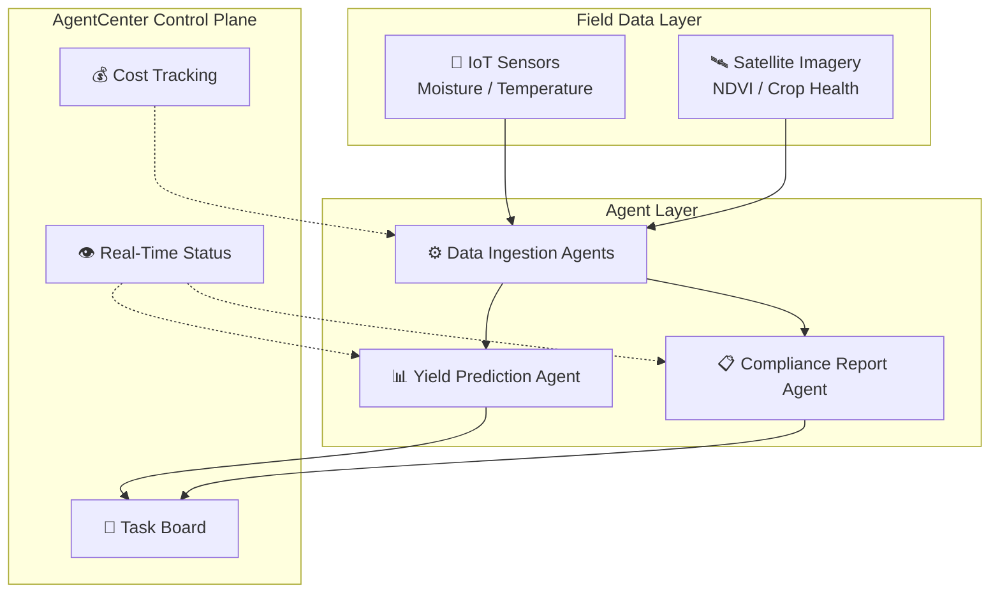

AgriTech operations teams run some of the most time-sensitive AI agents in any vertical. A yield prediction agent that goes stale during planting season doesn't just produce a bad number. It affects purchasing decisions, logistics contracts, and farmer recommendations that can't easily be undone.

Managing AI agents for agritech is harder than it looks from the outside. A mid-sized agritech platform might have 10 to 25 agents running concurrently: some pulling satellite imagery data, some processing IoT sensor feeds from smart irrigation systems, others generating regulatory compliance reports for government subsidy programs. Running that fleet from a folder of YAML configs and a shared Slack channel doesn't hold.

## What Breaks When You Scale AI Agents in AgriTech

**Sensor data agents that fail silently.** An IoT sensor feed goes down at 3am. The agent processing moisture readings keeps running — returning cached or empty outputs — and nobody notices until a farmer report comes back wrong two days later. There's no way to see whether the agent is working or just appearing to work.

**Compliance agents with no clear ownership.** AgriTech platforms in the US and EU generate mandatory reports for USDA, EPA, and CSRD compliance programs. These are often agent-generated. When a report fails mid-run, the question "whose agent is that?" takes 45 minutes to answer across three Slack channels.

**Cost spikes during harvest season.** Token usage triples during peak periods when agents run on denser crop datasets and more frequent sensor polling. Without per-agent cost tracking, teams discover budget overruns at month-end — after the damage is done.

## How AgriTech Teams Manage AI Agents With AgentCenter

**Real-time agent status.** Each data ingestion agent shows its live state on the [AgentCenter dashboard](/features/agent-dashboard). When a moisture sensor feed drops, the downstream agent switches to "blocked" — visible to the whole team without anyone digging through logs. That two-day debugging gap becomes a two-minute response.

**Kanban board for seasonal task orchestration.** AgriTech operations change with the calendar. Planting season means different agent workloads than harvest season. The [task orchestration board](/features/task-orchestration) shows every active agent task, lets teams assign ownership by crop region or data pipeline, and tracks handoffs between agents. The institutional knowledge stops living in one person's head.

**Threaded comments on tasks.** When a compliance report agent produces a flagged output, the reviewing agronomist can comment directly on the task in AgentCenter. The agent owner gets notified immediately. No context gets lost in a Slack thread.

**Per-agent cost tracking.** During peak harvest, you can see exactly which agents are driving token costs up. A yield prediction agent running hourly on dense satellite imagery might cost 4x more than one running daily. The [agent monitoring view](/features/agent-monitoring) surfaces this before it becomes a billing surprise.

**Recurring task automation.** Compliance reports and field data summaries run on fixed schedules. Setting these as recurring tasks in AgentCenter (Pro plan and above) means no manual triggering, no missed runs, and a full execution history available when a regulator asks questions.

## The Numbers

A typical mid-sized agritech platform runs 10 to 20 agents in production: data ingestion, transformation, analysis, reporting, and customer-facing recommendation agents. The Pro plan at $29/month covers up to 15 agents and handles most teams. Larger platforms tracking hundreds of crop regions or managing multiple enterprise clients typically need Scale ($79/month, up to 50 agents).

AgentCenter replaces a mix of spreadsheets for agent tracking, Slack for status updates, and manual log reviews for debugging. Not one tool — an entire category of tribal knowledge that evaporates when someone leaves.

See the [full pricing breakdown](/pricing) if you're figuring out which plan fits your fleet size.

## Before vs After

| Area | Without AgentCenter | With AgentCenter |
|------|---------------------|-----------------|
| Visibility | No way to see what's running or stuck | Live status for every agent |
| Task handoffs | Managed in Slack and shared documents | Assigned, threaded, tracked in one board |
| Error detection | Found when reports come out wrong | Caught when agent goes blocked or idle |
| Cost tracking | Discovered at month-end billing | Per-agent cost visible in real time |
| Debugging time | 30 to 90 minutes per incident | Under 10 minutes with task history |

## Where to Start

Set up the [agent monitoring view](/features/agent-monitoring) first. Connect your existing OpenClaw agents and spend one week watching status. You'll likely find two or three agents that were failing silently — processing no data, returning empty outputs, not surfacing any errors to anyone.

Fixing those before adding new agents is worth more than any new capability.

Most agritech teams try to scale their agent fleet before they know which agents are actually working. Monitoring first changes what you build next.

---

*AgriTech operations teams that add a control plane early spend less time firefighting later. [Start your 7-day free trial](/pricing).*
