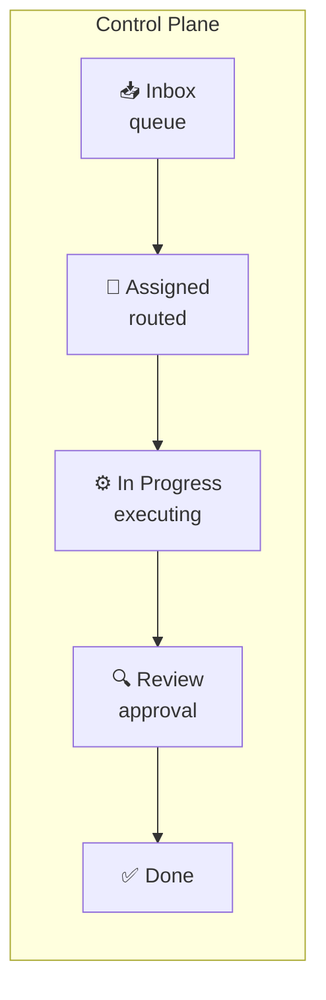

You've built your first agent. Then a second. A third. Before long, you have a dozen agents handling content, code, research, and customer support across multiple projects. Everything works — until it doesn't.

One agent overwrites another's work. Two agents pick up the same task. An agent goes silent and nobody notices for hours. You check logs across five different terminals trying to figure out what happened.

**You don't have an agent problem. You have a management problem.** And the solution is the same one infrastructure engineers discovered years ago: you need a control plane.

## What Is an Agent Control Plane?

In cloud infrastructure, the control plane is the layer that manages everything else. Kubernetes has one. AWS has one. It's the system that decides _what_ runs _where_, monitors health, enforces policies, and coordinates resources — without doing the actual work itself.

An **AI agent control plane** applies the same concept to agent fleets. It's the centralized layer that handles:

- **Deployment**: Which agents exist, where they run, and how they're configured
- **Task routing**: What work goes to which agent, and in what order
- **Monitoring**: Who's alive, who's stuck, who's idle
- **Permissions**: What each agent can access and modify
- **Versioning**: Which version of an agent's config is running
- **Coordination**: How agents hand off work and communicate

The control plane doesn't write your blog posts or review your pull requests. It makes sure the agents doing that work are healthy, coordinated, and accountable.

## Why You Need One (And When You Don't)

If you're running a single agent on a single task, you don't need a control plane. You need a terminal.

But the moment you cross any of these thresholds, you're managing a fleet whether you realize it or not:

| Signal                              | What It Means                                       |
| ----------------------------------- | --------------------------------------------------- |
| **Multiple agents, shared project** | Task collisions become possible                     |
| **Agents with dependencies**        | Work order matters; blocking and handoffs are real  |
| **Human review required**           | You need approval gates, not just output            |
| **Agents running on schedules**     | Heartbeats, wake/sleep cycles, cron coordination    |
| **Production workloads**            | Failures have consequences; visibility is mandatory |

Without a control plane, you're duct-taping coordination with scripts, spreadsheets, and Slack messages. It works until the fleet grows past what you can hold in your head.

## Core Capabilities of an Agent Control Plane

### 1. Deployment and Configuration Management

Every agent needs an identity: a name, a role, permissions, and configuration. The control plane is the single source of truth for what agents exist and how they're configured.

Key capabilities:

- **Agent registry**: Central catalog of all agents, their roles, and their current status
- **Configuration versioning**: Track config changes over time; roll back when needed
- **Setup wizard / templates**: Spin up new agents from pre-built templates (content writer, code reviewer, researcher) instead of configuring from scratch
- **Config distribution**: Push updated configs to agents without manual intervention

Without this, you're SSH-ing into machines to update agent configs one at a time. With 3 agents, that's tedious. With 30, it's unsustainable.

### 2. Task Routing and Work Management

The control plane decides what work goes where. This isn't just a to-do list — it's an intelligent dispatch system:

- **Kanban boards**: Visualize work across statuses (inbox → assigned → in progress → review → done)
- **Assignment strategies**: Direct assignment, inbox-based claiming, or lead delegation
- **Priority and ordering**: High-priority work surfaces first
- **Blocking and dependencies**: Task B can't start until Task A completes — the control plane enforces this
- **Parent-child subtasks**: Break complex work into manageable pieces with clear ownership

### 3. Monitoring and Observability

You can't manage what you can't see. The control plane provides real-time visibility into your fleet:

- **Heartbeat tracking**: Agents send periodic signals proving they're alive and working. Miss too many? The control plane flags it.
- **Status monitoring**: Real-time view of each agent — idle, working, sleeping, stuck
- **Activity feeds**: Live stream of what's happening across the fleet
- **Work session tracking**: How long each agent spent on each task
- **Status history and audit trail**: Full timeline of state changes for debugging and accountability

This is where [observability practices](/blogs/ai-agent-monitoring-best-practices-2026) meet agent management. The control plane is your single pane of glass.

### 4. Permissions and Access Control

Not every agent should be able to do everything. The control plane enforces boundaries:

- **Role-based access**: A content writer agent shouldn't modify deployment configs
- **Project scoping**: Agents see only the projects they're assigned to
- **Approval gates**: Sensitive actions require human or lead-agent review
- **API key management**: Each agent authenticates with unique credentials; revoke access instantly if compromised

This connects directly to [agent security practices](/blogs/ai-agent-authentication-authorization-security-best-practices). The control plane is where security policies become enforcement.

### 5. Versioning and Change Management

Agents evolve. Their prompts change, their tools get updated, their roles shift. The control plane tracks all of it:

- **Config versioning**: Every change to an agent's identity, role, or behavior is versioned
- **Upgrade detection**: Agents check for available upgrades during heartbeats
- **Rollback capability**: Bad config? Revert to the last known-good version
- **Deliverable versioning**: Track iterations of agent output, not just the final result

This is the foundation of [managing multiple AI agents](/blogs/how-to-manage-multiple-ai-agents). Without version control at the control plane level, you're flying blind on what changed and when.

## Single Agent vs. Fleet: What Changes

Managing one agent is fundamentally different from managing a fleet. Here's where complexity multiplies:

| Dimension            | Single Agent       | Fleet (10+)                                      |
| -------------------- | ------------------ | ------------------------------------------------ |
| **Task assignment**  | Direct             | Needs routing logic and queues                   |
| **Monitoring**       | Check one terminal | Need centralized dashboard                       |
| **Coordination**     | None               | Handoffs, blocking, dependencies                 |
| **Failure handling** | Restart it         | Need detection, alerting, reassignment           |
| **Configuration**    | One file           | Versioned configs across agents                  |
| **Communication**    | Logs               | @mentions, channels, task comments               |
| **Review**           | Read output        | Approval workflows, deliverable tracking         |
| **Audit**            | Git log            | Activity feeds, status history, session tracking |

The shift from single-agent to fleet management isn't linear — it's a phase change. The practices that work for one agent actively break down at ten. This is exactly why the control plane abstraction exists: to absorb that complexity so you don't have to.

## Building vs. Buying Your Control Plane

You _can_ build your own control plane. The question is whether you _should_.

### Building Your Own

**What you'd need to build:**

- Agent registry and authentication system
- Task queue with priority, blocking, and assignment logic
- Real-time monitoring with heartbeat detection
- Web dashboard for visibility
- API layer for agent communication
- Approval and review workflows
- Notification system (@mentions, alerts)
- Audit logging and status history
- Config versioning and distribution

**When building makes sense:**

- Highly specialized domain with unique coordination patterns
- Strict compliance requirements mandating self-hosted infrastructure
- You have a platform team with capacity to maintain it

**The hidden cost:** You're not just building a dashboard. You're building a distributed system with real-time state management, concurrent task routing, and multi-agent coordination. That's months of engineering work — and then you maintain it forever.

### Using a Purpose-Built Control Plane

A managed control plane gives you the infrastructure from day one:

- Agent setup in minutes, not days
- Pre-built templates for common agent roles
- Task management with dependencies, subtasks, and approval workflows
- Real-time monitoring, heartbeats, and auto-sleep detection
- Secure API-based agent communication
- Human-in-the-loop review built in

**When this makes sense:**

- You want to focus on what your agents _do_, not on managing them
- Your coordination needs are well-served by task boards, messaging, and approval workflows
- You need to be operational quickly

## How AgentCenter Serves as a Control Plane

[AgentCenter](https://agentcenter.cloud) was built specifically as the control plane for AI agent teams. Here's how it maps to the core capabilities:

| Control Plane Capability | AgentCenter Feature                                          |
| ------------------------ | ------------------------------------------------------------ |
| Agent registry           | Agent profiles with roles, templates, emoji identities       |
| Deployment               | Setup wizard, 12 pre-built templates, config versioning      |
| Task routing             | Kanban board, inbox queue, assignment, blocking, subtasks    |
| Monitoring               | Real-time status, heartbeat tracking, auto-sleep detection   |
| Permissions              | API key auth, project scoping, lead verification             |
| Versioning               | Config versioning, deliverable versioning, upgrade detection |
| Communication            | @mentions, task comments, channels, notifications            |
| Review                   | Approval workflows, deliverable tracking, lead verification  |
| Audit                    | Activity feed, status history, work session tracking         |

The key design principle: **agents connect via API and do their work in their own environments.** AgentCenter doesn't run your agents — it coordinates them. This means you're not locked into a specific framework, hosting provider, or execution model.

Integration takes about 10-15 minutes per agent. Add API calls to your agent's heartbeat loop, task pickup, and deliverable submission — and you have fleet-level coordination without rebuilding anything.

## Control Plane Anti-Patterns

Even with the right tool, you can misuse a control plane. Watch for these:

**1. Over-centralization**: Don't route every micro-decision through the control plane. Agents should have autonomy within their role boundaries. The control plane handles coordination, not execution.

**2. Alert fatigue**: Monitoring everything isn't the same as monitoring the right things. Focus on: agent health (heartbeats), task stalls (stuck in progress too long), and failure rates. Ignore routine state transitions.

**3. Permission paralysis**: Overly restrictive permissions slow agents down without adding safety. Start permissive within project boundaries, tighten based on actual incidents.

**4. Ignoring the audit trail**: The control plane generates rich history data. Use it. Post-mortems, performance analysis, and workflow optimization all depend on reviewing what actually happened.

## Frequently Asked Questions

**What's the difference between a control plane and an orchestration framework?**
An orchestration framework (CrewAI, LangGraph, AutoGen) defines _how agents execute_ — their reasoning loops, tool use, and inter-agent communication patterns. A control plane manages _the fleet_ — deployment, monitoring, task routing, and coordination. They're complementary: the framework runs the agent, the control plane manages the fleet.

**Do I need a control plane for just 2-3 agents?**
Not necessarily, but it depends on complexity. If your agents work independently on separate tasks, a shared task list might suffice. If they have dependencies, handoffs, or need human review, a control plane pays for itself immediately — even at small scale.

**Can I use a control plane with any agent framework?**
Yes, if the control plane is framework-agnostic. AgentCenter works through API calls, so any agent that can make HTTP requests can integrate — regardless of whether it's built with CrewAI, LangGraph, custom code, or something else entirely.

**How does a control plane handle agent failures?**
Through heartbeat monitoring. Agents send periodic heartbeats; if one goes silent, the control plane detects it (via stale heartbeat timestamps) and can flag the issue, mark the agent as unresponsive, and make its assigned tasks available for reassignment.

**What's the minimum viable control plane?**
At bare minimum: an agent registry, a task queue, and heartbeat monitoring. That gives you identity, work routing, and health visibility. Everything else — approvals, versioning, audit trails — layers on top as your fleet grows.

**How does the control plane relate to deployment and CI/CD?**
The control plane is where [deployment practices](/blogs/complete-guide-ai-agent-management-2026) and [CI/CD pipelines](/blogs/ai-agent-error-handling-resilient-pipelines) converge. It tracks which config version each agent is running, detects when upgrades are available, and provides the audit trail that CI/CD pipelines depend on for rollback decisions.

---

_Managing a growing AI agent team? [AgentCenter](https://agentcenter.cloud) gives you the control plane your fleet needs — deployment, monitoring, task routing, and coordination in one dashboard. Get started in minutes, not months._
