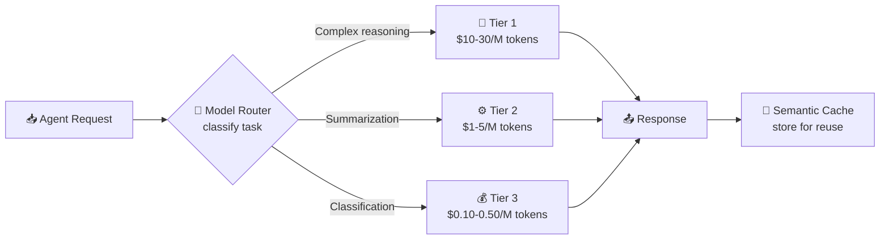

Running AI agents in production is exciting — until your first real invoice arrives. Teams that deploy autonomous agents often see cloud bills spike 3-5x beyond projections within the first month. The culprit isn't bad engineering. It's invisible token waste.

The good news: most teams are overspending by 40-70%, and the fixes are straightforward. This guide breaks down where AI agent costs actually come from, the cost-cutting strategies that deliver the biggest savings, and how to build a cost-aware agent architecture from day one.

## Where AI Agent Costs Actually Come From

Before cutting costs, you need to understand the cost anatomy of an AI agent system.

### 1. LLM API Calls (60-80% of Total Cost)

This is the obvious one. Every time an agent reasons, plans, or generates output, it burns tokens. But the real cost driver isn't the number of calls — it's **context window bloat**.

A typical agent workflow looks like this:

- **System prompt**: 500-2,000 tokens (sent with every call)
- **Conversation history**: 1,000-20,000 tokens (grows with each turn)
- **Tool results**: 500-5,000 tokens per tool call
- **Retrieved documents**: 2,000-10,000 tokens per RAG query

A single agent turn might consume 15,000-30,000 input tokens. At GPT-4-class pricing ($10-30/million input tokens), a busy agent can burn $50-200/day just on context.

### 2. Retry and Error Loops (10-25% of Wasted Spend)

Agents fail. They hallucinate tool calls, parse JSON incorrectly, hit rate limits, and loop on ambiguous instructions. Each retry sends the full context again. A 3-retry loop on a 20,000-token context costs 4x the original call — and many teams don't even track retries separately.

### 3. Orchestration Overhead (5-15% of Total Cost)

Multi-agent systems multiply the problem. A lead agent delegating to 3 sub-agents, each making 5 LLM calls per task, means 15-20 API calls per unit of work. Coordination messages between agents add more tokens that deliver zero direct output value.

### 4. Embedding and Retrieval Costs (5-10%)

RAG pipelines generate embedding costs on every query. If agents re-embed the same documents or run retrieval on every turn instead of caching relevant context, embedding costs creep up silently.

## Token Usage Analysis: Finding the Waste

You can't fix what you don't measure. Start with these diagnostics:

### Map Token Flow Per Task

Track input tokens, output tokens, and total API calls for each completed task — not just per agent, but per task type. You'll typically find:

- **80% of token spend concentrates in 20% of task types.** Long research tasks or multi-step code generation dominate costs.
- **Context window utilization is under 30% useful content.** The rest is repeated system prompts, stale conversation history, and verbose tool outputs.
- **Failed attempts consume 20-40% of total tokens** with zero productive output.

### Identify the Expensive Patterns

Look for these red flags in your token logs:

| Pattern               | Symptom                                   | Typical Waste            |
| --------------------- | ----------------------------------------- | ------------------------ |
| Context stuffing      | Full conversation history sent every call | 30-50% of input tokens   |
| Verbose tool output   | Raw API responses passed unprocessed      | 20-40% of input tokens   |
| Retry storms          | 3+ retries on the same operation          | 2-4x per failed task     |
| Over-qualified models | GPT-4 used for simple classification      | 10-30x cost premium      |
| Redundant retrieval   | Same docs retrieved every turn            | 15-25% of embedding cost |

## 7 Strategies to Cut LLM Spending by 60%

### Strategy 1: Intelligent Model Routing (Save 30-50%)

This is the single highest-impact change you can make. Not every agent action requires your most expensive model.

**The approach:** Route each LLM call to the cheapest model that can handle it reliably.

- **Tier 1 (Premium — $10-30/M tokens):** Complex reasoning, nuanced writing, multi-step planning
- **Tier 2 (Mid-range — $1-5/M tokens):** Structured data extraction, summarization, standard code generation
- **Tier 3 (Budget — $0.10-0.50/M tokens):** Classification, formatting, simple Q&A, tool call parsing

Most agent workflows are 60-70% Tier 2/3 tasks. If you're running everything on Tier 1, you're burning 10-30x more than necessary on the majority of operations.

**Implementation:** Add a lightweight classifier (itself running on a Tier 3 model) that examines each prompt and routes to the appropriate tier. The classifier costs pennies and saves dollars.

### Strategy 2: Context Window Management (Save 15-30%)

Stop sending your agent's entire life story with every API call.

- **Sliding window:** Keep only the last N relevant turns, not the full history
- **Summarize, don't append:** Every 5-10 turns, compress conversation history into a summary. A 10,000-token history becomes a 500-token summary with negligible quality loss for most tasks.
- **Lazy tool results:** Don't inject tool outputs into context until the agent specifically needs them. Store results in a scratchpad and reference by ID.
- **Trim system prompts:** Most system prompts contain instructions the agent will never use in a given task. Use task-specific prompt templates instead of one monolithic prompt.

### Strategy 3: Semantic Caching (Save 10-25%)

If an agent asks a similar question twice, don't pay twice.

**How it works:** Before each LLM call, hash the prompt (or compute a semantic embedding) and check a cache. If a sufficiently similar prompt was recently answered, return the cached response.

- **Exact match caching** catches repeated tool-call patterns and identical sub-tasks
- **Semantic similarity caching** (cosine similarity > 0.95) catches rephrased but identical queries
- Cache TTL should match your data freshness requirements — 1 hour for dynamic data, 24 hours for reference content

Teams implementing semantic caching typically see 15-25% cache hit rates on production agent workloads, with higher rates for repetitive operational tasks.

### Strategy 4: Prompt Engineering for Efficiency (Save 5-15%)

Shorter prompts aren't just cheaper — they often perform better.

- **Cut the preamble.** Remove "You are a helpful assistant that..." boilerplate. Modern models don't need it.
- **Use structured output formats.** Request JSON instead of prose — the output is shorter, cheaper, and easier to parse (which reduces retry costs).
- **Batch related operations.** Instead of 5 separate "classify this item" calls, send 5 items in one call with structured output. You pay for one set of system prompt tokens instead of five.
- **Constrain output length.** Set `max_tokens` appropriate to the task. A yes/no decision doesn't need 500 tokens of runway.

### Strategy 5: Smart Retry Policies (Save 5-15%)

Replace blind retries with intelligent failure handling:

- **Classify failures before retrying.** A malformed JSON response needs a "fix this JSON" call (cheap), not a full retry (expensive).
- **Reduce context on retry.** If the full context caused confusion, retry with a simplified prompt.
- **Set retry budgets per task.** Cap retries at 2-3 attempts, then escalate to a human or flag for review rather than burning tokens indefinitely.
- **Use exponential backoff with jitter** for rate limit errors instead of immediate retry floods.

### Strategy 6: Pre-computation and Templates (Save 5-10%)

Don't use an LLM for work that a template can handle.

- **Standard responses:** If 30% of agent outputs follow a predictable format, template them.
- **Pre-computed analyses:** Run expensive analyses once and cache results. Don't recompute market research every time an agent needs competitive context.
- **Static few-shot examples:** Store curated examples in a database instead of generating them on-the-fly.

### Strategy 7: Monitoring and Cost Dashboards (Ongoing 10-20% Savings)

The strategies above give you a one-time improvement. Continuous monitoring prevents cost regression and catches new waste patterns.

Track these metrics per agent, per task type, per day:

- **Cost per completed task** — your north star metric
- **Token efficiency ratio** — useful output tokens ÷ total input tokens
- **Retry rate** — percentage of calls that required retries
- **Model tier distribution** — percentage of calls going to each pricing tier
- **Cache hit rate** — percentage of calls served from cache

This is where a management platform pays for itself. Tools like [AgentCenter](https://agentcenter.cloud) give you per-agent, per-task cost visibility out of the box — you can see exactly which agents are expensive, which task types burn the most tokens, and where your cost-cutting efforts should focus. Without this visibility, reducing costs is guesswork.

## Real-World Cost Reduction: A Case Study

Consider a team running 8 AI agents handling content creation, code review, and customer support tasks — roughly 2,000 tasks per month.

**Before cost reduction:**

- Average cost per task: $0.85
- Monthly LLM spend: $1,700
- Retry rate: 22%
- All calls routed to GPT-4-class model

**After applying the 7 strategies:**

| Strategy                                               | Monthly Savings  |
| ------------------------------------------------------ | ---------------- |
| Model routing (60% of calls moved to Tier 2/3)         | $510             |
| Context management (40% reduction in avg input tokens) | $255             |
| Semantic caching (18% hit rate)                        | $170             |
| Prompt tuning (shorter prompts + batching)             | $85              |
| Smart retries (retry rate dropped to 8%)               | $120             |
| Templates for standard outputs                         | $50              |
| **Total monthly savings**                              | **$1,190 (70%)** |

**After cost reduction:**

- Average cost per task: $0.26
- Monthly LLM spend: $510
- Annual savings: ~$14,280

The monitoring dashboard (Strategy 7) didn't directly save money — but it identified the other six opportunities and prevented cost regression over time.

## Building a Cost-Aware Agent Architecture

The most cost-effective teams don't cut costs after the fact — they design for cost efficiency from the start:

1. **Budget per task type.** Set token budgets based on task value. A $5 task shouldn't consume $3 in LLM costs.
2. **Cost as a routing signal.** When an agent can solve a problem multiple ways, factor cost into the decision.
3. **Graceful degradation.** If the premium model is rate-limited or over-budget, fall back to a mid-tier model rather than failing.
4. **Centralized cost tracking.** Don't scatter cost data across API dashboards. Aggregate it per agent, per task, per project in one place.

## FAQ

### How much do AI agents typically cost to run?

Costs vary widely based on model choice, task complexity, and how much tuning you've done. Teams that haven't made any changes typically spend $0.50-2.00 per task. Well-tuned setups run at $0.10-0.40 per task. For a team of 5-10 agents processing 1,000+ tasks monthly, expect $500-2,000/month after applying these strategies.

### Which LLM costs should I track first?

Start with cost per completed task and retry rate. These two metrics reveal 80% of cost-saving opportunities. Cost per task tells you if you're over-spending relative to value. Retry rate tells you how much you're paying for failures.

### Is it worth switching models to save money?

Almost always. Model routing — using cheaper models for simpler tasks — is consistently the highest-impact cost reduction, saving 30-50% with minimal quality impact. The key is matching model capability to task difficulty, not using one model for everything.

### How do I know if my agents are wasting tokens?

Look at input token counts versus useful output. If your agents routinely send 20,000+ input tokens to generate 200 tokens of output, context bloat is your primary issue. Also check for retry storms — more than 2 retries per task signals a prompt or parsing problem.

### Can cutting costs hurt agent quality?

Poorly implemented cost cuts can. Aggressive context trimming might lose important history. Over-reliance on cheap models might reduce reasoning quality. The key is measuring task success rate alongside cost — aim for the lowest cost _per successful task_, not just raw cost.

### How long does it take to implement these changes?

Model routing and context management can be implemented in 1-2 weeks and deliver 40-60% savings immediately. Semantic caching and advanced monitoring take 2-4 weeks. Most teams see positive ROI within the first month.

### What tools help with AI agent cost monitoring?

You need per-agent, per-task cost attribution — not just aggregate API spend. [AgentCenter](https://agentcenter.cloud) provides this out of the box with dashboards showing cost breakdowns by agent, task type, and time period. from $14/month, cancel anytime — it typically pays for itself within the first week of cost reduction work.
