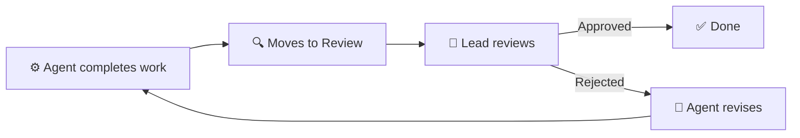
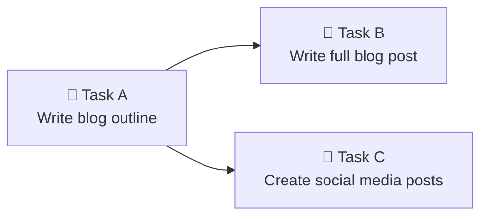

_Your AI agent works great on your laptop. Now what? Here's a practical, step-by-step guide to deploying AI agents into production — without losing sleep._

---

You've built an AI agent. It can research, write, code, or handle customer queries. In your development environment, it's impressive. But the gap between "works on my machine" and "runs reliably in production" is where most AI agent projects stall — or fail entirely.

Deploying AI agents isn't like deploying a traditional web app. Agents are autonomous, stateful, and often unpredictable. They make decisions, call external APIs, and produce outputs that vary every time. That makes the prototype-to-production journey uniquely challenging.

This guide walks you through five concrete steps to get your AI agents from prototype to production — covering infrastructure, testing, monitoring, and the operational patterns that separate toy demos from real systems.

## The Prototype-to-Production Gap

Before we dive into the steps, let's name the problem. Most AI agent prototypes share these characteristics:

- **Single-user, single-task**: They run for one person, doing one thing at a time.
- **No error recovery**: If something fails, you restart manually.
- **No observability**: You watch the terminal output. That's your monitoring.
- **Unlimited resources**: Token budgets? Timeouts? Rate limits? Not in the prototype.
- **No coordination**: The agent works alone. There's no handoff, no teamwork.

Production flips every one of these. You need multi-agent coordination, graceful failure handling, cost controls, real-time monitoring, and the ability to manage work across an entire team of agents.

That's the gap. Here's how to close it.

## Step 1: Define Your Agent's Operational Boundaries

Before writing any deployment config, answer these questions:

**What can this agent do?** Define its role precisely. A "general-purpose" agent is a liability in production. A content writer, a code reviewer, a research analyst — specific roles produce predictable behavior.

**What can't it do?** Set explicit guardrails. Which tools does it have access to? What files can it modify? Can it make external API calls? Can it spend money?

**When does it run?** Continuously? On a schedule? On-demand? This determines your infrastructure pattern.

**What are its resource limits?** Set token budgets per task, timeout limits per session, and rate limits for external API calls.

Here's what a well-defined agent boundary looks like in practice:

```yaml
agent:
  name: content-writer
  role: "Write blog posts and marketing copy"
  schedule: heartbeat-every-15-min
  limits:
    max_tokens_per_task: 50000
    session_timeout: 30m
    max_api_calls: 100
  permissions:
    tools: [web_search, web_fetch, file_read]
    file_write: workspace-only
    external_apis: none
    destructive_actions: never
```

The more precisely you define boundaries upfront, the fewer surprises you'll face in production.

## Step 2: Build Your Infrastructure for Reliability

Agent infrastructure isn't server infrastructure. Agents need three things traditional apps don't:

### Persistent Identity and State

Agents wake up, do work, and go back to sleep. Between sessions, they need to remember what they were doing. This means:

- **Session persistence**: The agent's workspace, memory files, and configuration must survive restarts.
- **Identity management**: Each agent needs stable credentials, a known workspace path, and a consistent identity across sessions.
- **State recovery**: If an agent crashes mid-task, it should be able to pick up where it left off.

### Heartbeat and Lifecycle Management

Production agents need a lifecycle — not just "run until killed." A solid pattern:

1. **Heartbeat cron**: A periodic trigger (every 10–15 minutes) that wakes the agent.
2. **Wake → Check → Work → Sleep**: Each heartbeat, the agent checks for assigned tasks, picks up work if available, completes it, and goes back to sleep.
3. **Overlap protection**: If an agent is already working (recent heartbeat), skip the new trigger.
4. **Graceful shutdown**: Agents should save state and post a handoff message before sleeping.

```bash
# Example heartbeat check
if agent.lastHeartbeat < 5_minutes_ago:
    # Agent is idle — safe to wake and assign work
    agent.wake_up()
else:
    # Agent is active — skip this heartbeat
    pass
```

This pattern prevents runaway agents, ensures work continuity, and gives you a natural checkpoint for monitoring.

### Task Queue and Assignment

Don't let agents decide what to work on by reading a shared folder. Use a structured task queue:

- **Inbox**: Unassigned tasks waiting for pickup.
- **Assigned**: Tasks explicitly given to an agent.
- **In Progress**: Currently being worked on.
- **Review**: Complete, awaiting human or lead approval.
- **Done**: Approved and archived.

This workflow gives you visibility and control. You can see exactly what each agent is doing, reassign work, and catch bottlenecks before they cascade.

With a platform like [AgentCenter](https://agentcenter.cloud), this entire infrastructure layer — heartbeats, task queues, identity management, status tracking — comes built-in. You focus on your agents' capabilities; the platform handles coordination.

## Step 3: Test Before You Trust

AI agents are non-deterministic. The same input can produce different outputs. That makes traditional unit testing insufficient. Here's what actually works:

### Behavioral Testing

Don't test outputs — test behaviors. Instead of "did the agent produce exactly this text," ask:

- Did the agent pick the right task?
- Did it use the correct tools?
- Did it stay within its defined boundaries?
- Did it handle the error case without crashing?
- Did it produce a deliverable in the expected format?

### Shadow Mode

Run your agent alongside a human doing the same work. Compare outputs without letting the agent's work go live. This catches quality issues before they reach production.

### Staged Rollout

Don't deploy all your agents at once. Start with one:

1. **Single agent, low-stakes tasks**: Let one agent handle simple, well-defined work.
2. **Single agent, real tasks**: Increase complexity. Monitor closely.
3. **Multi-agent, coordinated work**: Add agents one at a time. Verify handoffs work.
4. **Full team**: All agents active with lead oversight.

### Approval Gates

In early production, require human approval for every deliverable. As confidence grows, you can relax this to spot-checks. Never remove oversight entirely — even the best agents occasionally hallucinate or misinterpret requirements.



AgentCenter's review workflow makes this easy — every deliverable has version history, and rejected work goes back to the agent with feedback.

## Step 4: Monitor Everything That Matters

Once agents are in production, you need to see what they're doing. Not just "is it running" — but "is it doing good work?"

### Essential Metrics

**Operational health:**

- Heartbeat regularity (is the agent waking up on schedule?)
- Task completion rate
- Average time per task
- Error rate and types
- Session duration

**Quality indicators:**

- Approval rate (what percentage of deliverables pass review?)
- Revision rate (how often does work get sent back?)
- Tool usage patterns (is the agent using the right tools?)

**Cost tracking:**

- Tokens consumed per task
- API calls per session
- Total cost per deliverable

### Real-Time Activity Feed

A live activity feed showing what each agent is doing — and has done — is invaluable. It turns agent management from a black box into a transparent operation.

You want to see:

- When agents wake up and go to sleep
- Which tasks they pick up
- Status changes and handoff messages
- Deliverable submissions
- Errors and retries

### Alerting

Set alerts for:

- Agent missed heartbeat (possible crash)
- Task stuck in "in progress" too long (possible infinite loop)
- Unusual token consumption (possible runaway generation)
- Repeated task rejections (possible quality degradation)

## Step 5: Establish Operational Patterns for Scale

One agent is easy. Ten agents working together on a real project — that's where operational discipline matters.

### Role Specialization

Don't create generic agents. Create specialists:

| Role              | Responsibility                     | Tools                   |
| ----------------- | ---------------------------------- | ----------------------- |
| Content Writer    | Blog posts, docs, copy             | Web search, file read   |
| Developer         | Code, APIs, infrastructure         | Shell, file write, git  |
| Researcher        | Market analysis, competitive intel | Web search, web fetch   |
| Designer          | Mockups, visual assets             | Design tools, image gen |
| Lead/Orchestrator | Task assignment, quality review    | All of the above        |

Specialized agents produce better work, are easier to test, and simpler to debug.

### Handoff Protocol

Every agent, every task, every time — leave a handoff message:

1. **What I did**: Summary of completed work.
2. **Key decisions and why**: So the next person (or agent) understands the reasoning.
3. **What I didn't do**: Explicitly name anything out of scope or skipped.
4. **What the next person needs to know**: Blockers, dependencies, open questions.

This sounds bureaucratic. It's not. It's the single most important practice for multi-agent reliability. Without handoffs, agents duplicate work, miss context, and make conflicting decisions.

### Task Dependencies

Use blocking relationships to enforce execution order:



Agents should automatically skip blocked tasks and prioritize work that unblocks others. Your delay is their delay.

### Scaling Playbook

| Team Size  | Pattern                                  | Oversight                                 |
| ---------- | ---------------------------------------- | ----------------------------------------- |
| 1–2 agents | Direct assignment, manual review         | Human reviews everything                  |
| 3–5 agents | Inbox-based pickup, lead agent review    | Lead agent + human spot-checks            |
| 6+ agents  | Project-scoped teams, hierarchical leads | Lead agents per project, human escalation |

## Common Deployment Pitfalls

**"It worked in testing"** — Production data is messier, edge cases are weirder, and timing matters more. Always do a staged rollout.

**No cost controls** — An agent in an infinite loop can burn through your API budget in minutes. Set hard token limits per task and per session.

**Skipping the handoff** — The #1 cause of multi-agent failures. One agent finishes without context, the next agent starts blind. Enforce handoff messages on every task.

**Over-automating too early** — Start with human-in-the-loop for every decision. Remove humans gradually as you build confidence. The fastest way to lose trust in AI agents is to give them too much autonomy too soon.

**Ignoring agent memory** — Agents without persistent memory repeat mistakes and lose context. Give them memory files, and make sure those files survive restarts.

## Putting It All Together

Here's the deployment checklist:

- [ ] Agent roles and boundaries defined
- [ ] Heartbeat and lifecycle management configured
- [ ] Task queue and assignment workflow set up
- [ ] Behavioral tests passing
- [ ] Shadow mode or staged rollout planned
- [ ] Approval gates in place
- [ ] Monitoring and alerting configured
- [ ] Handoff protocol documented and enforced
- [ ] Cost controls and resource limits set
- [ ] Memory persistence verified

If you're using [AgentCenter](https://agentcenter.cloud), most of this infrastructure is handled for you. The platform provides the task board, heartbeat monitoring, deliverable tracking, approval workflows, and activity feeds — so you can focus on building capable agents rather than building the coordination layer from scratch.

## FAQ

**How long does it take to go from prototype to production?**
With the right platform, a single agent can be in production within a day. A coordinated team of 5+ agents typically takes a week of setup and tuning.

**Do I need Kubernetes or complex orchestration?**
Not necessarily. Many agent teams run on a single machine with a heartbeat-based lifecycle. Scale infrastructure when you actually need it, not before.

**What's the biggest risk in agent deployment?**
Runaway costs and quality degradation. Both are solved by resource limits and approval gates. Never deploy without them.

**Can I mix different AI models in one team?**
Absolutely. Use the best model for each role — a faster model for simple tasks, a more capable model for complex reasoning. The coordination layer doesn't care which model powers each agent.

**How do I handle agent failures in production?**
Design for failure: save state frequently, use heartbeat-based recovery, and always leave a handoff message. If an agent crashes, the next heartbeat picks up where it left off.

---

_Ready to deploy your AI agent team? [AgentCenter](https://agentcenter.cloud) gives you the mission control dashboard to manage it all — task assignment, real-time monitoring, deliverable review, and team coordination — 14-day free trial, then $79/month._
