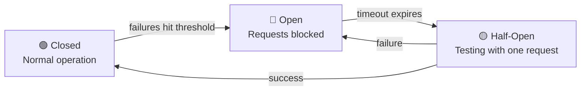

Your AI agent just hallucinated a function call, crashed mid-task, and left three downstream agents waiting on output that will never arrive. Sound familiar?

Agent errors aren't like traditional software bugs. They're probabilistic, context-dependent, and cascade in ways that are hard to predict. A single failed API call can poison an entire multi-agent pipeline. A hallucinated tool invocation can corrupt state that takes hours to untangle.

This guide covers the error handling patterns that separate toy demos from production-grade agent systems — from retry strategies and circuit breakers to self-healing architectures that recover without human intervention.

## Why Agent Errors Are Different

Traditional software fails predictably. Given the same input, the same bug produces the same crash. Agents break that contract in three fundamental ways:

### Non-Determinism Is the Default

The same prompt, same model, same temperature — different output. This means:

- **Errors aren't reproducible.** You can't reliably replay a failure to debug it.
- **Tests give false confidence.** Passing 100 times doesn't mean it won't fail on attempt 101.
- **Root cause analysis is harder.** "Why did it fail?" often has no single answer.

### Cascading Failures Propagate Silently

In a multi-agent pipeline, Agent A's slightly wrong output becomes Agent B's confidently wrong input. By the time Agent C acts on it, the error has compounded beyond recognition. Unlike a stack trace that points to line 47, agent cascades hide their origin.

### Partial Success Is the Norm

An agent might complete 80% of a task correctly and botch the last 20%. Unlike a function that returns a value or throws an exception, agents produce _gradient_ failures — outputs that are mostly right but subtly wrong.

## Common Failure Modes

Before you can handle errors, you need to know what breaks. Here's the taxonomy:

| Failure Mode               | Frequency | Severity   | Detection Difficulty |
| -------------------------- | --------- | ---------- | -------------------- |
| API timeouts / rate limits | High      | Low–Medium | Easy                 |
| Tool call failures         | Medium    | Medium     | Easy                 |
| Hallucinated actions       | Medium    | High       | Hard                 |
| Context window overflow    | Medium    | Medium     | Medium               |
| Model degradation          | Low       | High       | Very Hard            |
| State corruption           | Low       | Critical   | Hard                 |

**API timeouts and rate limits** are the most common and easiest to handle. Your LLM provider returns a 429 or 503, and you retry. Straightforward.

**Tool call failures** happen when an agent invokes a tool with bad arguments, the tool's API is down, or permissions have changed. These are detectable — the tool returns an error.

**Hallucinated actions** are the dangerous ones. The agent generates a plausible-looking but nonexistent function call, or passes arguments that look right but aren't. Your system tries to execute something that shouldn't exist.

**Context window overflow** occurs when accumulated conversation history, tool outputs, or injected context exceeds the model's limit. The agent starts dropping critical information silently.

**Model degradation** is the stealth killer. The model provider ships an update, and your agent's behavior subtly changes. No error code. No exception. Just worse outputs.

**State corruption** happens when an agent writes bad data to shared state — a database, a file, a message queue — and downstream agents consume it as truth.

## Error Handling Patterns

### 1. Retry with Exponential Backoff

The bread and butter. But agents need smarter retries than traditional services.

```python
import time
import random

def retry_with_backoff(fn, max_retries=3, base_delay=1.0):
    for attempt in range(max_retries):
        try:
            result = fn()
            # Validate the result isn't a soft failure
            if validate_agent_output(result):
                return result
            raise SoftFailureError(f"Output validation failed: {result}")
        except (RateLimitError, TimeoutError) as e:
            if attempt == max_retries - 1:
                raise
            delay = base_delay * (2 ** attempt) + random.uniform(0, 1)
            time.sleep(delay)
        except HallucinationError:
            # Don't retry hallucinations with the same prompt
            # Rephrase or add constraints instead
            fn = create_constrained_retry(fn, attempt)
    raise MaxRetriesExceeded()
```

Key insight: **don't blindly retry hallucinations.** If the agent hallucinated a tool call, sending the same prompt again often produces the same hallucination. Instead, rephrase the prompt, add explicit constraints, or switch to a more capable model.

### 2. Fallback Chains

When your primary approach fails, degrade gracefully through alternatives:

```python
FALLBACK_CHAIN = [
    {"model": "claude-opus", "temperature": 0.3},    # Primary: best quality
    {"model": "claude-sonnet", "temperature": 0.1},   # Fallback: faster, more constrained
    {"model": "claude-haiku", "temperature": 0.0},    # Last resort: fastest, most deterministic
    {"handler": "template_response"},                  # Emergency: static template
]

async def execute_with_fallbacks(task, chain=FALLBACK_CHAIN):
    errors = []
    for config in chain:
        try:
            if "handler" in config:
                return static_handlers[config["handler"]](task)
            result = await run_agent(task, **config)
            if validate_output(result):
                return result
            errors.append(f"Validation failed with {config['model']}")
        except Exception as e:
            errors.append(f"{config.get('model', 'handler')}: {e}")
    raise AllFallbacksExhausted(errors)
```

The pattern: start with your best model, fall back to faster/cheaper ones with tighter constraints, and have a static template as the absolute last resort. A mediocre response is almost always better than no response.

### 3. Circuit Breakers



Borrowed from microservices architecture, circuit breakers prevent a failing component from taking down the whole system:

```python
class AgentCircuitBreaker:
    def __init__(self, failure_threshold=5, reset_timeout=60):
        self.failure_count = 0
        self.failure_threshold = failure_threshold
        self.reset_timeout = reset_timeout
        self.state = "closed"  # closed = normal, open = blocking, half-open = testing
        self.last_failure_time = None

    async def call(self, fn):
        if self.state == "open":
            if time.time() - self.last_failure_time > self.reset_timeout:
                self.state = "half-open"
            else:
                raise CircuitOpenError("Circuit breaker is open")

        try:
            result = await fn()
            if self.state == "half-open":
                self.state = "closed"
                self.failure_count = 0
            return result
        except Exception as e:
            self.failure_count += 1
            self.last_failure_time = time.time()
            if self.failure_count >= self.failure_threshold:
                self.state = "open"
            raise
```

Use circuit breakers around:

- **External API calls** (LLM providers, tool APIs)
- **Agent-to-agent communication** (prevent one failing agent from overwhelming others)
- **Database writes** (stop corrupted state from spreading)

### 4. Graceful Degradation

Design your system so that when components fail, the overall pipeline still produces _something_ useful:

- **Agent can't research?** Use cached data from the last successful run.
- **Summarization agent down?** Pass raw content with a disclaimer.
- **Review agent unavailable?** Submit with an auto-generated confidence score instead.

The key principle: **define minimum viable output** for every agent in your pipeline. If the agent can't produce its ideal output, what's the smallest useful thing it can return?

## Designing Resilient Multi-Agent Pipelines

### Isolation

Never let agents share mutable state directly. Use message passing or a coordination layer (like [AgentCenter](https://agentcenter.cloud)) to mediate all inter-agent communication. This way:

- A failing agent can't corrupt another agent's state
- You can restart individual agents without affecting others
- Each agent's error boundary is self-contained

### Checkpointing

Save pipeline state at every stage boundary:

```yaml
pipeline:
  stages:
    - name: research
      checkpoint: true # Save output before proceeding
      retry_policy: 3x_backoff
    - name: draft
      checkpoint: true
      depends_on: research
      rollback_to: research # On failure, restart from research checkpoint
    - name: review
      checkpoint: true
      depends_on: draft
      rollback_to: draft
```

When a downstream stage fails, you can restart from the last checkpoint instead of rerunning the entire pipeline. This saves time, tokens, and money.

### Recovery Strategies

| Strategy                  | When to Use                                | Tradeoff                                   |
| ------------------------- | ------------------------------------------ | ------------------------------------------ |
| **Retry from checkpoint** | Transient failures (timeouts, rate limits) | Simple but may repeat the same error       |
| **Rollback and reroute**  | Agent-specific failures                    | More complex, avoids the same failure path |
| **Human escalation**      | Safety-critical or ambiguous failures      | Slowest but safest                         |
| **Skip and continue**     | Non-critical pipeline stages               | Fastest but may degrade quality            |

## Monitoring and Alerting on Agent Errors

You can't fix what you can't see. Here's what to track:

### Key Metrics

- **Error rate per agent** — sudden spikes signal model degradation or API issues
- **Retry frequency** — climbing retries mean something's degrading before it fully breaks
- **Fallback activation rate** — if you're hitting fallbacks regularly, your primary path needs attention
- **Output validation failure rate** — soft failures that don't throw exceptions
- **Latency percentiles (p50, p95, p99)** — agents slowing down often precedes failure
- **Token usage anomalies** — sudden jumps may indicate context window issues or prompt injection

### When to Page

| Condition                         | Action                  |
| --------------------------------- | ----------------------- |
| Error rate > 20% over 5 min       | Page on-call            |
| Circuit breaker opens             | Alert team channel      |
| All fallbacks exhausted           | Page + pause pipeline   |
| Output validation < 80% pass rate | Alert + flag for review |
| Latency p95 > 3x baseline         | Investigate             |

Don't alert on every individual failure — agents fail regularly. Alert on **patterns** that indicate systemic issues. For deeper coverage on observability, see our guide on [AI agent monitoring in production](/blogs/ai-agent-monitoring-best-practices-2026).

## Post-Mortem Practices for Agent Failures

Agent post-mortems need adaptations from traditional incident review:

### 1. Capture the Full Context

Save the complete prompt chain, tool call history, intermediate outputs, and model versions. Unlike traditional bugs, you often can't reproduce agent failures without the exact context.

### 2. Classify the Failure Type

Was it a **model failure** (hallucination, quality regression), an **infrastructure failure** (timeout, rate limit), a **design failure** (bad prompt, missing guardrails), or a **data failure** (corrupt input, stale context)?

### 3. Ask "What Would Have Caught This?"

For every post-mortem, identify:

- What validation would have caught this before it reached production?
- What monitoring would have detected this sooner?
- What fallback would have prevented user impact?

### 4. Update Your Test Suite

Add the failure scenario to your evaluation suite. This is how your test coverage grows organically from real incidents. Our [agent management guide](/blogs/complete-guide-ai-agent-management-2026) covers integrating these tests into your pipeline.

## Building Self-Healing Agents

The ultimate goal: agents that detect and recover from their own failures without human intervention.

### Auto-Recovery Patterns

```python
class SelfHealingAgent:
    def __init__(self, agent, health_check_interval=30):
        self.agent = agent
        self.health_check_interval = health_check_interval
        self.state_snapshots = []

    async def run_with_healing(self, task):
        self.state_snapshots.append(self.agent.get_state())

        try:
            result = await self.agent.execute(task)
            if not self.validate(result):
                return await self.self_correct(task, result)
            return result
        except RecoverableError as e:
            return await self.recover(task, e)
        except CriticalError as e:
            await self.escalate(task, e)
            raise

    async def self_correct(self, task, bad_result):
        """Ask the agent to review and fix its own output."""
        correction_prompt = f"""
        Your previous output had issues:
        {self.explain_validation_failures(bad_result)}

        Original task: {task}
        Your output: {bad_result}

        Please fix the issues and try again.
        """
        return await self.agent.execute(correction_prompt)

    async def recover(self, task, error):
        """Restore last good state and retry."""
        if self.state_snapshots:
            self.agent.restore_state(self.state_snapshots[-1])
        return await self.agent.execute(task)
```

### State Management for Recovery

Every agent should support:

1. **State serialization** — export current state to a storable format
2. **State restoration** — import a previous state snapshot
3. **Idempotent operations** — re-running a task from a checkpoint produces the same result

This is where a management platform like [AgentCenter](https://agentcenter.cloud) becomes essential — it tracks agent state, heartbeats, and task progress so recovery is possible even when an agent crashes completely. See our [deployment guide](/blogs/ai-agent-control-plane-managing-agents-at-scale) for more on production infrastructure.

## FAQ

### How often should agents retry failed operations?

3 retries with exponential backoff is a reasonable default for transient failures (timeouts, rate limits). For hallucinations or quality failures, limit to 1-2 retries with modified prompts. More retries waste tokens without improving outcomes.

### Should I retry hallucinations?

Not with the same prompt. If an agent hallucinated, the prompt likely has an ambiguity that the model exploits. Add constraints, rephrase, or switch models before retrying. Blind retries may produce the same hallucination.

### How do I detect silent agent failures?

Output validation is your primary defense. Define schemas, assertions, and quality checks for every agent's output. Complement with monitoring: track token usage, latency, and output length distributions. Sudden changes in these metrics often indicate silent failures.

### What's the difference between a circuit breaker and a rate limiter?

A rate limiter controls how fast you send requests. A circuit breaker stops sending requests entirely when a downstream service is failing. Use both: rate limiters for steady-state flow control, circuit breakers for failure protection.

### How do I handle errors in multi-agent pipelines?

Isolate agents with message passing, checkpoint at stage boundaries, and define rollback strategies for each stage. Never let a failing agent block the entire pipeline indefinitely — use timeouts and fallback paths.

### When should I escalate to a human instead of auto-recovering?

Escalate when: (1) all automated fallbacks are exhausted, (2) the failure involves safety-critical operations (financial transactions, data deletion), (3) the agent detects ambiguity it can't resolve, or (4) the same failure has occurred more than 3 times in a short window.

---

*Building resilient agent pipelines is an ongoing practice, not a one-time setup. Start with retries and validation, add circuit breakers as you scale, and invest in self-healing as your agent fleet grows. The goal isn't zero failures — it's zero *unrecoverable* failures.*
