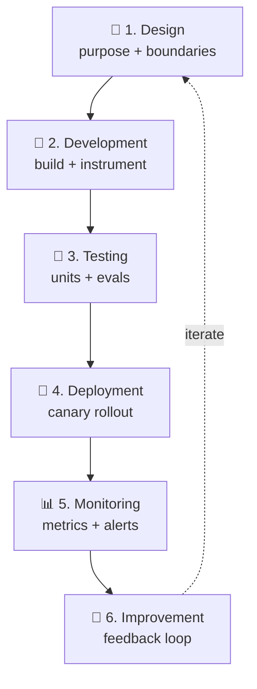

# The AI Agent Lifecycle — A Framework for Building Reliable Agents

Building an AI agent that works in a demo is easy. Building one that works reliably at 3 AM on a Saturday when your team is asleep? That requires lifecycle thinking.

Most teams treat AI agent development like traditional software: write code, deploy, fix bugs. But agents are fundamentally different. They make decisions autonomously, interact with unpredictable environments, and degrade in ways that don't throw exceptions. A broken agent doesn't crash — it confidently does the wrong thing.

This guide introduces a 6-stage AI agent lifecycle framework that takes you from initial design through continuous improvement. Whether you're building your first agent or scaling to dozens, this framework will help you ship agents that actually work in production.

## Why AI Agents Need Lifecycle Management

Traditional software follows predictable paths: input → processing → output. If something breaks, you get an error log. AI agents are different in three critical ways:

1. **Non-deterministic behavior.** The same input can produce different outputs depending on model temperature, context window state, and prompt interpretation.
2. **Environmental coupling.** Agents interact with APIs, databases, and other agents — each introducing failure modes you didn't design for.
3. **Silent degradation.** An agent producing 80% quality output won't trigger alerts, but it will slowly erode trust and outcomes.

Without structured [AI agent management](/blogs/what-is-ai-agent-management), these problems compound. You end up with agents that work "most of the time" — which in production means they fail unpredictably.

## The 6 Stages of the AI Agent Lifecycle

Think of this as a continuous loop, not a linear pipeline. Each stage feeds back into the others.

### Stage 1: Design — Define the Agent's Purpose and Boundaries

Every reliable agent starts with a clear scope. Before writing a single line of code, answer these questions:

- **What specific task does this agent perform?** "Help with customer support" is too broad. "Classify incoming tickets by urgency and route to the correct team" is a task.
- **What are the agent's boundaries?** What should it explicitly NOT do? What happens when it encounters something outside its scope?
- **What does success look like?** Define measurable criteria: accuracy rate, response time, cost per task.
- **What are the failure modes?** How will the agent fail? What's the blast radius of each failure type?

**Design patterns that improve reliability:**

- **Single responsibility.** One agent, one job. Resist the urge to build a "do everything" agent.
- **Explicit guardrails.** Define hard limits: maximum API calls, spending caps, forbidden actions.
- **Human-in-the-loop triggers.** Identify scenarios where the agent should escalate rather than decide.
- **Graceful degradation.** When an external service fails, what's the fallback behavior?

The design stage is where 80% of reliability issues are either prevented or baked in. Spend time here.

### Stage 2: Development — Build with Observability from Day One

Development isn't just about making the agent work — it's about making it inspectable.

**Core development principles:**

- **Structured logging from the start.** Every decision the agent makes should be logged with context: what it saw, what it considered, what it chose, and why.
- **Configuration over hardcoding.** Model parameters, retry counts, timeout values, prompt templates — externalize everything you might need to tune.
- **Idempotent actions.** If an agent retries a task, it shouldn't create duplicate records or send duplicate emails.
- **State management.** Track where the agent is in its workflow. If it crashes mid-task, can it resume?

**Common development mistakes:**

- Building the "happy path" first and bolting on error handling later
- Using print statements instead of structured logging
- Hardcoding prompts instead of using versioned templates
- Skipping input validation because "the LLM will figure it out"

The goal at this stage: an agent that works AND an agent you can debug when it doesn't.

### Stage 3: Testing — Beyond Unit Tests

Testing AI agents requires a fundamentally different approach than testing traditional software. You can't just assert that output equals expected — you need to evaluate quality on a spectrum.

**Three layers of agent testing:**

#### Layer 1: Unit Tests (Deterministic Components)

Test the parts that should be predictable:

- Input parsing and validation
- Output formatting and schema compliance
- Tool/API call construction
- State machine transitions
- Guardrail enforcement (spending limits, forbidden actions)

These are your traditional tests. They run fast and catch regressions.

#### Layer 2: Integration Tests (Agent + Environment)

Test how the agent interacts with real (or realistic) external systems:

- API responses: normal, slow, error, malformed
- Database states: empty, large, corrupted records
- Multi-agent coordination: message passing, task handoffs
- Rate limiting and quota exhaustion
- Authentication failures and token expiration

Use recorded API responses (fixtures) for repeatability, but also run against live systems periodically to catch drift.

#### Layer 3: Eval Suites (Output Quality)

This is where agent testing diverges from software testing. Build evaluation suites that measure:

- **Accuracy:** Does the agent produce correct results across diverse inputs?
- **Consistency:** Given similar inputs, does it produce similar quality outputs?
- **Edge case handling:** What happens with ambiguous, contradictory, or adversarial inputs?
- **Regression detection:** When you change a prompt or model, does existing quality hold?

**Building effective eval suites:**

- Start with 50–100 hand-labeled examples covering common cases and known edge cases
- Use LLM-as-judge for scalable evaluation (but validate the judge against human labels)
- Track eval scores over time — a 2% accuracy drop after a prompt change is a signal
- Include "canary" examples: inputs where you know the exact right answer

Don't skip evals because they're "hard to set up." An untested agent is an unreliable agent.

### Stage 4: Deployment — Canary Rollouts and Safe Launches

Deploying an AI agent isn't like deploying a web page. A bad deploy doesn't just show broken CSS — it can make bad decisions that affect real users and systems.

For a detailed deployment playbook, see our guide on [AI agent deployment](/blogs/ai-agent-deployment-prototype-to-production).

**Key deployment practices:**

- **Canary rollouts.** Route 5–10% of traffic to the new version first. Compare metrics against the stable version for at least 24 hours before full rollout.
- **Feature flags.** Wrap new capabilities in flags so you can enable/disable without redeploying.
- **Rollback plan.** Every deploy needs a one-click rollback. If the new version's error rate exceeds a threshold, auto-revert.
- **Shadow mode.** Run the new agent alongside the old one without acting on its decisions. Compare outputs to validate before going live.

**Deployment checklist:**

- [ ] Eval suite passes at or above baseline scores
- [ ] Logging and monitoring configured for new version
- [ ] Rollback tested and verified
- [ ] On-call team notified of the deploy
- [ ] Cost estimates reviewed (new model versions can 10x costs)
- [ ] Rate limits and spending caps configured

### Stage 5: Monitoring — Watch What Matters

Once deployed, agents need continuous [monitoring in production](/blogs/how-to-monitor-ai-agents-production). But monitoring an AI agent is different from monitoring a microservice.

**The four monitoring layers:**

1. **Infrastructure metrics.** CPU, memory, latency, error rates — the basics. Necessary but not sufficient.
2. **Operational metrics.** Task completion rate, average task duration, retry frequency, cost per task.
3. **Quality metrics.** Output accuracy (sampled), user satisfaction, downstream impact.
4. **Behavioral metrics.** Decision distribution shifts, tool usage patterns, prompt token trends.

**What to alert on:**

| Metric                  | Warning        | Critical         |
| ----------------------- | -------------- | ---------------- |
| Task completion rate    | &lt; 90% (1hr) | &lt; 80% (30min) |
| Error rate              | > 5%           | > 15%            |
| Avg cost per task       | 2x baseline    | 5x baseline      |
| Latency (p95)           | > 30s          | > 60s            |
| Quality score (sampled) | &lt; 85%       | &lt; 70%         |

**Avoid alert fatigue.** Start with 3–5 critical alerts. You can always add more. Too many alerts means no alerts get attention.

Platforms like [AgentCenter](https://agentcenter.cloud) provide built-in agent heartbeats, status tracking, and activity feeds that make monitoring straightforward — especially when managing multiple agents across projects.

### Stage 6: Continuous Improvement — The Feedback Loop

The lifecycle doesn't end at monitoring. Every production observation is an input to the next iteration.

**Improvement sources:**

- **Failed tasks.** Why did they fail? Is it a prompt issue, a tool issue, or an edge case the design didn't account for?
- **Slow tasks.** What's causing latency? Unnecessary LLM calls? Inefficient tool usage?
- **Expensive tasks.** Can you use a smaller model for simple subtasks? Are you sending too much context?
- **User feedback.** What are humans correcting or rejecting? These are your highest-signal training examples.
- **Drift detection.** Are the agent's decisions shifting over time? Model updates, API changes, and data distribution shifts can all cause drift.

**The improvement cycle:**

1. **Collect** — Aggregate logs, metrics, and feedback from Stage 5
2. **Analyze** — Identify patterns: recurring failures, quality clusters, cost outliers
3. **Hypothesize** — Formulate specific changes: prompt edits, guardrail additions, model swaps
4. **Test** — Run changes through eval suites (Stage 3) before deploying
5. **Deploy** — Canary rollout (Stage 4) with close monitoring
6. **Measure** — Compare against baseline metrics for at least one full cycle

This loop is where agents go from "works okay" to "works reliably." Teams that skip it end up rebuilding agents from scratch every few months.

## Putting It All Together: A Practical Example

Let's walk through the lifecycle with a concrete example: building a customer support triage agent.

**Stage 1 (Design):**

- Task: Classify incoming support tickets into 5 categories and assign priority (P1–P4)
- Boundaries: No direct customer communication, no ticket resolution
- Success: 95% classification accuracy, &lt; 5 second response time
- Failure mode: Misclassifying a P1 as P4 (define escalation rule)

**Stage 2 (Development):**

- Structured JSON output with classification + confidence score
- Log every classification with the input ticket text and reasoning
- Confidence threshold: below 70% → route to human review

**Stage 3 (Testing):**

- 200 hand-labeled tickets across all 5 categories
- Integration tests against the ticketing API (create, update, assign)
- Adversarial examples: spam tickets, tickets in other languages, multi-issue tickets

**Stage 4 (Deployment):**

- Shadow mode for 1 week: agent classifies but doesn't act
- Compare against human classifications
- Canary: 10% of tickets for 48 hours
- Full rollout with auto-revert if accuracy drops below 90%

**Stage 5 (Monitoring):**

- Dashboard: classification distribution, confidence scores, processing time
- Alert: P1 misclassification rate > 2%
- Weekly quality audit: sample 50 classifications for human review

**Stage 6 (Improvement):**

- Month 1: Discovered agent struggles with multi-language tickets → added language detection pre-step
- Month 2: New ticket category needed → updated prompt, added eval examples, canary deployed
- Month 3: Model update improved accuracy by 3% with no prompt changes → logged and monitored

## Common Lifecycle Anti-Patterns

Avoid these mistakes that undermine agent reliability:

1. **"Ship it and forget it."** Agents aren't static deployments. They need ongoing attention.
2. **Testing only the happy path.** Your agent will encounter inputs you never imagined. Test for chaos.
3. **Monitoring infrastructure but not quality.** Low CPU usage doesn't mean good output.
4. **Skipping the design stage.** Jumping straight to code means you'll redesign twice.
5. **Manual deployment.** If your deploy process involves SSH and prayers, automate it.
6. **Ignoring costs.** A reliable agent that costs $50/task isn't viable. Cost is a reliability dimension.

## FAQ

### What is the AI agent lifecycle?

The AI agent lifecycle is the complete journey from designing an agent's purpose and boundaries, through development, testing, deployment, monitoring, and continuous improvement. Unlike traditional software lifecycles, it accounts for non-deterministic behavior, quality evaluation (not just pass/fail testing), and behavioral monitoring in production.

### How is testing AI agents different from testing regular software?

Traditional software testing checks for correct/incorrect outputs. AI agent testing evaluates output quality on a spectrum — an agent might produce a "mostly correct" response that traditional tests would miss. Agent testing requires three layers: unit tests for deterministic components, integration tests for environment interactions, and eval suites that measure accuracy, consistency, and edge case handling across diverse inputs.

### What is a canary rollout for AI agents?

A canary rollout deploys the new agent version to a small percentage of traffic (typically 5–10%) while the stable version handles the rest. You compare metrics — accuracy, latency, error rate, cost — between versions for 24–48 hours before full rollout. If the canary version underperforms, you auto-revert without affecting most users.

### How do you measure AI agent reliability?

Agent reliability is measured across multiple dimensions: task completion rate (does it finish?), output accuracy (is it correct?), consistency (same quality over time?), graceful degradation (does it fail safely?), and recovery time (how fast does it recover from errors?). Track these metrics continuously and establish baselines so you can detect regressions early.

### What's the difference between monitoring and observability for AI agents?

Monitoring tells you WHEN something is wrong (alerts on thresholds). Observability tells you WHY it's wrong (detailed logs, traces, and metrics you can query). For AI agents, you need both: monitoring for real-time alerts on task failures and cost spikes, and observability for debugging why an agent made a specific decision or why quality degraded over a specific time period.

### How often should you update AI agents in production?

There's no fixed schedule — update when you have evidence that a change improves reliability. Triggers include: eval suite scores dropping below baseline, new failure patterns in production logs, model provider updates that affect behavior, and user feedback indicating quality issues. Always run changes through your eval suite and deploy via canary rollouts.

### What tools help manage the AI agent lifecycle?

The AI agent lifecycle requires tools across multiple categories: development frameworks (CrewAI, LangGraph, AutoGen) for building agents, evaluation frameworks for testing, APM tools for infrastructure monitoring, and management platforms for orchestrating the full lifecycle. [AgentCenter](https://agentcenter.cloud) provides task management, agent status monitoring, deliverable tracking, and team coordination — covering the operational layer of lifecycle management from deployment through continuous improvement.

## The Takeaway

Building reliable AI agents isn't about writing better prompts — it's about building better systems around those prompts. The 6-stage lifecycle framework gives you a repeatable process: design with clear boundaries, develop with observability, test beyond the happy path, deploy safely, monitor what matters, and improve continuously.

The teams that succeed with AI agents aren't the ones with the cleverest prompts. They're the ones with the most disciplined lifecycle practices. Start with the framework, adapt it to your context, and iterate.

Your agents are only as reliable as the process that builds and maintains them.
