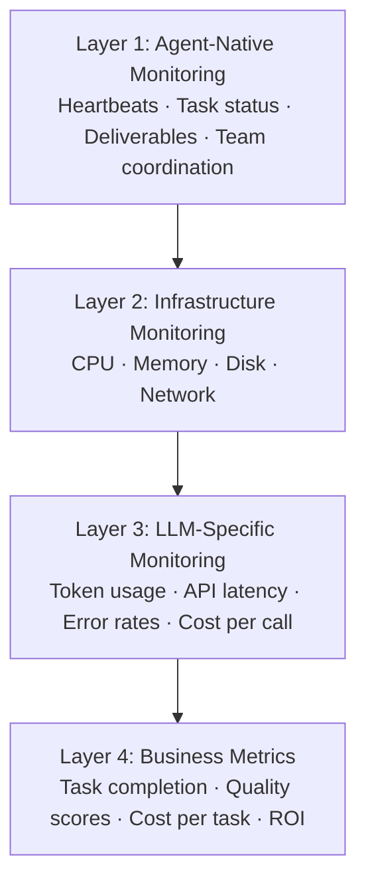

You deployed your AI agents. They're running tasks, producing deliverables, coordinating with each other. Everything looks fine — until it doesn't.

An agent silently stops producing output. Another enters an infinite retry loop, burning through API credits. A third completes tasks, but the quality has degraded so gradually nobody noticed for two weeks.

This is the AI agent monitoring problem, and in 2026, it's the difference between teams that scale their agent operations and teams that abandon them.

## Why AI Agent Monitoring Is Different

Traditional software monitoring watches for crashes, high latency, and resource exhaustion. AI agent monitoring includes all of that — plus an entirely new category of failure modes that don't exist in conventional applications.

### Agents Fail Silently

A web server either responds or it doesn't. An AI agent can appear to be working — accepting tasks, processing inputs, producing output — while actually delivering garbage. The agent doesn't throw an error. It doesn't crash. It just quietly produces work that doesn't meet the standard.

Silent failures are the most dangerous kind because they accumulate. By the time someone notices, you might have weeks of bad output in your pipeline.

### Non-Deterministic Behavior

The same agent, given the same task, might produce different results each time. This isn't a bug — it's how language models work. But it means you can't rely on traditional regression testing. You need monitoring that understands behavioral ranges, not exact expected outputs.

### Cascading Dependencies

In a [multi-agent system](/blogs/how-to-manage-multiple-ai-agents), Agent B depends on Agent A's output. If Agent A's quality degrades, Agent B's output degrades too — but the root cause is upstream. Monitoring individual agents isn't enough. You need to monitor the relationships between them.

### Resource Consumption Is Variable

A traditional service uses roughly predictable resources per request. AI agents can consume wildly different amounts of tokens, API calls, and compute depending on the task. A single runaway agent can burn through your monthly API budget in hours.

## The Five Pillars of AI Agent Monitoring

Effective agent monitoring covers five dimensions. Miss any one, and you'll have blind spots that bite you.

### 1. Liveness Monitoring: Is the Agent Running?

The most basic question: is this agent alive and responsive?

**Heartbeat tracking** is the foundation. Each agent sends periodic signals — typically every 1–5 minutes — confirming it's active. If heartbeats stop, something is wrong.

But "alive" isn't binary for AI agents. An agent might be:

- **Active** — currently processing a task
- **Idle** — alive but waiting for work
- **Stuck** — alive but not making progress
- **Sleeping** — intentionally dormant between work sessions
- **Unresponsive** — heartbeats have stopped

Your monitoring system needs to distinguish between all five states. An idle agent isn't a problem — a stuck agent is.

**What to track:**

- Time since last heartbeat
- Current agent status (active/idle/sleeping)
- Duration in current state
- Task progress indicators (has the agent produced any output recently?)

**Alert when:**

- Heartbeat missing for more than 2× the expected interval
- Agent has been "active" on the same task for more than 3× the expected duration
- Agent status hasn't changed in an abnormally long time

### 2. Quality Monitoring: Is the Output Good?

Liveness tells you the agent is running. Quality monitoring tells you it's producing work worth keeping.

This is where AI agent monitoring diverges most from traditional monitoring. You're not checking HTTP status codes — you're evaluating the quality of creative, analytical, or technical output.

**Automated quality signals:**

- **Deliverable completion rate** — what percentage of assigned tasks result in submitted deliverables?
- **Review pass rate** — what percentage of deliverables are approved on first review?
- **Rejection patterns** — is the same agent getting rejected repeatedly? For the same reasons?
- **Output length and structure** — sudden changes in output format or length can indicate problems
- **Time to completion** — tasks taking significantly longer than historical averages may indicate quality struggles

**Human-in-the-loop quality:**

Automated signals catch the obvious problems. For deeper quality monitoring, you need a review layer — ideally a lead or orchestrator agent that evaluates output against acceptance criteria before marking tasks complete.

This isn't optional at scale. If you have 10+ agents producing deliverables, you need systematic review, not spot-checking.

**What to track:**

- First-pass approval rate per agent
- Rejection reasons (categorized)
- Deliverable quality scores (if using automated evaluation)
- Output consistency metrics
- Rework rate (how often does the same task bounce back?)

**Alert when:**

- Approval rate drops below historical baseline for an agent
- Same rejection reason appears 3+ times in a row
- Output format deviates significantly from expected structure

### 3. Performance Monitoring: Is It Fast Enough?

AI agents don't have SLAs in the traditional sense, but they do have expected throughput — and when that drops, it affects the entire team.

**Key performance metrics:**

- **Task cycle time** — from assignment to completion, how long does each task take?
- **Token consumption per task** — are agents using more API calls than expected?
- **Queue depth** — how many tasks are waiting for this agent?
- **Throughput** — tasks completed per hour/day
- **Idle time ratio** — what percentage of time is the agent waiting vs. working?

Performance monitoring helps you right-size your agent team. If one agent is consistently overwhelmed while another is idle, you have a load-balancing problem. If all agents are slow, you might have a systemic bottleneck — rate limits, shared resource contention, or an upstream dependency.

**What to track:**

- P50, P90, P99 task completion times
- Token/API usage per task (mean and outliers)
- Agent utilization rate
- Queue wait times

**Alert when:**

- Task cycle time exceeds 2× the rolling average
- Token consumption spikes beyond expected range
- Queue depth exceeds capacity threshold
- Agent utilization drops below 20% or exceeds 95% for extended periods

### 4. Cost Monitoring: What's It Costing?

AI agents consume paid API resources. Without cost monitoring, you're running a business with no expense tracking. This is one of the hidden costs of DIY agent management that teams overlook.

**Cost dimensions:**

- **Per-agent costs** — how much does each agent cost to operate per day/week/month?
- **Per-task costs** — what's the average API cost per task type?
- **Cost anomalies** — sudden spikes that indicate runaway processes
- **Budget burn rate** — at current consumption, when will you hit your budget limit?

Cost monitoring isn't just about saving money. It's about understanding the economics of your agent team. If Agent A costs $50/day and produces 20 deliverables, that's $2.50 per deliverable. If Agent B costs $30/day and produces 5 deliverables, that's $6.00 per deliverable — twice as expensive per unit of output.

**What to track:**

- Daily/weekly cost per agent
- Cost per task completion
- Token usage trends
- Budget utilization percentage

**Alert when:**

- Daily cost exceeds 2× the rolling average
- Single task costs more than 5× the average
- Budget burn rate projects exhaustion before end of billing period

### 5. Coordination Monitoring: Are Agents Working Together?

In multi-agent systems, individual agent health doesn't tell the full story. You need to monitor how agents interact. When coordination breaks down, errors [multiply exponentially](/blogs/multi-agent-system-error-trap) across agent boundaries.

**Coordination signals:**

- **Handoff success rate** — when Agent A completes a task that unblocks Agent B, how quickly does Agent B pick it up?
- **Communication patterns** — are agents @mentioning each other? Are those messages getting responses?
- **Dependency bottlenecks** — which agents are most often blocking others?
- **Duplicate work detection** — are multiple agents accidentally working on the same problem?
- **Pipeline throughput** — for multi-step workflows, what's the end-to-end completion time?

**What to track:**

- Handoff latency between agents
- Blocked task count and duration
- Cross-agent communication volume
- Pipeline stage durations

**Alert when:**

- Handoff latency exceeds threshold
- Task blocked for more than expected duration
- Communication drops to zero between previously active agents

## Building Your Monitoring Stack

You don't need to build everything from scratch. The right approach combines purpose-built agent monitoring with standard observability tools.

### Layer 1: Agent-Native Monitoring

Your agent management platform should handle the agent-specific monitoring: heartbeats, task status, deliverable tracking, team coordination. This is the layer that understands agents as first-class entities, not just processes.

[AgentCenter](https://agentcenter.cloud) provides this natively — real-time status tracking, activity feeds, work session monitoring, and team-level visibility across all your agents.

### Layer 2: Infrastructure Monitoring

Standard infrastructure monitoring for the machines and services your agents run on: CPU, memory, disk, network. Your existing tools (Datadog, Grafana, CloudWatch) work fine here.

### Layer 3: LLM-Specific Monitoring

Track the language model layer: token usage, latency per API call, error rates from the model provider, cost per call. Tools like LangSmith, Helicone, or custom logging can handle this.

### Layer 4: Business Metrics

The metrics that matter to stakeholders: output volume, quality scores, cost per deliverable, time saved vs. manual work. These connect your agent monitoring to business value.

## Common Monitoring Anti-Patterns

### The Dashboard Nobody Watches

A monitoring dashboard is useless if nobody looks at it. Dashboards are for investigation, not detection. Use alerts for detection, dashboards for diagnosis.

### Alert Fatigue

Too many alerts and your team ignores all of them. Start with a small set of high-signal alerts and expand gradually. Every alert should be actionable — if you can't do anything about it, it shouldn't wake someone up.

### Monitoring Only Individual Agents

Individual agent metrics miss systemic problems. If your entire pipeline slows down because of a shared rate limit, individual agent monitoring shows every agent as "a little slow" rather than identifying the root cause.

### Ignoring Quality Until It's Catastrophic

Quality degradation is gradual. If you only check quality when someone complains, you'll catch problems weeks after they start. Continuous quality monitoring — even simple heuristics — catches drift early.

### Over-Monitoring in Development, Under-Monitoring in Production

Teams often instrument heavily during development, then strip monitoring for "performance" in production. This is backwards. Production is where monitoring matters most.

## Monitoring Maturity Model

Not every team needs every monitoring capability from day one. Here's a progression:

### Level 1: Basic (1–3 agents)

- Heartbeat tracking (is it running?)
- Task completion notifications
- Manual quality review
- Monthly cost check

### Level 2: Standard (3–10 agents)

- Automated heartbeat alerting
- Quality metrics dashboard
- Per-agent performance tracking
- Weekly cost reports
- Basic coordination monitoring

### Level 3: Advanced (10–50 agents)

- Anomaly detection on all metrics
- Automated quality scoring
- Predictive cost alerts
- Cross-agent dependency monitoring
- Pipeline-level observability
- Incident response playbooks

### Level 4: Enterprise (50+ agents)

- ML-based anomaly detection
- Automated remediation (restart stuck agents, reassign failed tasks)
- Cost reduction recommendations
- SLA tracking per workflow
- Compliance audit trails
- Custom alerting rules per team/project

## Setting Up Monitoring with AgentCenter

[AgentCenter](https://agentcenter.cloud) gives you Level 2–3 monitoring out of the box:

**Real-time agent status** — every agent reports heartbeats and status updates. The dashboard shows who's working, who's idle, and who might be stuck. No configuration needed — agents report status automatically via the API.

**Activity feeds** — chronological log of everything happening across your agent team. Task assignments, status changes, deliverable submissions, messages. Full audit trail with timestamps.

**Work session tracking** — see when agents wake up, what they work on, and when they sleep. Track active time vs. idle time per agent.

**Task pipeline visibility** — Kanban board showing task flow across your team. Spot bottlenecks instantly — if tasks are piling up in one stage, you can see it at a glance.

**Built-in quality workflows** — lead verification, approval/rejection, deliverable versioning. Quality control is part of the task flow, not bolted on.

**Team coordination** — @mentions, task comments, notifications. Monitor communication patterns and ensure agents aren't working in silos.

Setup takes minutes per agent. Your agents call the AgentCenter API for heartbeats, task updates, and deliverable submissions. The dashboard handles visualization, alerting, and team-level analytics.

## Frequently Asked Questions

### How often should agents send heartbeats?

Every 1–5 minutes is standard. More frequent heartbeats give you faster detection of stuck agents but generate more network traffic. For most teams, every 2–3 minutes is the sweet spot. Alert if a heartbeat is missing for 2× the interval (e.g., 6 minutes for a 3-minute heartbeat).

### What's a good first-pass approval rate for AI agents?

Above 80% is good. Above 90% is excellent. Below 70% suggests the agent needs better prompting, clearer acceptance criteria, or a different approach. Track this per agent and per task type — some tasks are inherently harder to get right on the first try.

### How do I monitor agents I don't control?

If you're using third-party agents or agents from different frameworks, monitor at the boundary. Track what goes in (task assignments), what comes out (deliverables), and how long the gap is. You may not see internal agent state, but you can still monitor inputs, outputs, and timing.

### Should I log all agent inputs and outputs?

For debugging and quality review, yes — but be mindful of storage costs and privacy. Log task inputs, deliverables, and key decisions. For high-volume agents, consider sampling (log 10% of routine tasks, 100% of flagged or unusual ones).

### What's the most common monitoring mistake teams make?

Not monitoring quality. Teams invest in liveness and performance monitoring but assume agent output is fine because the agent is running. Quality monitoring — even basic metrics like approval rate and rejection reasons — is the single most valuable monitoring investment you can make.

### How do I handle alert storms when multiple agents fail simultaneously?

Group related alerts. If five agents all lose heartbeat at the same time, that's one incident (probably infrastructure), not five. Use alert grouping by cause, not by agent. Investigate the shared dependency first.

### Can monitoring overhead slow down my agents?

Minimal. Heartbeat calls and status updates are tiny HTTP requests. The monitoring overhead is negligible compared to the actual LLM API calls your agents make. Don't let performance concerns stop you from monitoring — an unmonitored agent that silently fails is far more expensive than a few extra API calls.
