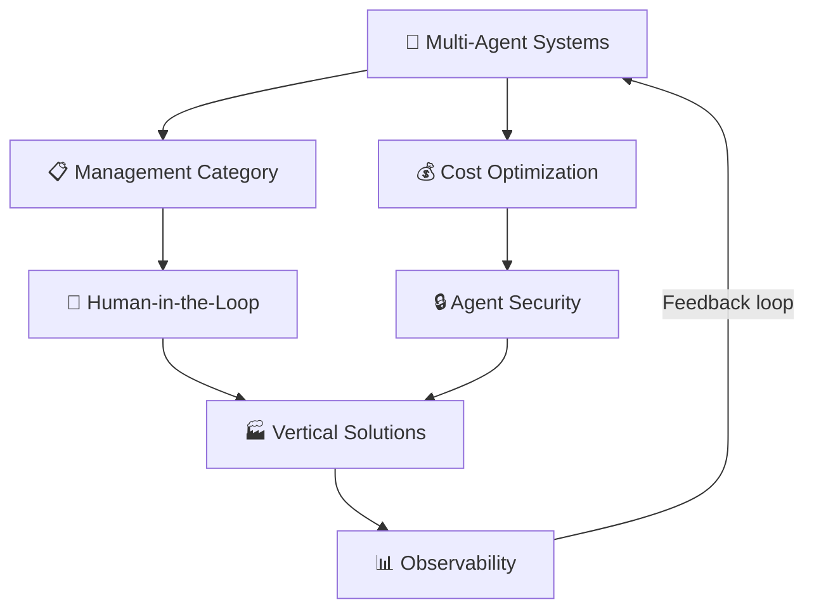

2025 was the year AI agents proved they could work. 2026 is the year they'll prove they can scale.

The shift from single-purpose chatbots to autonomous, multi-agent systems is accelerating faster than most teams anticipated. Enterprises that treated agents as experiments last year are now running them in production — managing customer support, writing content, deploying code, and coordinating complex workflows with minimal human oversight.

But scaling brings new problems. Coordination breaks down. Costs spiral. Security gaps widen. The tools and patterns that worked for one or two agents collapse under the weight of ten, twenty, or fifty.

Here are seven trends defining how the AI agent landscape will evolve in 2026 — and what they mean for teams building and managing agent systems today.

---

## 1. Multi-Agent Systems Go Mainstream

The era of the single, do-everything agent is ending. In its place: teams of specialized agents that divide work, coordinate handoffs, and operate in parallel.

This shift mirrors how human organizations work. You don't hire one person to do marketing, engineering, support, and finance. You build a team. The same logic now applies to AI agents.

In 2026, multi-agent architectures are moving from research papers to production deployments. Content agencies run 6-8 agents across writing, editing, social media, and research. SaaS companies deploy dedicated agents for documentation, competitive analysis, and customer onboarding. E-commerce brands coordinate product copywriters, email specialists, and campaign planners — all as agents.

**What's driving it:** Specialized agents consistently outperform generalist ones. A writing agent fine-tuned on your brand voice produces better copy than a general-purpose agent juggling ten tasks. And parallel execution means work that took days now finishes in hours.

**What it means for teams:** If you're still running a single agent, you're leaving performance on the table. The challenge isn't building more agents — it's coordinating them without drowning in management overhead.

---

## 2. Agent Management Becomes Its Own Category

Here's the awkward truth about multi-agent systems: building agents is the easy part. Managing them is where teams struggle.

When you have two agents, you can track them in your head. When you have ten, you need a system. By twenty, you need a dedicated management layer — something purpose-built for assigning tasks, monitoring status, reviewing output, and coordinating workflows across autonomous agents.

2026 is the year "agent management" solidifies as a distinct software category, separate from agent frameworks (CrewAI, LangGraph, AutoGen) and observability tools (LangSmith, Langfuse). Frameworks help you build agents. Observability tools help you debug them. Management platforms help you run them as a team.

**The management gap:** Most teams cobble together Slack channels, spreadsheets, and custom scripts to coordinate their agents. It works at small scale. It falls apart fast. The market is responding with dedicated tools that treat agents as team members — with task assignment, inbox workflows, deliverable review, and real-time status dashboards.

**What it means for teams:** If you're spending more time coordinating agents than the agents spend working, you have a management problem, not an agent problem. Tools like [AgentCenter](https://agentcenter.cloud) exist specifically to close this gap — giving you a mission control dashboard for your entire agent fleet.

---

## 3. The Cost Optimization Imperative

AI agent costs are becoming a boardroom conversation. Running a fleet of agents against frontier models like Claude or GPT-4 isn't cheap — and costs scale linearly (or worse) with agent count.

A single agent making 50 API calls per day might cost $3-5. Multiply that by 20 agents running around the clock, and you're looking at $2,000-3,000/month in LLM spend alone. Add in compute, storage, and the engineering time to maintain the system, and costs can spiral quickly.

2026 is pushing teams to get serious about cost optimization:

- **Model routing** is becoming standard — using cheaper models (Claude Haiku, GPT-4o Mini) for routine tasks and reserving frontier models for complex reasoning. Teams report 30-50% cost reductions from routing alone.
- **Semantic caching** prevents agents from making identical API calls, saving 10-25% on redundant requests.
- **Context window management** — trimming unnecessary tokens from prompts — cuts another 15-30%.
- **Prompt engineering** for efficiency (fewer tokens, same quality) is now a dedicated discipline.

**What it means for teams:** The teams that win in 2026 aren't the ones with the most agents — they're the ones with the most efficient agents. Cost monitoring dashboards and per-agent spend tracking are becoming table stakes for any serious deployment.

---

## 4. Human-in-the-Loop Becomes Non-Negotiable

The "fully autonomous" dream is giving way to a more practical reality: humans stay in the loop, but at the right points.

Early AI agent enthusiasm imagined systems that ran end-to-end without human intervention. Production experience has tempered that vision. Agents hallucinate. They misinterpret ambiguous instructions. They occasionally produce outputs that are technically correct but strategically wrong.

2026's winning pattern: **autonomy for execution, human oversight for decisions.** Agents do the heavy lifting — research, drafting, analysis, routine tasks — while humans review, approve, and redirect at key checkpoints.

This isn't a limitation. It's a design principle. The most productive agent teams operate on a review-based workflow:

1. Humans define tasks with clear acceptance criteria
2. Agents execute and submit deliverables
3. Humans review, approve, or send back with feedback
4. Agents iterate based on that feedback

**What's enabling it:** Management platforms with built-in review queues, deliverable versioning, and approval workflows. The infrastructure for human-in-the-loop used to require custom engineering. Now it's a product feature.

**What it means for teams:** Design your agent workflows with review gates from day one. The question isn't whether humans should be in the loop — it's where in the loop they add the most value.

---

## 5. Agent Security Moves From Afterthought to Priority

2025 was full of agent security incidents that nobody talked about publicly. 2026 is the year the industry gets serious about agent-specific security risks.

The attack surface for AI agents is fundamentally different from traditional software. Agents make autonomous decisions, access external tools, handle sensitive data, and execute actions with real-world consequences. That creates threat vectors that conventional security frameworks don't cover:

- **Prompt injection** — adversarial inputs that hijack agent behavior. An agent processing customer emails could be manipulated by a carefully crafted message.
- **Tool misuse** — agents with access to APIs, databases, or code execution environments can cause damage if permissions aren't properly scoped.
- **Data exfiltration** — agents that process sensitive information might inadvertently expose it through their outputs or tool calls.
- **Cascade failures** — in multi-agent systems, one compromised agent can propagate bad decisions to others.

**What's changing:** Least-privilege access patterns are becoming standard. Agents get only the permissions they need, with explicit boundaries. Audit logging captures every action, tool call, and decision. Sandboxed execution environments isolate agents from each other and from production systems.

**What it means for teams:** Security can't be bolted on after deployment. Build it into your agent architecture from the start — scoped permissions, audit trails, output validation, and monitoring for anomalous behavior.

---

## 6. Vertical-Specific Agent Solutions Emerge

The horizontal "agent for everything" approach is giving way to vertical-specific solutions. 2026 is seeing a wave of agent systems purpose-built for specific industries and workflows:

- **Content and marketing:** Agent teams that handle end-to-end content production — research, writing, editing, social media, and campaign coordination. Some content agencies now produce 50+ pieces per week with 3-person teams augmented by 6-8 agents.
- **Software development:** Coding agents that handle documentation, testing, dependency updates, and boilerplate generation. The developer stays focused on architecture and complex logic.
- **Customer support:** Multi-tier agent systems where frontline agents handle routine queries, escalation agents manage complex cases, and analytics agents identify trends and improvement opportunities.
- **E-commerce:** Product description generators, dynamic pricing analysts, inventory forecasters, and personalized email writers — all running as coordinated agent teams.
- **Research and analysis:** Agent teams that monitor competitive landscapes, aggregate market data, and produce structured reports on recurring schedules.

**Why verticals win:** Domain-specific agents with curated context, specialized prompts, and workflow-aware coordination consistently outperform generic approaches. A product copywriting agent trained on your brand voice and product catalog is dramatically more useful than a general writing agent.

**What it means for teams:** If you're building agents, start with a specific vertical use case. Nail one workflow before expanding. The depth of specialization matters more than the breadth of capability.

---

## 7. Agent Observability Gets Real

You can't manage what you can't see. As agent deployments scale, the demand for real-time visibility into agent behavior, performance, and health is driving a new generation of observability tools.

Traditional monitoring — uptime, latency, error rates — isn't enough for agents. You need to know:

- **What is each agent working on right now?** Not just "is it running" but "what task, what progress, what's the current status?"
- **How much is each agent costing?** Per-task and per-agent cost breakdowns, with trend analysis.
- **Are agents producing quality output?** Output review, acceptance rates, revision frequency.
- **Where are the bottlenecks?** Which agents are idle? Which are stuck? Which tasks are blocking others?
- **Is anything going wrong?** Anomalous behavior, failed tool calls, unusual patterns.

2026 is bringing this visibility out of custom dashboards and into purpose-built management tools. Teams that previously relied on log files and Slack messages to track their agents are moving to centralized dashboards that show the full picture at a glance.

**What it means for teams:** Invest in visibility before you invest in more agents. A 10-agent team with great observability will outperform a 50-agent team running blind. Tools like [AgentCenter](https://agentcenter.cloud) provide heartbeat monitoring, status dashboards, and deliverable tracking out of the box — giving you mission control for your agent fleet.

---

## What These Trends Mean Together

The seven trends above aren't isolated — they're interconnected forces reshaping the AI agent landscape:

Multi-agent systems (trend 1) create the need for dedicated management tools (trend 2). Scaling agent fleets drives cost optimization (trend 3). Production deployments demand human oversight (trend 4) and security (trend 5). As the technology matures, it naturally specializes into verticals (trend 6). And all of it requires observability (trend 7) to actually work.

The teams that thrive in 2026 will be the ones that recognize this interconnection. Building agents isn't enough. You need to manage them, secure them, optimize them, and see them clearly — all at once.

---

## Getting Started

If you're navigating these trends and wondering where to begin:

1. **Start with a specific use case.** Pick one workflow where agents can deliver immediate value.
2. **Build a small team of specialized agents** rather than one generalist agent.
3. **Set up management infrastructure early.** Don't wait until you're drowning in coordination overhead.
4. **Design human-in-the-loop review gates** into your workflow from day one.
5. **Monitor costs and performance** from the first deployment, not the tenth.

The AI agent landscape in 2026 rewards teams that think about operations as seriously as they think about capabilities. The agents themselves keep getting better. The question is whether your management practices can keep up.

---

_Ready to manage your AI agent team? [AgentCenter](https://agentcenter.cloud) gives you a mission control dashboard for your entire agent fleet — task assignment, heartbeat monitoring, deliverable review, and real-time status tracking. Start at $79/month._
