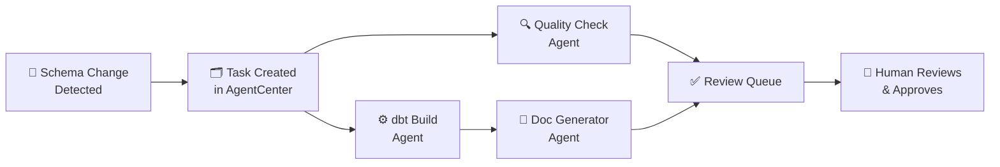

You deploy your first analytics agent on a Friday. It runs freshness checks on 40 tables every two hours. It works. You forget about it for six weeks.

Then a dashboard breaks. You spend the next 90 minutes tracing which agent touched which model before the failure. Turns out it was a documentation agent you also forgot about, regenerating column descriptions after a schema change. It wrote stale types into the docs. The BI tool read those docs and rejected the query.

That's the moment most analytics engineering teams realize they need a control plane.

## The Specific Bottleneck

Analytics engineering sits at the intersection of data infrastructure and business reporting. Agents here do real work: running quality checks, generating dbt documentation, monitoring model freshness, testing schema changes before they land in production.

The problems start when those agents multiply.

**You can't tell which agent touched a model last.** Your data quality agent and your model-build agent both run on a schedule. When a test fails, you check both logs, cross-reference timestamps, and hope the order of execution is obvious from the output. It usually isn't.

**Documentation drifts from the models.** A doc-generation agent produces output based on what it sees at runtime. If the model changed two hours before the agent ran, the docs are already wrong. Nobody knows until a stakeholder opens the data dictionary and finds columns that no longer exist.

**Cost is invisible until the bill.** A table-scan agent checking 300 tables every four hours is expensive. Not obviously expensive in any single run — just quietly expensive across a month. Most teams find out when they audit the LLM bill, not when the agent is deployed.

## Feature-to-Workflow Mapping

**Real-time agent status.** AgentCenter shows every agent's state — running, idle, blocked, or errored — in one view. When your freshness-check agent stalls at 3am, you see it in the morning feed. You don't find out when the morning report has blanks.

The specific value for analytics teams: you stop asking "did the quality agent run before the model refreshed?" You can see the sequence directly in the [agent dashboard](/features/agent-dashboard).

**Kanban board for task management.** Assign model validation tasks to specific agents, set their priority, and watch them move through stages — Queued, Running, Under Review, Done. When a quality check comes back with anomalies, it sits in review before you merge.

Without a board, agents complete tasks and drop results somewhere — a Slack message, an S3 file, a database row. You have to go find them. With a [kanban board](/features/task-orchestration), the result comes to you.

**Agent monitoring and cost tracking.** AgentCenter tracks cost per agent per task run. After one week of your table-scan agent running, you'll have a clear picture of what it costs per check, per table, per day. That's the data you need to right-size it.

One team running a similar setup found their monitoring agent was making 4x more API calls than needed because it was re-scanning tables that hadn't changed. They caught it in the cost view two weeks after deployment. Previously that would have taken a manual log audit.

**Deliverable review and approval.** Generated documentation goes into a review queue before it merges. A human checks one batch before 40 doc updates land in the catalog. That one-step approval workflow is what keeps your data dictionary accurate when you're running docs-as-code with agents.

See [deliverable review workflows](/features/agent-monitoring) for setup details.

## The Numbers

A mid-size analytics engineering team typically runs 8 to 15 agents: 2–3 for quality checks, 2 for documentation generation, 2–3 for model freshness monitoring, and a few for schema validation and change detection.

The **Pro plan** ($29/month) covers up to 15 agents across 15 projects. That's the right fit for most analytics teams. Teams scaling past that — or using recurring task automation for always-on monitoring jobs — move to Scale.

AgentCenter replaces the combination of cron logs, Slack alert channels, a shared spreadsheet tracking "which agent is responsible for what," and the informal on-call rotation that forms when nobody has a real monitoring setup.

## Before vs After

| | Without AgentCenter | With AgentCenter |
|---|---|---|
| **Visibility** | No view of which agent ran when | Real-time status per agent, per task |
| **Task handoffs** | Outputs dropped to Slack or S3; manually retrieved | Tasks move through Kanban with explicit handoffs |
| **Error detection** | Found when a dashboard breaks | Blocked or failed agents surface immediately |
| **Cost tracking** | Monthly bill surprise | Per-agent, per-task cost tracked continuously |
| **Debugging time** | 45–90 minutes tracing agent execution order | 5 minutes from the activity feed |

## Where to Start

Set up [agent monitoring](/features/agent-monitoring) first.

Connect your existing dbt orchestration agents — freshness checks, quality tests, whatever runs on a schedule today — and let AgentCenter track their runs for one week. Then look at cost-per-task.

Most teams find at least one agent they can right-size immediately. Some find an agent they forgot was still running. That's a common enough discovery that it's worth doing before you add any new agents.

Once monitoring is in place, add the Kanban board for your doc-generation agents. That's where the review gate matters most — documentation drifts are low-severity but high-frequency, and a board with a review column catches them before they hit your data catalog.

---

*Analytics engineering teams that add a control plane early spend less time firefighting later. [Start your 7-day free trial](/pricing).*
