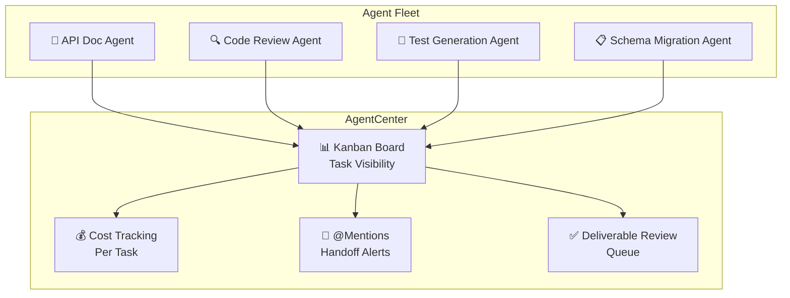

Backend engineers often start with one agent. Something to auto-generate API documentation from OpenAPI specs, or to write unit tests for new endpoints. That first one works. So they add a second. Then a third handles schema migration review. By month three, there are six agents running across three services, and nobody clearly remembers what the second one actually does anymore.

That's the real problem. Not the agents themselves. The gap between "we have agents" and "we know what our agents are doing."

## The Bottleneck Backend Teams Hit

Without a control plane, three things break first.

**Handoffs between agents go invisible.** The documentation agent finishes a run. Did it complete or fail silently? The test generation agent needs that output as input, but it's running blind. You find out there was a problem when a downstream task produces garbage.

**Cost tracking falls apart.** Each agent calls an LLM. Each call costs money. When six agents are running against the same codebase across a sprint, the LLM bill at the end of the month becomes a surprise. One backend team at a mid-stage startup spent $800/month before they had any idea which workflow was driving the spend.

**Debugging requires archaeology.** An agent produced wrong output two days ago. The engineer who configured it is in a different timezone. Figuring out what prompt ran, what the model returned, and why takes hours of reconstructing terminal logs, Slack threads, and git history.

## How Backend Engineering Teams Use AgentCenter

### Kanban Board for Agent Task Visibility

AgentCenter shows every running agent task on a board you can read at a glance. When the API documentation agent finishes a run, the task moves to "Review." When the test generation agent picks up that output, the handoff is logged. Backend engineers can see what's pending, what's blocked, and what's waiting for human review, without polling a Slack thread or running terminal commands.

A backend team might have one agent generating OpenAPI spec updates from code changes, and another agent reviewing those specs for breaking changes before a release. In AgentCenter, those two tasks appear in sequence. If the spec review agent flags an issue, an @mention goes to the engineer who made the change. The whole chain is visible.

### Real-Time Agent Status

AgentCenter shows each agent as online, working, idle, or blocked. Backend engineers running agents during CI/CD cycles or deploy windows need to know fast if something hangs. An agent that's been "working" for 45 minutes on a task that normally takes five minutes is stuck. Without a status indicator, that's invisible until the output fails to appear and someone notices.

See [agent monitoring](/features/agent-monitoring) for how status tracking works across a fleet.

### Cost Tracking Per Task

Every agent call goes through a model. Every model call has a cost. AgentCenter tracks cost per task and per agent, so when the monthly bill arrives, backend teams can trace which workflow was expensive and why.

A common finding: a migration review agent running against very large schemas used 4x more tokens than expected. Nobody caught it until the bill. After adding tracking via AgentCenter and adjusting context slicing on the agent, the same team cut their LLM spend from $800 to $320 per month.

### Deliverable Review Workflows

Backend engineers who run agents to produce artifacts, such as test files, migration scripts, or documentation, need a way to review those outputs before they go anywhere. AgentCenter's review queue puts deliverables in front of the right engineer with pass/fail controls. No more "the agent wrote the tests, I'll review them later" turning into "the agent wrote tests that passed but tested the wrong behavior."

This is especially useful for teams where agents produce code that goes into CI. A review step before merge catches the cases where the agent technically completed but produced something you wouldn't want in production.

## The Numbers for Backend Engineering Teams

A typical backend engineering team runs 8 to 20 agents: API documentation, test generation, code review, schema migration review, dependency auditing, changelog drafting, and load test scripting. Most teams fit on the [Pro plan](/pricing) ($29/month, 15 agents). Teams scaling past 20 agents move to Scale ($79/month, 50 agents).

AgentCenter replaces ad-hoc Slack coordination for tracking agent outputs, shared Google Docs for agent task status, and manual cost spreadsheets nobody updates.

## Without AgentCenter vs. With AgentCenter

| | Without AgentCenter | With AgentCenter |
|---|---|---|
| Visibility | Check Slack logs or run terminal commands | Live status on every agent in the fleet |
| Task handoffs | Manual pings between engineers or scripts | Logged handoffs with @mention triggers |
| Error detection | Output fails; trace back manually | Blocked status visible immediately |
| Cost tracking | Monthly LLM bill surprise | Per-task cost visible in real time |
| Debugging time | 2 to 4 hours reconstructing what ran | Timeline and logs on each task in the dashboard |

## Where to Start

If you're setting up AgentCenter for a backend team, start with the [task orchestration board](/features/task-orchestration) and map your existing agents to tasks. Even if you only add three agents to the board in week one, the visibility payoff is immediate. The first time you see two agents in the same pipeline represented as linked tasks, the coordination problem becomes solvable.

After that, turn on cost tracking. It will tell you things your LLM provider's dashboard won't.

---

*Backend engineering teams that add a control plane early spend less time firefighting later. [Start your 7-day free trial](/pricing).*
