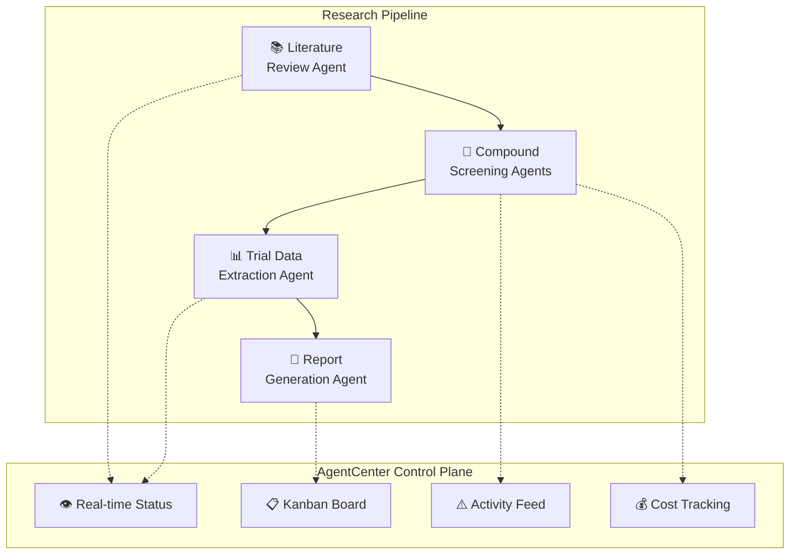

Biotech research teams were running AI agents before most industries figured out what they were. Literature review agents scanning PubMed. Compound screening pipelines chewing through SMILES strings. Trial data extraction agents pulling structured output from clinical PDFs. The use cases were obvious, the ROI was real, and teams moved fast.

The problem shows up three months in, when you have eight agents across four pipelines and no idea what any of them are actually doing right now.

## Why Biotech Agent Pipelines Break Without a Control Plane

The failure modes are specific to how research pipelines are structured, and they're not obvious until they've already cost you time.

**Silent completion with bad output.** Your compound screening agent finishes in 11 minutes instead of the usual 45. Status shows green. But it hit a malformed input on batch item 6 and short-circuited through the rest. You find out when the downstream analysis agent produces nonsense two hours later — and now you're unsure whether yesterday's run had the same problem.

**Stuck agents that keep spending.** A trial data extraction agent gets into a retry loop on a corrupted PDF. It doesn't fail. It just keeps running, keeps calling the model, and keeps accumulating cost. Nobody checks it for four hours because the status never went red.

**Broken handoffs between pipeline stages.** Agent A finishes lit review and writes output to a named task. Agent B is supposed to pick it up. Someone changed the task naming format last week, the handoff condition doesn't match, and Agent B sits idle while two researchers spend a day working from a week-old output without realizing it.

These three patterns share one root cause: no shared visibility into what the agents are doing across the pipeline.

## How Biotech Research Teams Manage AI Agents with AgentCenter

**Real-time agent status across pipelines.** The [AgentCenter agent dashboard](/features/agent-dashboard) shows every agent's current state: online, working, idle, or blocked. When your compound screening agent goes from "working" to "blocked" at item 47 of 500, you see it immediately in the dashboard rather than at the end of the run when the output file is 90% empty.

**Kanban board for pipeline handoff tracking.** Biotech pipelines are sequences, not single jobs. Lit review feeds screening. Screening feeds analysis. Analysis feeds the report. [Task orchestration in AgentCenter](/features/task-orchestration) shows where each task sits in that chain, which agent is holding it, and what's waiting downstream. When a handoff breaks because of a naming change, the Kanban board shows it before a researcher wastes a day.

**Activity feed for error detection.** When an agent retries on the same input 14 times in a row, the [agent monitoring](/features/agent-monitoring) activity feed surfaces that pattern. You're not grepping log files across six agents looking for "retry." It shows up in one place, and you can act on it while the agent is still running.

**Per-task cost tracking.** GPT-4o calls across 500 compound batches add up fast. AgentCenter tracks cost per task, not just the monthly total. When your screening pipeline costs 3x more than the previous run, you see it immediately — not on the billing page two weeks later.

**@Mentions and task threads.** When a data extraction agent produces unexpected output mid-run, a researcher can flag it directly in the task thread without opening a separate ticket. The context stays attached to the task, not buried in Slack where it'll be gone in a week.

## The Numbers

A mid-size biotech research team typically runs 8 to 20 agents across 3 to 6 pipelines covering literature review, compound or sequence screening, clinical data extraction, regulatory document parsing, and report generation.

The [Pro plan at $29/month](/pricing) covers up to 15 agents across 15 projects and fits most research teams. Teams running parallel programs across multiple therapeutic areas or indications fit the Scale plan at $79/month, which handles up to 50 agents across 50 projects.

What AgentCenter replaces for most biotech teams: manual cron job status checks, shared Slack channels where engineers post "screening done" messages, a spreadsheet of known agent quirks, and whoever happens to be the on-call engineer when a pipeline runs overnight.

## Before vs After

| | Without AgentCenter | With AgentCenter |
|---|---|---|
| Visibility | Check log files one by one per agent | Live status for all pipeline agents in one view |
| Task handoffs | Manually confirm output before triggering next stage | Handoffs tracked on Kanban, failures visible immediately |
| Error detection | Discovered when a downstream stage breaks | Flagged in activity feed during the run |
| Cost tracking | Rough monthly estimate, no per-run detail | Per-task cost visible in real time |
| Debugging time | Grep logs, replay manually (2 to 4 hours) | Agent history and error trace surfaced in minutes |

## Where to Start

Connect your highest-volume agent first — likely your literature review or compound screening agent — and watch the [activity feed](/features/agent-monitoring) for one week without changing anything else.

You'll see which runs complete cleanly, which ones retry repeatedly on the same inputs, and which cost more than you expected. That baseline tells you exactly where to spend engineering time next. Most biotech teams find at least one stuck or expensive agent in the first week that they had no idea about.

---

*Biotech research teams that add a control plane early spend less time firefighting later. [Start your 7-day free trial](/pricing).*
