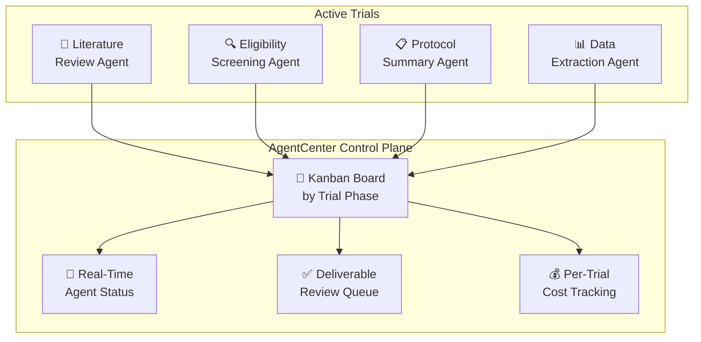

Clinical research coordinators start their week not knowing which of their agents finished overnight. They're running a literature review agent, two or three eligibility screening agents across active trials, a regulatory document prep agent, and a data extraction agent — all at the same time, often across multiple sponsors.

Then someone asks why the protocol summary isn't ready.

Nobody knows which agent did what.

## What Breaks When Clinical Research Teams Scale Agents

The agents aren't the problem. The problem is that clinical research is already a high-stakes coordination exercise — and most teams drop their AI agents into that environment with no management layer on top.

Here's what actually breaks:

**Eligibility screening agents go silent overnight.** An agent checking patient records against inclusion and exclusion criteria hits an API rate limit at 2 a.m. It writes partial results to the shared folder and stops. No error message surfaces. The coordinator finds out the next morning when they count the records and the numbers don't match the expected run.

**Regulatory prep agents run on stale templates.** A document preparation agent runs Friday afternoon. Over the weekend, someone updates the protocol template. The agent runs again Monday with the version it cached. Now there are two outputs, both plausible, neither labeled clearly. A researcher submits the old one to the site.

**Costs are invisible across trials.** The team is running agents for three sponsors simultaneously. The cloud bill arrives at month-end as a single number. Nobody can break it down by trial or show Sponsor B what their specific work cost to run. This matters when AI compute is billable to grants or contracts.

These aren't edge cases. They happen within the first two months of running agents in clinical operations.

## How AgentCenter Fits a Clinical Research Workflow

### Agent Status Monitoring

Every agent in AgentCenter shows real-time status: working, idle, blocked, or errored. For a clinical research team, the "blocked" status is what matters most.

When an eligibility screening agent hits a rate limit at 3 a.m., it surfaces as blocked in the [agent monitoring dashboard](/features/agent-monitoring). The coordinator logs in at 8 a.m. and sees it immediately — not after a sponsor call, not after manually counting records. The fix takes minutes rather than hours of log archaeology.

You don't need to write custom alerting. The status is there when you need it.

### Kanban Board Organized by Trial Phase

Agents are assigned to tasks, and tasks live on a board you control. A clinical research team can set it up with columns that match how they actually work: screening, active enrollment, data lock, regulatory submission.

When a data extraction agent finishes a pass, the task moves. When an output needs review before it goes to a sponsor or regulatory body, the task card sits in a review column until someone approves it. This is how the [task orchestration](/features/task-orchestration) feature is designed — not as a workaround, but as the actual workflow.

### @Mentions for Human-in-the-Loop Sign-Off

Some outputs can't go to regulators without a clinical lead reviewing them. A protocol deviation summary, a patient narrative, an adverse event flag — these need a human in the loop before anything moves.

In AgentCenter, the agent creates a deliverable and @mentions the reviewer in the task thread. The reviewer sees the output in context, approves or comments, and the task moves forward. No separate email thread. No question of whether someone saw the attachment.

### Per-Task Cost Tracking

AgentCenter tracks what each task costs. For a research team billing AI compute to a grant or a sponsor contract, this matters a lot.

A research operations manager can pull every task tagged to Trial A and get a real number. Trial B's data validation agents show separately. When a sponsor asks what their trial cost to run, the answer isn't a rough estimate from a shared cloud invoice.

## The Numbers

A mid-size CRO or academic research team typically runs 8 to 20 agents across 3 to 8 active trials at any point. The [Pro plan](/pricing) covers up to 15 agents; the Scale plan covers 50, which suits larger CROs running multiple phase trials simultaneously.

What AgentCenter replaces: shared spreadsheets tracking agent run status, Slack messages asking "did the extraction finish?", and month-end cost reconciliation done manually across cloud dashboards.

## Before vs. After

| | Without AgentCenter | With AgentCenter |
|---|---|---|
| **Visibility** | Logs in three separate systems, no unified view | One board showing all trials, all agents, current status |
| **Task handoffs** | Email the reviewer, wait to hear back | @Mention in the task thread, no parallel tracking needed |
| **Error detection** | Sponsor asks why the report looks incomplete | Blocked agent status visible before anyone is affected |
| **Cost tracking** | One cloud bill at month-end, no trial breakdown | Per-task cost data, attributable per trial and sponsor |
| **Debugging time** | 3 to 5 hours tracing which agent ran what version | 20 minutes in the activity feed |

## Where to Start

Set up the Kanban board first, organized by trial phase.

Clinical research teams already think in trials and phases. That structure maps directly onto AgentCenter's board. Create a column for each active phase — screening, enrollment, data lock, submission — assign your current agents to tasks, and you'll have a real-time view of what's running within a day.

The [agent monitoring dashboard](/features/agent-monitoring) starts showing status the moment your agents connect. No configuration needed to know an agent has gone idle or blocked.

---

*Clinical research teams that add a control plane early spend less time firefighting later. [Start your 7-day free trial](/pricing).*
