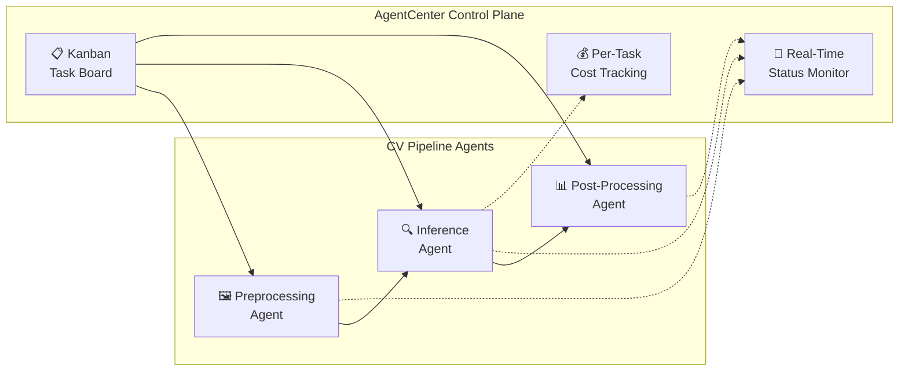

Computer vision engineering teams are running AI agents in production and quietly losing track of them. The preprocessing agent finishes. The inference agent takes over. The post-processing agent should handle the output — but something stalled two steps back, and nobody caught it because there was no shared view of the pipeline.

You find out 90 minutes later, when a customer flags that detections are missing from the last 300 frames your system processed.

That's the daily reality for CV teams running agents at scale. You're managing 10 to 20 agents that form a single fragile pipeline, with no dashboard showing what each one is doing right now.

## Where Computer Vision Pipelines Break Without a Control Plane

Computer vision pipelines typically chain multiple agents together: one for image preprocessing (resize, normalize, deduplicate frames), one for inference (call the detection model, parse raw outputs), one for post-processing (score confidence levels, filter noise, route results to storage or downstream systems). When these are separate agents, failures don't surface cleanly.

Here are the specific patterns that hit CV teams once they're running at real scale:

**Silent batch drops.** An agent processes a batch of 1,200 images. Three hundred fail schema validation and get quietly dropped — no exception raised, no log entry that stands out. Downstream agents complete successfully because they never see the missing records. You discover the gap two days later when a customer reports missed detections.

**Inference cost spikes with no attribution.** Your detection agent switches to a more expensive model path when it hits difficult image conditions — heavy occlusion, low resolution, motion blur. It's handling things correctly, but the per-task cost is 8x the baseline. You won't know until the billing CSV arrives.

**Stuck agents with no alert.** The preprocessing agent is waiting on a GPU-accelerated step that never finishes because the host is down. It's not erroring. It's not retrying. It's just blocked — and it'll stay that way until someone manually checks or an SLA fires. That's usually an hour or more.

Without a control plane, you're managing this with log grep, ad-hoc Slack messages, and a Notion page three people stopped updating last month.

## How AgentCenter Handles CV Pipeline Management

**Kanban task board for batch tracking.** Each batch becomes a task card. You can see exactly which agent holds it, when it started, and what output it produced. When a batch stalls in the inference stage, the card stays in "Working" for longer than expected — you catch it in minutes, not hours. The [task orchestration view](/features/task-orchestration) gives you one place to see your entire pipeline.

**Real-time agent status.** AgentCenter shows each agent as online, working, idle, or blocked. If your preprocessing agent is waiting on a resource that's not responding, you see it in the [agent monitoring panel](/features/agent-monitoring) immediately — not when a downstream SLA fires. Status is live, not on a polling lag.

**Per-task cost tracking.** Inference agents that call cloud vision APIs or LLM endpoints log cost per task run. When a specific batch triggers an expensive detection path, you see it at the task level. You can spot the batch that cost $4.20 against a baseline of $0.30 without waiting for a billing report.

**@Mentions and task threads.** When a batch fails the QA scoring step, the QA agent can post a comment directly on the task card. Engineers and product owners get notified. The conversation lives on the task, not in a Slack channel that nobody checks after 7pm.

**Enforced task dependencies.** Set the inference agent to wait until preprocessing marks its task complete. The dependency is enforced in AgentCenter — not in code, not in a custom queue script. If preprocessing fails, inference never starts on that batch. You see why it didn't start, and when.

## The Numbers for CV Teams

A typical computer vision engineering team runs 3 to 5 agent types across 4 to 8 active pipelines — usually preprocessing, inference, quality scoring, and one or more routing or enrichment agents. That's 12 to 20 agents running concurrently during peak batch windows.

The [Pro plan](/pricing) ($29/month, 15 agents, 15 projects) covers most teams. Scale ($79/month) fits teams running separate pipelines per product line or customer — 30 to 50 agents across 10+ projects.

AgentCenter replaces: a shared spreadsheet tracking which batches have been processed, a Slack channel doubling as an informal incident queue, and three or four bespoke cron job scripts pushing status to a Notion page nobody opens anymore.

## Before vs After

| | Without AgentCenter | With AgentCenter |
|---|---|---|
| **Visibility** | Log files and grep across multiple services | Live task board with per-agent real-time status |
| **Task handoffs** | Inference polls a queue after preprocessing writes output | Dependency-enforced: inference starts only when preprocessing marks complete |
| **Error detection** | Found in billing statements or customer complaints | Caught when the task card stalls mid-pipeline on the board |
| **Cost tracking** | Monthly billing CSV, no per-batch breakdown | Cost logged per task run, visible at the individual batch level |
| **Debugging time** | 2-4 hours tracing across logs and Slack threads | 15-20 minutes — task thread shows exactly where the pipeline stopped and why |

## Where to Start

Set up the Kanban board for one pipeline before you wire in everything else. Take your preprocessing, inference, and post-processing agents, create one task per batch, and assign each agent to its stage. Run it for a week.

You'll see your first stalled card within 48 hours. And you'll know which agent it was, how long it was stuck, and what it last processed — without opening a terminal.

That visibility alone changes how the team responds to pipeline failures. Instead of reactive log-diving, you're looking at a board.

---

*Computer vision teams that add a control plane early spend less time firefighting later. [Start your 7-day free trial](/pricing).*
