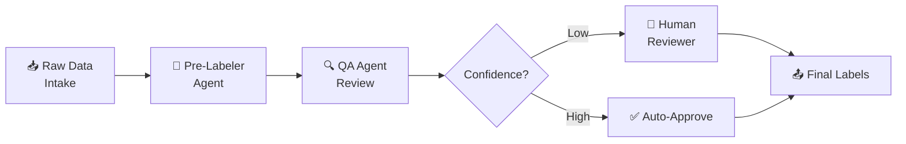

Data labeling teams run more AI agents than almost anyone else, and track them worse than almost anyone else.

A mid-sized annotation team might have agents pre-labeling images, reviewing text for quality, flagging low-confidence samples, and routing work to human reviewers. That's four agents minimum, often more. Most teams manage them through a mix of cron logs, Slack messages, and shared spreadsheets.

When one agent drifts — maybe it starts flagging 40% of samples as low confidence instead of 5% — the team finds out two days later when the queue backs up. Thousands of labels are in question. Nobody knows where it went wrong.

## What Breaks Without a Control Plane

### You Can't Tell Which Agent Is Misbehaving

A typical labeling pipeline chains agents together. Pre-labeler passes work to the QA agent, which routes to reviewers. When throughput drops, you have no idea where the bottleneck is. Is the pre-labeler producing bad output? Is the QA agent too strict? Did routing fail? Without real-time status per agent, you're guessing — and usually blaming the wrong one first.

### Error Counts Are Invisible Until They're Catastrophic

Most annotation tools report final output quality. They don't track agent-level errors mid-pipeline. A pre-labeling agent that throws 5 errors per hour might run for days before someone notices. You've paid for thousands of tokens on work that needs to be redone, with no log tying the cost to the specific batch that broke.

### Human-Agent Handoffs Break Silently

The most common failure mode in labeling pipelines isn't the agent crashing. It's the handoff. Agent produces output, human reviewer doesn't get notified, task sits idle. Two days later someone asks where the batch went. Nobody has an answer, because nobody was watching.

## How AgentCenter Fixes This for Data Labeling Teams

### Real-Time Agent Status Across the Pipeline

The [agent monitoring dashboard](/features/agent-monitoring) shows every agent's current state: online, working, idle, or blocked. For a labeling pipeline with four agents, you see at a glance which one is stuck. When your QA agent goes idle at 2pm on a Tuesday, you know immediately — not when someone files a ticket Friday morning.

### Task Orchestration Across Agent Handoffs

The [task orchestration board](/features/task-orchestration) treats each batch as a task that moves through your pipeline. When the pre-labeler finishes a batch, the QA agent gets the next task. If the QA agent finishes and a human review is needed, the reviewer gets @mentioned in the task thread. Nothing sits in limbo.

For most labeling teams, this replaces a Slack channel where someone manually pings reviewers when a batch is ready. That person now doesn't have to do that.

### Cost Tracking Per Agent

LLM costs in a labeling pipeline add up fast. AgentCenter tracks token spend per agent, per task. You can see that your pre-labeler spent $47 on a batch that produced 80% unusable labels — and trace that back to a prompt change the day before. Without per-agent cost data, you're looking at a single monthly invoice with no way to tie it to specific work.

### Error Detection Before the Queue Backs Up

AgentCenter surfaces agent errors in the activity feed in real time. If your QA agent starts throwing validation errors at a rate above baseline, you see it right away — not after the downstream queue is empty and your reviewers are idle. You can pause the agent, fix the issue, and requeue the affected tasks without losing the work already done.

## The Numbers

A data labeling team typically runs 3–8 agents depending on pipeline complexity:
- 1–2 pre-labeling agents (often one per task type: text, image, structured data)
- 1 QA and validation agent
- 1 routing and prioritization agent
- Optionally: a reconciliation agent for label disagreements

That puts most teams on the **Pro plan** ($29/month) covering up to 15 agents across 15 projects. What it replaces: scattered cron logs, Slack-based status updates, and roughly two hours per week of someone manually checking which batches are stuck.

## Before vs After

| | Without AgentCenter | With AgentCenter |
|---|---|---|
| Visibility | No single view of which agent is running | Real-time status per agent on one dashboard |
| Task handoffs | Manual Slack pings when batches are ready | Automatic @mention when task moves to next stage |
| Error detection | Found when queue backs up, hours or days later | Surfaced in activity feed within minutes |
| Cost tracking | Monthly invoice with no per-agent breakdown | Cost per agent per task, tied to specific batches |
| Debugging time | 2+ hours tracing logs across different tools | Task history and agent status in one place |

## Where to Start

Set up the Kanban board first. Map your existing pipeline stages as columns: Pre-Labeling, QA Review, Human Review, Approved. Create one task per batch and move it through stages manually for the first week.

Once you can see where batches actually sit — which column, which agent, which reviewer — you'll know exactly which handoffs need automation next. That single change, making task status visible across the team, cuts the "where did that batch go?" questions to near zero for most teams.

From there, wire up @mentions for reviewer assignments and cost tracking per agent. The whole setup takes an afternoon. See [pricing and plans](/pricing) to pick the right tier for your agent count.

---

*Data labeling teams that add a control plane early spend less time firefighting later. [Start your 7-day free trial](/pricing).*
