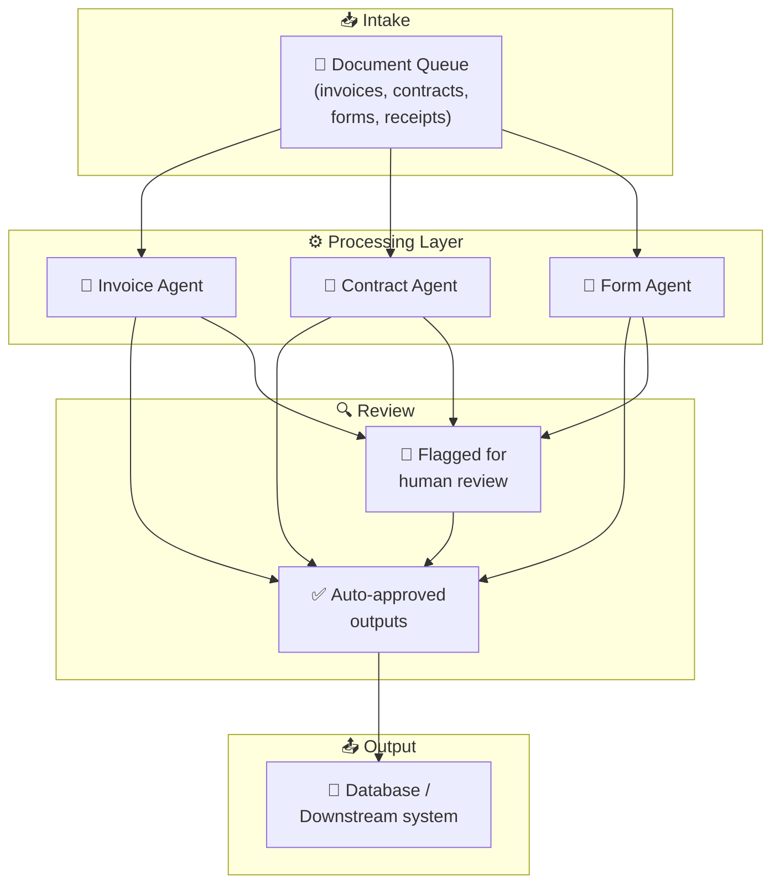

If you run AI agents to extract data from invoices, parse contracts, or process intake forms, you already know the core problem: the agents work — until they don't. And when they stop working correctly, you find out from accounting. Not from your monitoring.

Document processing is one of the trickier places to run agents in production. The work is repetitive enough that you want automation. The stakes are high enough that silent errors are a real problem. A misclassified invoice field or a missed contract clause doesn't throw an exception. It flows downstream and causes headaches two weeks later.

## What Breaks Without a Control Plane

Here are three situations document processing teams hit when managing agents without a central dashboard.

**Batch failures with no attribution.** You run 12 agents — each handling a different document type (invoices, purchase orders, expense reports, contracts). A batch of 300 invoices processes overnight. In the morning, 17 are wrong. Which agent did them? When did it run? Was it the same agent that failed last Tuesday? Without a control plane, you're grepping logs and guessing.

**No human-in-the-loop for edge cases.** Document processing agents hit ambiguous inputs constantly: handwritten fields, non-standard templates, scanned PDFs with low contrast. Without a way to flag specific outputs for review, agents either make a decision (sometimes wrong) or silently drop the document. Both outcomes are bad.

**Cost opacity across models.** You're paying per LLM call. A team running 15 agents across different document types has wildly different costs per document — a complex contract extraction costs 10x what a simple receipt extraction costs. Without per-agent cost tracking, you can't tell if the ROI is there or which agents are eating budget without delivering.

## How AgentCenter Solves These Problems

**Kanban board for batch tracking.** Each document batch becomes a task card. You see it move from "Queued" to "Processing" to "Validation" to "Done." If a card stalls at "Validation" for 3 hours, that's visible. You don't need to look at logs — the board shows you the blockage.

**Deliverable review and approval.** Agents submit extracted JSON as a deliverable. Your team can spot-check 10% of outputs directly in AgentCenter before they hit the database. For high-value documents like contracts, you can require approval before any downstream write. This is the human-in-the-loop layer that most homebrew setups skip.

**Real-time agent status.** Every agent has a live status: online, working, idle, or blocked. If your contract extraction agent shows "blocked" at 2am, you'll see it in the activity feed. Not in Slack at 9am when someone asks why the contracts haven't processed.

**Per-agent cost tracking.** AgentCenter's [agent monitoring](/features/agent-monitoring) shows you token usage and cost per agent over any time window. You can see that your invoice agent processed 1,200 documents last week at $0.04 each, and your contract agent processed 80 documents at $0.71 each. That's the data you need to decide which models to use for which tasks.

**@Mentions and task threads.** When a document output looks wrong, anyone on the team can @mention a teammate directly on that task card. The conversation stays attached to the specific batch — not buried in a Slack thread. Six months later, you'll know exactly why that batch got flagged.

## The Numbers

A typical document processing team runs 8 to 20 agents. One or two per document type, with separate agents for extraction, validation, and sometimes classification. The [Pro plan at $29/month](/pricing) covers up to 15 agents and fits most teams. Teams with sub-agents per document type, or separate agents per client, should look at Scale ($79/month, 50 agents).

AgentCenter replaces: scattered cron job monitoring, Slack channels for error alerts, spreadsheets tracking which batch ran when, and manual cost calculations from your LLM provider's billing page.

## Before vs After

| | Without AgentCenter | With AgentCenter |
|---|---|---|
| **Visibility** | Log files and grep | Live status per agent and batch |
| **Task handoffs** | Agents write to S3, next step polls | Task cards move through Kanban stages |
| **Error detection** | Downstream complaints, 2-day lag | Activity feed shows stalls in real time |
| **Cost tracking** | Monthly provider bill, no granularity | Per-agent, per-task cost breakdown |
| **Debugging time** | 2 to 4 hours grepping logs per incident | 15 minutes tracing the specific task card |

## Where to Start

Set up the [Kanban board](/features/task-orchestration) first.

Create four columns: Intake, Processing, Validation, Done. Map each document type to a lane — invoices in one lane, contracts in another. Assign your agents to the appropriate stages. This takes about 30 minutes to configure and immediately gives you a visual picture of where work is stuck.

Once that's running, connect agent monitoring to track cost per agent. Two weeks of data is enough to tell you which agents are worth their token spend.

---

*Document processing teams that add a control plane early spend less time firefighting later. [Start your 7-day free trial](/pricing).*
