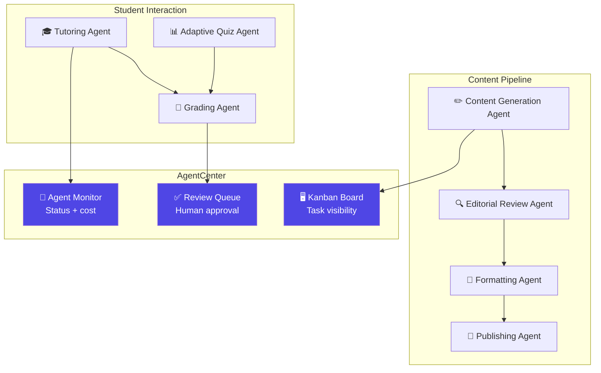

Edtech platforms are one of the fastest-growing consumers of AI agents right now. A content generation agent for course materials. A tutoring agent answering student questions at 2am. A grading agent evaluating open-ended responses. An adaptive quiz agent that adjusts difficulty based on prior performance.

Most platforms accumulate these agents gradually. One per subject. One per use case. By the time you've expanded to five subjects with multilingual support, you might have 30 agents running. Nobody planned for that number. And nobody built a way to watch them all.

## The Real Daily Problem for Edtech Teams

Learning agents fail quietly. That's the part nobody warns you about.

A code-grading agent that starts miscalibrating scores doesn't crash. It keeps running. A tutoring agent stuck in a loop explaining the same concept differently keeps responding to students. A content agent that drifted off-topic keeps producing material. None of these show up as errors in your logs. They show up as confused students and angry instructors — usually days later.

Most edtech teams discover agent problems the same way: a support ticket, a teacher complaint, or a sudden spike in the cloud bill.

## What Breaks Without a Control Plane

**Pipeline handoffs fail silently.** A typical content production flow might be: content generation agent → editorial review agent → formatting agent → publishing agent. When the editorial review agent stalls waiting on a rate limit, the content agent keeps generating. By the time someone notices, there are 80 unreviewed drafts backlogged. No alert fired. No one knew.

**You can't tell which agents are actually doing useful work.** When a tutoring agent responds to 200 student queries a day, is that good coverage or is it looping on the same 12 questions? Without task-level visibility, there's no way to tell from the outside. You need to dig into logs per agent, which takes time nobody has.

**Cost spikes are invisible until the invoice arrives.** During exam season, tutoring agent volume can spike 5x. If you're not watching per-agent spend in real time, you find out about that $3,000 overage when Stripe charges your card. By then the damage is done.

## How AgentCenter Solves These Problems

**Kanban board for content pipelines.** Every task in your content pipeline gets a card. You can see exactly where each piece of content is — whether it's being generated, waiting for review, or stuck at formatting. When the editorial review agent stalls, the card doesn't move. You see the blockage immediately instead of discovering it during a content audit.

**Real-time agent status across every agent.** The [agent monitoring dashboard](/features/agent-monitoring) shows every agent's status: online, working, idle, or blocked. For an edtech platform with 20 agents, this is the difference between knowing your tutoring agents are healthy and guessing. If a grading agent goes idle during peak submission time, you see it within minutes, not after a wave of students report ungraded work.

**Deliverable review before content goes live.** For any agent output that needs a human check — course materials, graded essays, personalized feedback — you can set up an approval step. Instructional designers get an @mention, review the output in the same interface, and approve or send it back. No email chains. No shared drives. The review is attached to the task so there's a clear record of what was approved and when.

**Per-agent cost tracking.** The [agent monitoring view](/features/agent-monitoring) shows cost per agent, not just total API spend. When exam season hits and your tutoring agents spike from 200 queries a day to 1,200, you see that in the dashboard before the bill arrives. You can make the decision to scale down or set a budget cap — deliberately, not reactively.

**Recurring tasks for content maintenance.** Course material needs regular updates. With recurring task automation on the Pro plan, you can schedule a content refresh agent to review and flag outdated lessons weekly. It runs on its own. You see the results in the Kanban board without having to remember to trigger it manually.

## The Numbers for Edtech Platforms

A typical edtech platform with 3-5 active subjects runs somewhere between 10 and 30 agents. That breaks down to content agents, tutoring agents, grading agents, and assessment/adaptation agents per subject area.

The [Pro plan at $29/month](/pricing) fits platforms running up to 15 agents across up to 15 projects. If you've expanded to multiple languages or subjects and are running closer to 30-50 agents, the Scale plan at $79/month covers that.

What AgentCenter replaces for most edtech teams: a mix of cron jobs for scheduling, spreadsheets for tracking which agents did what, and Slack threads for communicating when something looks wrong. The coordination overhead alone — figuring out which agents ran, what they produced, who reviewed it — often takes 5-10 hours a week across the team.

## Before vs After

| | Without AgentCenter | With AgentCenter |
|---|---|---|
| **Visibility** | No unified view — check each agent's logs separately | Single dashboard showing all agent statuses in real time |
| **Task handoffs** | Silent failures when content pipeline stalls | Blocked cards visible immediately on Kanban board |
| **Error detection** | Discovered via student complaints or teacher reports | Idle/blocked agents flagged in the monitoring view |
| **Cost tracking** | Monthly bill from the cloud provider, post-hoc | Per-agent spend visible in real time |
| **Debugging time** | 2-4 hours tracing logs to find which agent misbehaved | 20-30 minutes with task history and agent status log |

## Where to Start

Set up the [agent monitoring dashboard](/features/agent-dashboard) first. Before you build out your Kanban board or configure deliverable reviews, you need to know what's already running and whether it's healthy.

Connect your existing agents, let the dashboard run for a week, and look at two things: which agents go idle unexpectedly, and which agents are consuming the most cost. That alone will tell you where to focus. For most edtech teams, it's either the grading agents during submission peaks or the tutoring agents during exam season.

Once you've got visibility, set up deliverable reviews for any agent output that touches students directly. Graded essays. Generated feedback. Personalized study plans. Those are the outputs where a miscalibrated agent causes the most damage — and where a quick human review step adds the most protection.

---

*Edtech teams that add a control plane early spend less time firefighting later. [Start your 7-day free trial](/pricing).*
