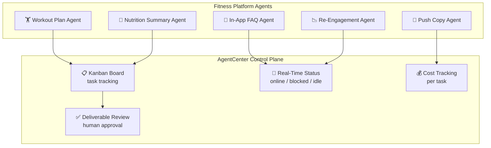

Fitness and wellness platforms run on personalization. Every user has a different goal, starting point, and schedule. Serving that at scale means running a lot of agents — and keeping track of what all of them are doing.

A mid-size fitness platform might run 10 to 18 agents in production: one that generates weekly workout plans, one that adjusts those plans based on check-in data, one that writes nutrition summaries, one that drafts push notification copy, one that handles in-app FAQ responses, and a set of background watchers tracking users who've gone quiet for seven days. All running at the same time. All touching user health data. All requiring different review standards before anything ships.

When something goes wrong, figuring out which agent caused a bad user experience is a real problem.

## The Bottleneck: What Breaks Without a Control Plane

**Workout plan agents drift without anyone noticing.** A plan generation agent starts recommending exercises beyond a user's stated fitness level after a prompt change or model update. No crash, no error. Just a wave of "this is too hard" support tickets a week later. Without visibility into what each agent produced on which day, tracing the drift back to the change is a manual forensics job across API logs and version history.

**Nutrition and coaching agents contradict each other.** If the nutrition summary agent and the weekly coaching tip agent share no state, they can give a user conflicting advice in the same app session. The user sees it as the app not knowing what it said last week. The team hears about it from support, not from their own monitoring.

**Push copy agents burn tokens at unpredictable rates.** LLM-written push notifications perform better — but at 10,000 users per morning run, the cost adds up fast. Without per-task cost tracking, there's no way to tell whether the agent is running efficiently or rewriting copy 3 times per user because the prompt is ambiguous.

## How Fitness and Wellness Teams Use AgentCenter

**Kanban board for task orchestration.** Every agent's output lands as a task card. Workout plans, nutrition summaries, and push copy all appear in one board, visible to both the engineering team and the content reviewers responsible for quality. You can see what's pending, what's been reviewed, and what failed without pulling logs. [AgentCenter's task orchestration](/features/task-orchestration) gives non-engineers a view into what agents are actually producing.

**Real-time agent status.** When the push notification agent stalls because the LLM provider hit a rate limit at 6am, you know before the day's notifications fail to send. The status view shows which agents are working, idle, or blocked. No more finding out from users.

**Deliverable review workflows.** Fitness content has stakes. A workout plan with the wrong load progression can injure someone. Before anything ships, content reviewers can approve or flag agent-generated plans directly in AgentCenter. The task card carries the output; the reviewer approves or sends it back with a comment. No email thread, no exported Google Doc.

**Per-task cost tracking.** With [agent cost monitoring](/features/agent-monitoring), you see exactly what each push copy run costs per morning. Set a spending alert, and you'll know immediately if a prompt change accidentally doubled the token spend — before the bill arrives.

## The Numbers

A mid-size fitness platform running 100,000 to 500,000 users typically keeps 8 to 18 agents in production. The Pro plan ($29/month) covers 15 agents across 15 projects — enough for most teams at this scale. Platforms with separate agent clusters per vertical (strength, weight loss, meditation) often move to Scale ($79/month) for 50 agents.

What AgentCenter replaces: cron job dashboards, spreadsheets tracking which agent produced what output, Slack threads where content reviewers ask engineers to manually pull results, and retroactive cost estimates from monthly API invoices.

## Before vs After

| | Without AgentCenter | With AgentCenter |
|---|---|---|
| **Visibility** | Engineers know what's running; content team doesn't | All agent status visible to engineering and content |
| **Task handoffs** | Engineers email outputs to content reviewers | Reviewer gets a task card and approves in one step |
| **Error detection** | Noticed when support tickets arrive | Blocked agents surface in real time |
| **Cost tracking** | Monthly API invoice reviewed after the fact | Per-task cost logged; alerts fire on spikes |
| **Debugging time** | Hours finding which run produced a bad plan | Task history tied to agent version and run timestamp |

## Where to Start

Set up the deliverable review workflow first. Health content has a higher bar than most — having a human approve agent output before it reaches users is the right instinct, and AgentCenter makes it a one-click process rather than an email chain. Once your reviewers are working in the same interface as your agents, the rest of the monitoring picture builds around it.

---

*Fitness and wellness tech teams that add a control plane early spend less time firefighting later. [Start your 7-day free trial](/pricing).*
