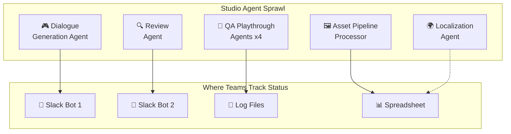
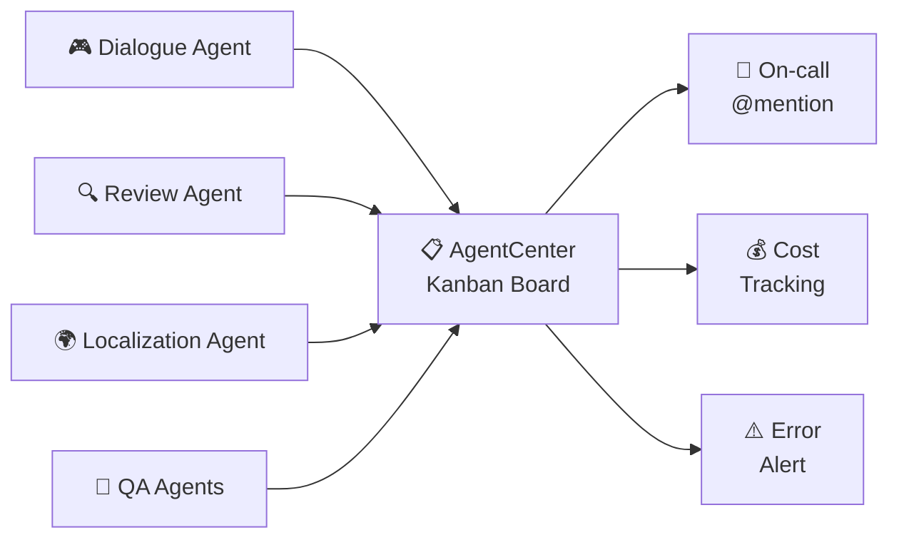

Game studios were early adopters of AI agents. Dialogue generators, automated QA testers, asset pipeline processors, localization agents. A mid-size studio with 50 developers might be running 12 or more agents across active projects. But almost no studio has a control plane for them.

They have version control for code, ticket systems for bugs, build pipelines for releases. The agents live in scripts, notebooks, and half-documented Slack threads. That's the gap.

## What Breaks When Game Studios Scale AI Agents Without a Control Plane

**QA agents running blind.** A studio runs automated playthrough agents overnight. These agents load levels, test collisions, report framerate drops. In the morning, nobody knows which agents finished, which hit errors, and which are still running at 9am consuming tokens. The QA lead checks 4 different Slack bots and still isn't sure what happened.

**Dialogue pipeline handoffs disappear.** A dialogue generation agent writes first-draft NPC lines. A review agent flags lines that break character consistency. A localization agent queues them for translation. Three agents, three steps, no single view of where any batch of lines actually is. When a line goes wrong in production, tracing it back takes hours.

**Agent costs invisible until the invoice arrives.** Game studios run tight budgets. An agent making expensive model calls for two weeks on a task that should have taken two days is invisible until accounting flags the bill. At that point, the spend is already done.

Without a control plane, agent state gets tracked through scattered side channels. Nobody owns the full picture.

## How AI Agents for Game Studios Work in AgentCenter

AgentCenter is the [agent monitoring and task management layer](/features/agent-monitoring) that sits on top of your OpenClaw agents. For game studios, three features change the daily workflow immediately.

### Kanban Board for Agent Task Tracking

Each agent run gets a task card. Dialogue generation for Chapter 3 boss fight. QA overnight run for build 847. Localization batch for German locale.

The game director wants to know where the boss fight dialogue is. They open AgentCenter. No Slack. No asking engineering. The card shows current status, last update, and any flags raised.

This is the [task orchestration layer](/features/task-orchestration) that game studio pipelines don't have by default.

### Real-Time Agent Status

QA agents run overnight. They either finish, hit errors, or get stuck. Without visibility, you find out at standup when someone says "the logs don't look right."

With real-time status monitoring, every agent has a live indicator: online, working, idle, blocked. If an agent errors out at 2am, the on-call person sees it. Not 9 hours later at standup.

### @Mentions and Chat Threads Per Task

When a QA agent flags a collision failure in level 12, that doesn't just write to a log. A task thread opens in AgentCenter. The level designer and QA lead get @mentioned. They respond, reassign, or close it, all in context.

This replaces the "ping me when the agent finishes" Slack workflow that works for 3 agents and breaks at 12.

### Cost Tracking Per Agent

AgentCenter shows cost per agent and per task. If your localization agent bills $80 in a single day instead of the usual $8, you see it before it compounds. No waiting for the monthly invoice.

### Pipeline Orchestration

The dialogue pipeline (generation > review > localization) doesn't have to run as three separate cron jobs with manual handoffs. One agent's task completion triggers the next. The pipeline runs managed, not manual.

Check the [multi-agent workflow features](/features/multi-agent-workflows) if you're chaining more than 3 agents in sequence.

## The Numbers for Game Studios

A mid-size studio (50-200 people) running active production typically has:

- 3-5 QA automation agents (playthrough, collision, regression testing)
- 2-4 dialogue and content generation agents
- 2-3 localization processing agents
- 1-2 asset pipeline processors
- 1-2 analytics or player behavior agents

That's 10-16 agents on live projects. The Pro plan ($29/mo, 15 agents, 15 projects) covers most studios. Larger teams shipping multiple titles at once fit the Scale plan ($79/mo, 50 agents).

What it replaces: cron jobs, custom webhook scripts, several Slack bots, and one Google Sheet that became the unofficial agent status dashboard.

See the full [pricing breakdown](/pricing) to pick the right plan.

## Before vs After

| | Without AgentCenter | With AgentCenter |
|---|---|---|
| Visibility | Fragmented across Slack, logs, and scripts | Single dashboard, real-time status per agent |
| Task handoffs | Manual triggers or brittle cron jobs | Managed orchestration with automatic chaining |
| Error detection | Found in logs hours later, if noticed at all | Flagged immediately with task-level context |
| Cost tracking | Visible only on the monthly invoice | Per-agent, per-task cost updated continuously |
| Debugging time | 2-3 hours tracing across 4 separate systems | 15-20 minutes from the task thread |

## Where to Start

Set up the Kanban board first.

Drop your active agents in as tasks. QA runs, pipeline jobs, content generators. Even without any automation wired up, having one place to see what's running changes how your team talks about agent work.

Once that's stable, wire up status reporting. Agents send a status update to AgentCenter when they start and when they finish. That's the minimum viable control plane. Everything else builds from there.

---

*Game development studios that add a control plane early spend less time firefighting later. [Start your 7-day free trial](/pricing).*
