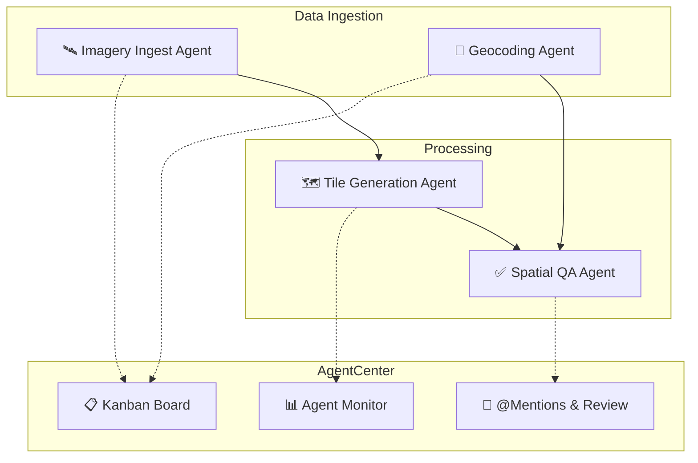

Geospatial engineering teams run some of the most data-heavy agent pipelines in production. Imagery ingestion, tile generation, geocoding validation, spatial data QA — each one is a separate agent, often running in parallel, often dependent on what the one before it produced. When things go right, the map updates look smooth. When things go wrong, you find out from a customer who noticed the tile at zoom level 14 is six months stale.

That gap between "the agent ran" and "the output was correct" is where most geospatial teams spend their debugging time.

## The Bottleneck: Agents That Finish Without You Knowing What They Did

The problem isn't that agents fail outright. It's that they succeed quietly with incomplete results.

Here are three concrete situations that come up repeatedly for geospatial teams:

**Silent data drops.** A tile generation agent processes a batch of 8,000 imagery tiles. It completes successfully — exit code zero, no errors logged. Three days later you discover that zoom levels 10-12 were silently skipped for one region because the input imagery had a metadata mismatch the agent didn't surface as an error. The agent marked the task done. The task was not done.

**Cascading pipeline stalls.** Geocoding validation depends on the output of a spatial join agent. The spatial join agent hit an API rate limit at 60% through its run and paused indefinitely. Nothing in your system knows this happened. Your geocoding agent is now queued behind a stalled predecessor for 11 hours before anyone notices the downstream tile update didn't land.

**Cost spikes you don't see coming.** You added a new imagery provider to your processing pipeline. The agent that re-processes imagery for the new source runs 4x longer than expected on cloud-hosted high-resolution data. You find out when the LLM invoice arrives.

None of these are exotic failures. They're the normal operating conditions for teams running multi-step geospatial pipelines without visibility into what the agents are actually doing moment to moment.

## How AgentCenter Fits Into a Geospatial Pipeline

### Kanban board: see where every pipeline stage stands

Geospatial pipelines have natural stages: raw data ingestion, processing, QA, publication. AgentCenter's Kanban board maps directly to those stages. You can see at a glance that the imagery ingest agent for the Pacific Northwest region is in "processing," the tile generation agent for that same region is "blocked," and three geocoding tasks are queued behind it.

Before this, you'd check Slack messages, cron logs, and individual agent log files to piece together the same picture. Now it's one board.

### Task dependencies: enforce pipeline order without custom glue code

The tile generation agent should not run until the imagery ingest agent finishes and passes QA. You can set that dependency directly in AgentCenter. The tile agent sits in the queue until the upstream task is marked complete. If the ingest agent stalls, the tile agent doesn't silently try to proceed on incomplete input — it waits, and you can see it waiting.

This replaces the hand-rolled dependency logic that most geospatial teams have scattered across cron schedules and shell scripts.

### Agent monitoring: catch cost spikes before they compound

Every agent run in AgentCenter logs performance data — tokens used, runtime, task volume. When your new high-resolution imagery agent takes 40 minutes instead of 10, you see that deviation in the monitoring view before the next six runs queue up. You can pause the pipeline, investigate, and restart with better input constraints.

See more on [agent monitoring features](/features/agent-monitoring).

### @Mentions and deliverable review: flag bad output before it ships

When your spatial QA agent flags a coverage gap, it can drop a comment on the task in AgentCenter. Your team member gets notified, reviews the flagged output directly in the dashboard, and either approves it or sends it back for reprocessing. No context switching to a separate review tool, no email threads about which tile batch has the problem.

This matters most for teams that publish maps to external customers. A bad tile that ships is harder to explain than one that never left the pipeline.

## The Numbers

A typical geospatial engineering team runs 10-30 agents depending on how many regions, data sources, and output formats they support. A team managing imagery for 5 regions with 3 data sources might run: ingest agents per source (9), tile generation agents per region (5), geocoding and address validation agents (4), QA agents (5), and report generation or export agents (3). That's 26 agents before you've added anything custom.

The [Pro plan](/pricing) at $29/month covers up to 15 agents — right for smaller teams or single-region deployments. The Scale plan at $79/month handles up to 50, which covers most full-scale geospatial operations.

What it replaces: Slack channels for pipeline status, manual log file monitoring, spreadsheets tracking which batch ran when, and custom alerting scripts that drift out of date with the actual pipeline.

## Before vs After AgentCenter

| | Without AgentCenter | With AgentCenter |
|---|---|---|
| **Visibility** | Check logs and Slack threads per agent | One Kanban board for the full pipeline |
| **Task handoffs** | Manual coordination or fragile cron timing | Built-in dependencies with status gates |
| **Error detection** | Found when downstream output is wrong | Flagged at the agent level in real time |
| **Cost tracking** | Monthly invoice surprise | Per-agent cost visible in monitoring |
| **Debugging time** | Hours tracing which step caused the issue | Start from the task that was last marked complete |

## Where to Start

Set up [agent monitoring](/features/agent-monitoring) first. Before you wire up dependencies or build review workflows, you need to know what your agents are actually doing. The first week of monitoring a geospatial pipeline almost always surfaces something unexpected — an agent that runs much longer on certain input types, a cost spike tied to a specific data source, a task that gets marked complete before the full output is written.

Start with monitoring. The rest of the control plane is easier to configure once you know where the actual problems are.

---

*Geospatial teams that add a control plane early spend less time firefighting later. [Start your 7-day free trial](/pricing).*
