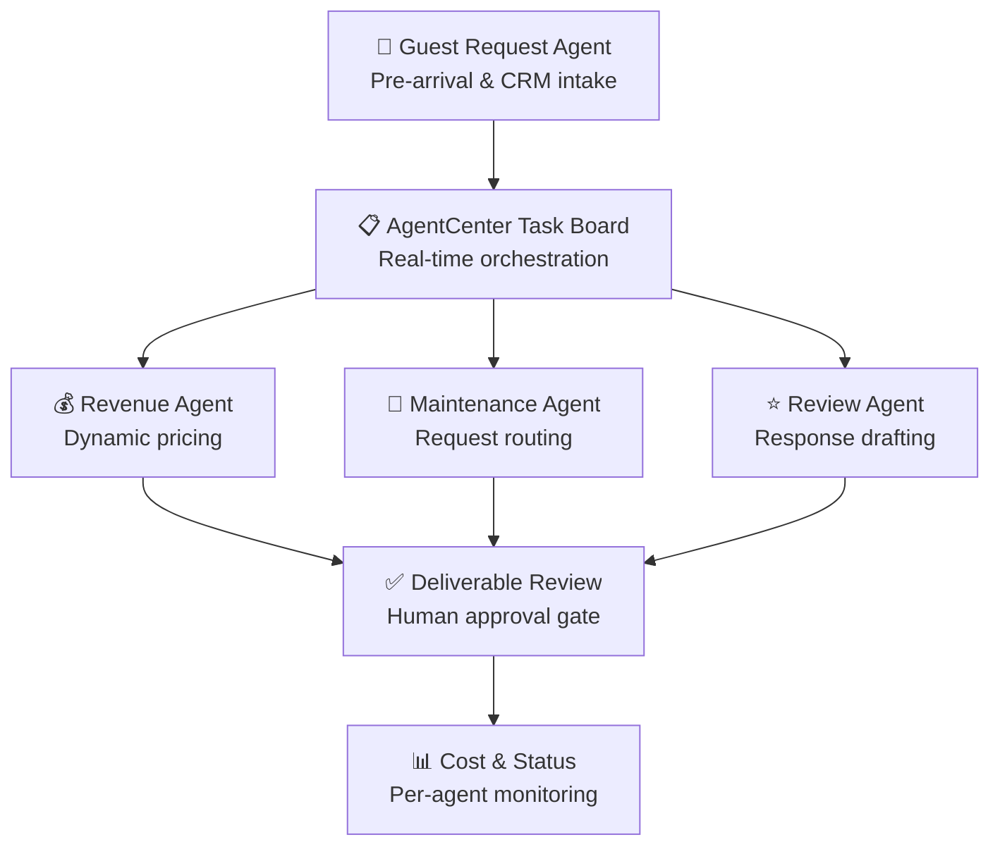

A mid-sized hotel group typically runs a dozen AI agents by the time it gets serious about automation. There's the pre-arrival communication agent, the dynamic pricing model, the review response writer, the maintenance dispatcher, the competitor rate monitor, the loyalty outreach agent. Each one was a good idea when someone built it.

Then something breaks. A guest gets the wrong check-in time. A rate agent stops pulling data. A review response goes out with the wrong property name. And because nothing connects these agents to a shared view, the team finds out from a guest complaint, not from their own systems.

That's the problem hospitality tech teams hit around agent seven or eight. Not that agents are bad. That there's no control plane sitting on top of them.

## What Breaks Without a Control Plane

Hospitality technology is operationally dense. Agents touch live booking systems, CRM data, OTA platforms, and guest-facing communications. When one step fails, the downstream effects are concrete.

Here's what teams typically run into:

**Silent errors in guest communication agents.** A pre-arrival email agent sends duplicate messages during a database sync issue. Nobody sees this until front desk staff start fielding "I got three emails" calls. No central dashboard caught the retry storm.

**Rate agent drift.** A revenue management agent is calibrated against last quarter's occupancy patterns. Seasonality shifts, the model drifts, pricing recommendations get less reliable. The pricing team sees it first in RevPAR data. Engineering had no visibility.

**No handoff tracking between agents.** Maintenance requests flow from a guest intake agent to a routing agent to a contractor notification system. When a request stalls mid-chain, neither the front desk nor the engineering team can tell where it stopped. The guest follows up about an issue that was supposedly resolved.

All three of these are coordination and visibility failures. The agents themselves may have run fine. The system around them didn't.

## How AgentCenter Solves It for Hospitality Teams

### Real-Time Agent Status

Hospitality teams can't wait until morning to find out what broke overnight. AgentCenter's [agent monitoring](/features/agent-monitoring) shows every agent's current status. When the pre-arrival email agent starts retrying at 2am, the on-call engineer sees it, not via a customer complaint at 9am.

**Concrete example:** Your rate monitoring agent pulls competitor OTA pricing every four hours. It starts returning partial data after a platform update. In AgentCenter, the task shows stalled with an error flag. You catch it before pricing recommendations go out based on incomplete data.

### Task Orchestration for Multi-Step Workflows

Maintenance routing is not one agent. It's a chain. Guest intake, issue categorization, contractor assignment, resolution confirmation. AgentCenter's [task orchestration view](/features/task-orchestration) maps these as dependent tasks. When the categorization step stalls, the downstream assignment step waits instead of continuing blindly. You see exactly where the chain broke.

### Deliverable Review Gates

Review response agents are particularly risky in hospitality. A bad public response to a negative review is worse than no response. AgentCenter's approval workflow puts a human in the loop before any agent-drafted response goes out. The agent writes, a team member approves, then it publishes. Simple gate, avoids worst-case scenarios.

### Cost Tracking Per Agent

A hotel group running 12 agents across 15 properties generates meaningful API spend. AgentCenter breaks down cost per agent and per task, so you can see when your review response agent is processing four times as many requests as expected during peak review season. You act on that before the billing surprise arrives.

## The Numbers

A typical hospitality tech team running agents in production manages between 8 and 20 agents. That usually covers:

- 1 to 3 guest communication agents (pre-arrival, in-stay, post-stay)
- 1 to 2 revenue and pricing agents
- 1 to 2 maintenance routing agents
- 1 to 2 review monitoring and response agents
- 2 to 4 operational agents (F&B demand, housekeeping, competitor intelligence)

That puts most teams in the [Pro plan](/pricing) at $29/month (up to 15 agents) or Scale at $79/month for larger hotel group deployments. What they usually replace: Slack threads used as a status system, spreadsheets for task tracking, and manual review workflows that don't hold up at volume.

## Before vs After AgentCenter

| | Without AgentCenter | With AgentCenter |
|---|---|---|
| **Visibility** | Find out something broke from a guest complaint | See agent status and errors in real time |
| **Task handoffs** | Chain failures are invisible mid-pipeline | Stalled tasks visible immediately in the task board |
| **Error detection** | Email from front desk or hotel ops team | Alert when the retry loop starts |
| **Cost tracking** | Monthly API invoice with no breakdown | Per-agent, per-task cost in the dashboard |
| **Debugging time** | 2 to 4 hours reconstructing what happened | Audit log and task history available instantly |

## Where to Start

If you're running more than five hospitality agents, start with the agent monitoring view. Wire up your highest-risk agent first. That's probably your guest communication agent, since it touches the most guests and the most external systems.

Add the task board next so your team can see what each agent is supposed to be doing. Then layer in deliverable review for anything that produces guest-facing output.

You don't need all of this live in week one. Pick the agent with the highest blast radius if it breaks. Instrument that one first.

---

*Hospitality tech teams that add a control plane early spend less time firefighting later. [Start your 7-day free trial](/pricing).*
