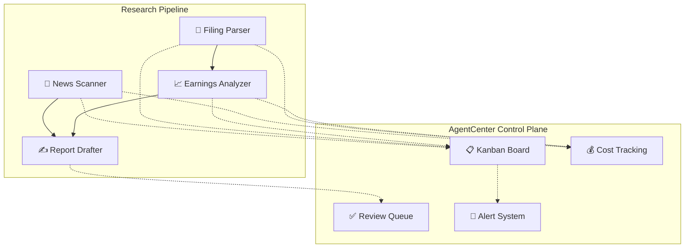

Investment research teams are running agents they can't see.

You've got 12 agents covering 200 companies. An earnings parser handling 10-Ks and 10-Qs, a news scanner watching press releases and earnings calls, a sentiment analyzer parsing analyst commentary, a report drafter pulling it all together. Each one built over six months to solve a real problem.

Then Q1 earnings season hits. Forty companies report in the same week. And the first thing you notice is: you have no idea which agents already processed which filings.

That's the real problem. Not building the agents — you've done that. Managing them when they're all running at once.

## What Breaks During Earnings Season

### Silent failures hide downstream

Your SEC filing parser processes 800 documents a quarter. Most of the time, it works. But when a company files a non-standard format, it returns partially populated data — no crash, no error message you'd catch, just missing fields. The earnings analyzer downstream trusts that data. The report drafter trusts the analyzer. Two days later, an analyst asks why the free cash flow figures are blank for three companies.

You spend four hours digging through S3 logs to find the exact input that broke the parser.

### Cost spikes during high-volume weeks

Earnings season is expensive. Your news scanner starts processing 500 articles a day instead of 80 because six major companies report on the same day. You don't notice until the monthly bill arrives. There's no view showing you: "this agent made 3,400 API calls on Tuesday, 10x its normal rate."

### Handoff failures look like bad agent output

When your filing parser hands data to the earnings analyzer, it passes a structured object. If that object has an unexpected schema, the analyzer might not crash — it might silently skip fields it doesn't recognize. The report drafter gets a summary with missing context. The analyst assumes the agent is generating bad analysis. You spend hours tuning prompts when the real problem was a schema mismatch three steps back.

## How AgentCenter Fixes This for Investment Research

### Kanban board — visual coverage during earnings season

Instead of checking each agent's logs individually, you open AgentCenter's [task orchestration board](/features/task-orchestration) and see every active task across all research agents. "Filing Parser: processing AAPL 10-Q", "Earnings Analyzer: queued for MSFT, GOOGL, AMZN", "Report Drafter: working on META summary." You know what's in progress, what's queued, and what's done — without touching a single log file.

During earnings season, this changes how you work. You scan the board in two minutes, see that three parsers are stuck on non-standard filings, and reassign before anything downstream gets blocked.

### Cost monitoring per agent

AgentCenter tracks what each agent costs per task, not just your total API spend. When your news scanner makes 3,400 calls on Tuesday, you see it that day. You can set a daily cost threshold for specific agents and get alerted before a looping condition turns into a $400 surprise.

For investment research teams where coverage scales from 10 companies to 200 in a single quarter, per-agent cost tracking is how you know which agents scale well and which ones need fixing.

### Error detection before it reaches analysts

When the filing parser returns a response with missing required fields, [AgentCenter's monitoring](/features/agent-monitoring) catches it and surfaces it in the agent's task thread before the data moves downstream. You see: "Filing Parser returned incomplete data for XYZ Corp 10-Q — fields: revenue, operating_income missing." You fix the input. The earnings analyzer and report drafter never see the bad data.

That's the difference between catching a parsing failure at the source and debugging a research summary three steps later.

### Task threads and mentions for specific tickers

Each research task gets its own thread. If a portfolio manager asks why the NVDA analysis looks thin, you open that task's thread in AgentCenter and see exactly what data the filing parser extracted, what the earnings analyzer produced, and what the report drafter received. You can mention a specific agent or team member directly in the thread.

This is useful for one-off requests too. "Can you get a deep analysis on this SPAC filing?" becomes a task with a thread, not a Slack message that disappears.

### Deliverable review before analyst delivery

Before research summaries reach the analyst team, AgentCenter's review queue lets you check outputs against your quality standards. Flag summaries that look too thin, send tasks back for re-processing, or approve and route automatically. You define the workflow once; agents follow it every time.

## The Numbers for Investment Research Teams

A typical sell-side research team or boutique fund running OpenClaw agents looks like this:

- **8–15 agents:** earnings parser, SEC filing scanner, news aggregator, sentiment analyzer, competitor monitor, report drafter, data validator, alert dispatcher
- **Pro plan at $29/mo** covers up to 15 agents — fits most boutique fund and sell-side setups
- **What it replaces:** a Notion board nobody updates, a Python monitoring script someone wrote two years ago, a Slack channel called #agent-status that everyone ignores

Larger teams covering 100+ companies or running 20+ agents during peak season would fit the Scale plan at $79/mo.

## Before vs After

| | Without AgentCenter | With AgentCenter |
|---|---|---|
| Visibility | No view of which agents processed which tickers | Live kanban — every agent's task visible by company or queue |
| Task handoffs | Parser to analyzer to drafter fails silently | Task thread tracks each step; alert fires on schema mismatch |
| Error detection | Find out when analyst reports bad output | Alert fires when parser returns incomplete data |
| Cost tracking | Monthly API bill with no per-agent breakdown | Daily cost per agent with thresholds you set |
| Debugging time | 3–4 hours tracing logs per incident | See the exact task, agent, and output in under 10 minutes |

## Where to Start

Connect your earnings parser first.

It's the entry point for everything downstream. Once AgentCenter is watching that one agent — seeing its tasks, tracking its costs, catching its errors — you have a working model for every other agent in your pipeline. Add the news scanner next, then the report drafter.

You don't need to instrument everything at once. Start with the agent your analysts complain about most when it fails silently.

---

*Investment research teams that add a control plane early spend less time firefighting later. [Start your 7-day free trial](/pricing).*
