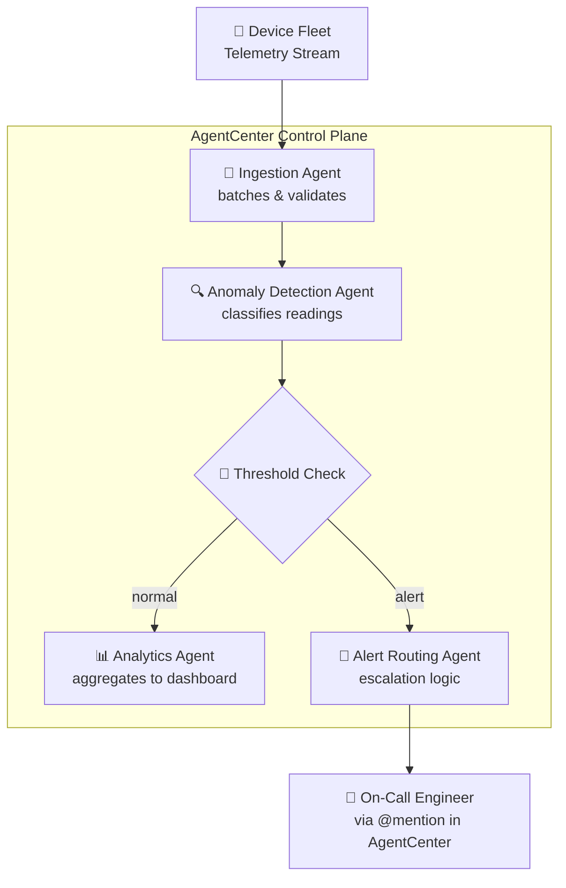

Running AI agents for IoT platform engineering means your pipeline never stops. Telemetry agents pull device state every 30 seconds. Anomaly detection agents classify sensor readings around the clock. Firmware update coordinators push changes across 40,000 edge devices. Alert routing agents decide whether a temperature spike is noise or a building fire.

When one of those breaks at 2am, you typically find out from a customer. Not a dashboard.

That's the core problem for IoT platform teams managing agents in production: the agents themselves work fine, but the visibility into what they're actually doing — what's blocked, what failed silently, what's costing money — doesn't exist until something goes wrong.

## Why IoT Agent Pipelines Break Without a Control Plane

Most IoT platform engineering teams start with 3 or 4 agents. A data ingestion pipeline. An anomaly classifier. A threshold alerter. Six months later there are 18 of them, and no single picture of the system.

Three things break first:

**Task handoffs disappear.** Your ingestion agent finishes processing a batch. Does the downstream classifier pick it up? You don't know without checking logs. If the classifier is stuck on a stale batch from three hours ago, you might not catch it until data starts missing from your dashboard.

**Errors become invisible.** An agent that returns a result is not the same as one that returns a correct result. If your anomaly detection agent starts flagging everything as normal because a sensor calibration drifted, it won't throw an exception. It'll quietly stop being useful while looking fine from the outside.

**Costs spike without warning.** LLM-backed diagnostic agents burn through token budgets fast during incident spikes — exactly when device events multiply. Without per-agent cost tracking, you see the damage in the monthly bill, not in real time.

## Which AgentCenter Features Matter for IoT Teams

The [AgentCenter features](/features) that solve these problems aren't complex. They're the visibility layer your IoT agent pipeline is currently missing.

### Real-Time Agent Status

Every agent gets a live status: online, working, idle, or blocked. For a pipeline with 12 agents in sequence, you see at a glance which stage is active and which one has been idle for 40 minutes when it shouldn't be.

When your firmware rollout agent stalls waiting on a device acknowledgment queue, you see it stall. You don't have to SSH into a server and scroll logs.

### Kanban Board for Pipeline Stages

The [task orchestration board](/features/task-orchestration) lets you map your agent pipeline as tasks. Each stage — ingest, validate, classify, route, alert — becomes a card. You see what's in progress, what's done, and what's stuck.

For IoT teams running parallel device groups (zones, regions, device classes), this turns pipeline state from tribal knowledge into something the whole team can read.

### Agent Monitoring with Cost Tracking

The [agent monitoring view](/features/agent-monitoring) shows performance and token usage per agent. During a fleet-wide firmware push when diagnostic agents spike in activity, you see the cost curve live, not after the fact.

Set cost alerts so a runaway classification agent doesn't burn through a month's budget over a weekend.

### @Mentions and Task Threads

When an alert routing agent escalates something ambiguous, your on-call engineer can drop a comment directly on the task. The agent picks it up as context on the next cycle. No side channels, no hunting through Slack threads for what someone decided three hours ago.

## The Numbers for IoT Platform Teams

A typical IoT platform engineering team running production agents manages 8 to 25 agents across ingestion, processing, monitoring, and notification pipelines. During firmware rollouts or incident response, that number goes higher.

The **Pro plan** ($29/month, up to 15 agents, 15 projects) fits most teams. For platforms with regional agent clusters or multi-tenant deployments, **Scale** ($79/month, 50 agents) gives you the room you need.

What it replaces: a collection of cron jobs, custom dashboards built by individual engineers that only they understand, Slack notifications that trigger only when something explodes, and tribal knowledge about which agent handles what.

See the full [pricing breakdown](/pricing) before starting a trial.

## Before vs After AgentCenter

| | Without AgentCenter | With AgentCenter |
|---|---|---|
| **Visibility** | Check logs per agent, no unified view | Live status board for all pipeline stages |
| **Task handoffs** | Inferred from output files or DB state | Explicit task cards — stalled handoffs are visible immediately |
| **Error detection** | Silent wrong outputs until a customer notices | Blocked status on board, cost anomalies flagged in real time |
| **Cost tracking** | Monthly bill surprise | Per-agent token usage tracked continuously |
| **Debugging time** | 45-90 minutes tracing which agent introduced a problem | Under 15 minutes from the task card to the specific agent run |

## Where to Start

Set up [agent monitoring](/features/agent-monitoring) before anything else. Before you touch orchestration or task boards, get your existing agents reporting into AgentCenter.

Once you see all your agents in one place — what's running, what's idle, what's costing what — the gaps become obvious fast. You'll spot the ingestion agent that's been in "working" state for six hours without completing. You'll see the classification agent that costs 3x the others.

From there, the Kanban board fills itself.

---

*IoT platform teams that add a control plane early spend less time firefighting later. [Start your 7-day free trial](/pricing).*
