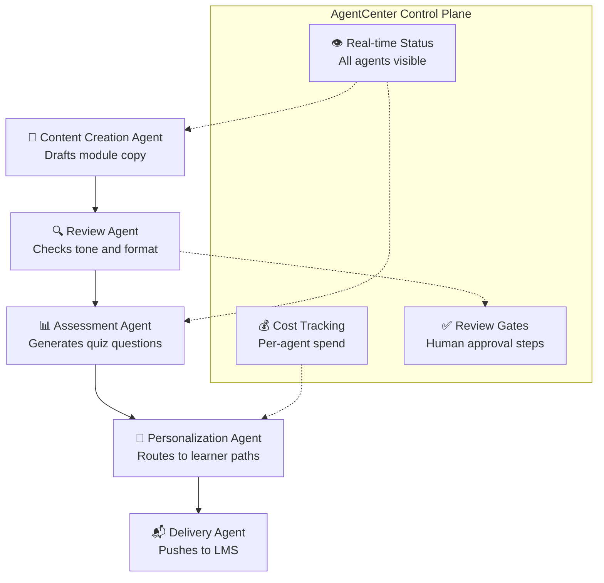

Learning and development teams have a specific problem with AI agents: the work looks like it's running fine until it isn't.

You have an agent drafting module content, another scoring assessments, and a third recommending learning paths to employees. On a good day, they run quietly. On a bad day, one agent produces output that doesn't match the course template, a second has been retrying silently for two hours, and you find out because an L&D coordinator asks why a cohort received duplicate notifications.

That's the moment you realize a shared spreadsheet and a folder full of scripts won't hold this together.

## What Breaks Without a Control Plane

L&D pipelines are long and multi-step. When agents run without coordination, the friction shows up in predictable places.

**Module handoff failures.** A content creation agent finishes a draft and marks itself complete. But the downstream review agent is waiting for a structured JSON file, and the creation agent exported markdown. No error fires. No alert goes out. The review queue stacks up while someone wonders why nothing is moving.

**Compliance training drift.** Your quarterly compliance refresh agent pulls updated regulatory content, generates new assessment questions, and sends them to the LMS. One quarter, the source URL changes structure. The agent keeps running, pulls nothing new, and generates questions based on stale cached content. Nobody notices until an audit.

**Cost spikes from onboarding surges.** A learning path recommendation agent handles a burst of 200 new hires joining at once. Without a cost cap, it burns through the monthly token budget in three days. You find out when the invoice arrives.

These aren't edge cases. They're what happens when agents run without a shared control plane.

## How AgentCenter Fits the L&D Workflow

### Kanban Board for L&D Pipelines

L&D work moves through distinct stages: create, review, assess, personalize, deliver. AgentCenter's [task orchestration board](/features/task-orchestration) maps directly to this. Each task card shows which agent owns it, what stage it's in, and whether it's waiting on a human.

When the review agent finishes checking a module, the task moves to the next column. If the format check fails, the task flags for human review. You see exactly where the bottleneck is without digging through logs.

### Agent Monitoring for Silent Failures

The compliance drift scenario is precisely what [agent monitoring](/features/agent-monitoring) surfaces. AgentCenter tracks heartbeat signals per agent. If the compliance refresh agent runs but pulls zero new records, you set a threshold: flag if input content count falls below a minimum. The result shows up as a blocked task, not a silent success.

### Cost Tracking Per Agent

When 200 new hires hit the personalization agent at once, you see the cost curve in real time. AgentCenter tracks token spend per agent and per project. Budget alerts fire before a cohort surge wipes the monthly allocation.

### Task Dependencies for Pipeline Order

The handoff failure happens because nothing enforces the order between agents. In AgentCenter, you define task dependencies explicitly. The review task won't start until the creation task is marked complete with confirmed output attached. Silent queue stacking stops.

### Deliverable Review Gates for Quality Control

L&D output goes directly to employees. A module with incorrect terminology or a quiz with broken logic is a real problem, not just a minor bug. AgentCenter's deliverable review workflow adds a human gate before anything ships. An L&D coordinator can approve, reject, or request changes on any agent output before it reaches the LMS.

## The Numbers

A mid-size L&D team with two to five staff typically runs 6 to 12 agents: content drafting, assessment generation, learning path recommendation, compliance refresh, onboarding automation, and sometimes a translation agent for multilingual content.

The **Pro plan at $29/month** covers 15 agents across 15 projects. That fits most L&D teams running a few agent pipelines in parallel. Teams managing L&D across multiple business units or geographies may need the **Scale plan at $79/month** for up to 50 agents.

What it replaces: Notion databases used to manually track agent status, shared Google Sheets for reviewing agent output, scattered Slack threads for escalations, and monthly billing surprises from unmonitored agent runs.

## Before vs After AgentCenter

| Area | Without AgentCenter | With AgentCenter |
|---|---|---|
| Visibility | No clear view of which agent is running or stuck | Real-time status for every agent in one dashboard |
| Task handoffs | Agents finish with no enforced next step | Task dependencies control pipeline order |
| Error detection | Silent failures surface only after someone complains | Missed heartbeats and empty outputs flagged immediately |
| Cost tracking | Monthly invoice surprise after budget overrun | Per-agent spend visible daily with configurable alerts |
| Debugging time | Hours tracing logs across separate agent outputs | Task history per agent with full context in one place |

## Where to Start

Set up the Kanban board first. Map your L&D pipeline stages as columns: create, review, assess, deliver. Create one task per active agent and assign it to the right column. Within a day, you'll know which agents are actually doing work and which are sitting idle.

Once the board is running, add a deliverable review gate on your content creation agent. That single gate will catch more quality issues in the first week than you'd catch manually in a month.

---

*L&D teams that add a control plane early spend less time firefighting later. [Start your 7-day free trial](/pricing).*
