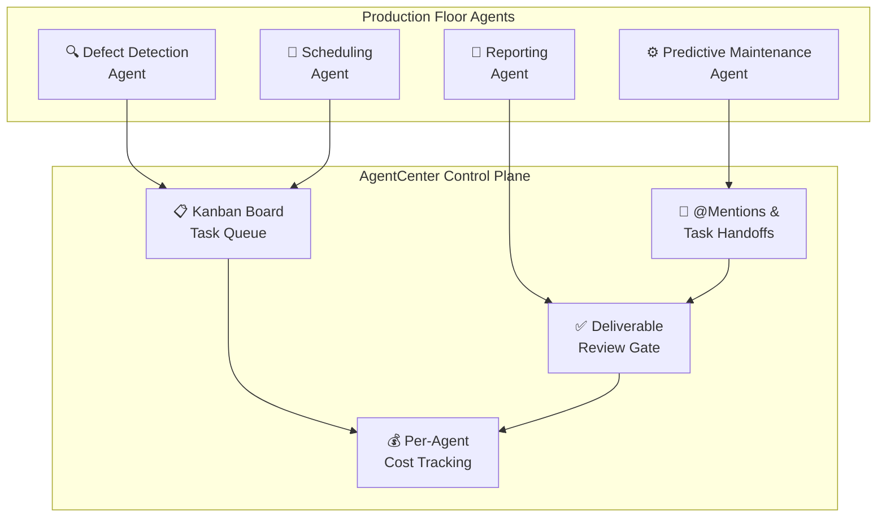

AI agents for manufacturing operations teams usually start small: one agent monitoring a production line for defects, another generating shift summary reports. Six months later you have 14 agents running across three shifts and nobody has a clear picture of what's running, what failed overnight, or what it's costing per production run.

That's the problem. Not the agents — they work. The visibility doesn't.

## What Goes Wrong Without a Control Plane

Manufacturing ops teams hit three specific failure modes when they scale agents without a management layer.

**The overnight gap.** Your defect detection agent flagged 14 anomalies at 2am. Nobody saw the alerts until morning standup. By then, the morning shift has already found rejects on the line. A human could have caught this at 2:15am if the escalation had reached them. The agent ran correctly. The handoff failed.

**Lost maintenance findings.** Your predictive maintenance agent flags a motor showing early bearing wear — a 4-hour fix if you catch it in time, a full-day outage if you don't. That finding needs to reach the maintenance scheduler to book a work order. Without a formal handoff, it sits in a log file nobody checks. The motor fails two weeks later. The post-mortem reveals the agent caught it. The process didn't.

**Cost opacity at scale.** You're running agents on Claude for document parsing and GPT-4 for scheduling logic. Three months in, the combined LLM bill is $4,200 with no breakdown by agent, line, or shift. Finance wants a justification. You can't give one because you never set up per-agent cost tracking.

## How AgentCenter Fits Manufacturing Workflows

**Real-time agent status.** The [agent monitoring dashboard](/features/agent-monitoring) shows every agent's current state: online, working, idle, or blocked. Your operations supervisor can check during the overnight shift without opening a single log file. They see which agents completed tasks, which are running, and which need attention — in one view.

**Task handoffs with @mentions.** When the maintenance agent flags a problem, it creates a task in AgentCenter's Kanban board and @mentions the maintenance scheduler directly. The scheduler gets notified, reviews the finding, confirms the priority, and books the work order. The information doesn't get lost between what the agent found and what a human needs to do about it. There's a full audit trail of every step.

**Deliverable review gates.** Some agent outputs need human sign-off before anything moves downstream. Your scheduling agent's recommended line changeover shouldn't reach the floor supervisor without review. AgentCenter's approval workflow adds that gate without adding manual tracking overhead. The agent submits the deliverable. The reviewer approves it. The task advances. If they reject it, the agent gets a retry with feedback.

**Per-agent cost tracking.** Every agent accumulates cost data per task and per project. You can see that your defect detection agent costs $0.04 per inspection run across 2,000 checks today, and your scheduling agent costs $1.20 per full schedule generation. When the LLM bill spikes in a specific week, you can point to exactly which agent drove it and whether the volume justified the spend.

## Typical Agent Count and Plan

A mid-size manufacturing operation usually runs 8 to 20 agents across quality, maintenance, scheduling, and reporting. Common breakdown:

- 2 to 4 defect and anomaly detection agents (one per line or product type)
- 1 to 3 predictive maintenance agents (monitoring equipment sensor feeds or maintenance logs)
- 1 to 2 production scheduling agents (line planning, changeover coordination)
- 2 to 4 reporting agents (shift summaries, KPI reports, supplier alerts)
- 1 to 3 document processing agents (work orders, safety checklists, compliance records)

That puts most teams on the **Pro plan at $29/month** (up to 15 agents, 15 projects) or **Scale at $79/month** for larger deployments. It replaces a mix of Slack notifications, emailed logs, and spreadsheets that nobody updates consistently. See [pricing details](/pricing) for the full breakdown.

## Before vs After

| | Without AgentCenter | With AgentCenter |
|---|---|---|
| **Visibility** | Logs spread across systems, reviewed manually | Single dashboard, real-time status per agent |
| **Task handoffs** | Findings emailed or messaged, easy to miss | Structured tasks with @mentions, tracked to resolution |
| **Error detection** | Discovered at shift handoff or after downstream impact | Visible immediately in dashboard, can escalate to on-call |
| **Cost tracking** | Monthly LLM bill with no agent-level breakdown | Per-agent, per-task cost visible in every project |
| **Debugging time** | 2 to 4 hours tracing which agent produced which output | Full audit trail and output history in AgentCenter |

## Where to Start

Set up the Kanban board with your maintenance and quality agents first. These two have the clearest handoff requirement: the agent finds something, a human needs to act on it. Getting that loop working gives you immediate value and shows the rest of the ops team what structured agent management looks like in practice.

Once your team can see agent status and task history in one place, adding scheduling and reporting agents is straightforward. You're already tracking where outputs go and who reviews them. See [how AgentCenter handles multi-agent task coordination](/features/multi-agent-workflows) for the handoff setup.

Don't wait for an incident to build the visibility layer. The first time a maintenance agent's finding gets lost in a log, you'll spend a day building manual processes to prevent it from happening again. Set up the control plane before that day arrives.

---

*Manufacturing operations teams that add a control plane early spend less time firefighting later. [Start your 7-day free trial](/pricing).*
