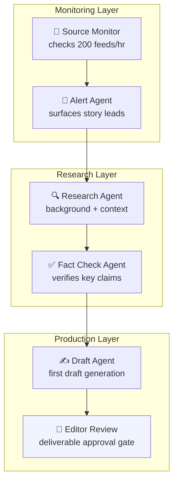

Newsrooms run on speed. When a story breaks at 2pm, the team that publishes by 3pm wins. But between source monitoring, background research, fact verification, and first-draft generation, actual writing time is maybe 20% of the total effort.

That's why editorial and news operations teams started deploying AI agents for newsroom automation. Source crawlers. Research agents. Headline optimizers. Newsletter summary generators.

Ten agents in, teams hit the same wall: nobody knows which agent ran, what it produced, or whether the output was actually good enough to use.

## What Breaks Without a Control Plane

Agents doing newsroom work run constantly. The monitoring agent checks 200 sources every hour. The research agent pulls background whenever a name appears. The draft generator kicks off when an editor assigns a story.

Without a shared control plane, three things break fast:

**Output goes unreviewed.** An agent drafts a company backgrounder. The editor assumes someone verified the numbers. Nobody did. The article ships with a funding figure that was corrected six months ago.

**Task handoffs get dropped.** The research agent finishes. The draft agent never picks up its output. The editor refreshes their dashboard for 20 minutes wondering why the draft is not there. It's sitting in a directory nobody is watching.

**Cost spikes are invisible.** A breaking news event triggers 40 agent runs in one hour. Your LLM bill for the day is 8x normal. You find out on the monthly billing statement, not from a live alert.

## How AI Agents Flow Through AgentCenter in a Newsroom

Every stage has a task in AgentCenter. Every handoff is visible. No output moves forward without a review gate.

## Feature-to-Workflow Mapping

### Agent Monitoring

The [agent monitoring dashboard](/features/agent-monitoring) shows every agent's status in real time. When the source crawler is idle, you know it completed or stalled. When the research agent is working, you see it. No checking Slack channels or shared folders.

A common setup: the monitoring agent runs on a 60-minute recurring task. When it surfaces a story worth pursuing, it creates a new task in AgentCenter tagged to the story slug. The research agent picks that up automatically.

### Kanban Board and Task Orchestration

Editorial queues look a lot like software sprint boards. The [Kanban-style task orchestration](/features/task-orchestration) maps directly to how a newsroom thinks about work in flight.

Teams set up three columns: Monitoring, Research, Draft Ready.

Each task carries the agent's output as an attached deliverable. When the research agent completes, the task moves to Draft Ready. The editor sees it immediately, opens the output, and decides whether to send it to a writer or route it to the draft agent.

### Deliverable Review and Approval Workflows

Every output from a draft agent should have a human look before it moves to the CMS. AgentCenter's deliverable review lets editors mark outputs approved, request revisions, or reject a draft outright.

This matters more in newsrooms than in most other industries. Agent errors here are not just bugs — they're published mistakes. A review gate before any draft reaches the CMS catches those before they become corrections.

### Cost Tracking Per Task

A breaking news day is not a normal day. Story volume, source volume, and research complexity all spike. The [monitoring view](/features/agent-monitoring) gives per-task token cost, so you can see when a single research agent is consuming 10x its usual budget because a topic is unusually deep.

Set a per-agent cost threshold. When an agent crosses it, you get an alert before the bill arrives.

## The Numbers

A mid-sized digital newsroom running agents for source monitoring, research, and draft generation typically operates 8-15 agents. That fits the Pro plan ($29/month), which covers up to 15 agents across 15 projects.

What it replaces: a tangle of scheduled Python scripts, a shared spreadsheet for tracking output status, and a Slack channel where most status updates go unread.

The Starter plan works for smaller operations like newsletters or vertical publications that need 3-5 agents. The Scale plan fits larger publications running 20+ agents across multiple beats or regional desks.

## Before vs After AgentCenter

| | Without AgentCenter | With AgentCenter |
|---|---|---|
| Visibility | Ask in Slack who ran the last research agent | Live status in the dashboard for every agent |
| Task handoffs | Manual file passing or scripted chaining | Automated task dependencies with deliverable handoffs |
| Error detection | Notice a bad output after it ships | Review gate before output moves to the CMS |
| Cost tracking | Monthly billing surprise | Per-task cost with real-time alerts on spend spikes |
| Debugging time | 2-3 hours tracing logs across scripts | Activity feed shows exactly what ran and when |

## Where to Start

Set up deliverable review workflows before you connect your draft agent to anything downstream. This is the highest-leverage starting point for newsroom teams:

1. It forces you to define what "done" looks like for each agent output
2. It puts an editor in the loop before bad output reaches the CMS
3. It builds the review habit before volume pressure tempts you to skip it

Once review is working, add the Kanban board and connect your monitoring agent as the first step in the pipeline. The rest follows from there.

---

*Newsroom teams that add a control plane early spend less time firefighting later. [Start your 7-day free trial](/pricing).*
