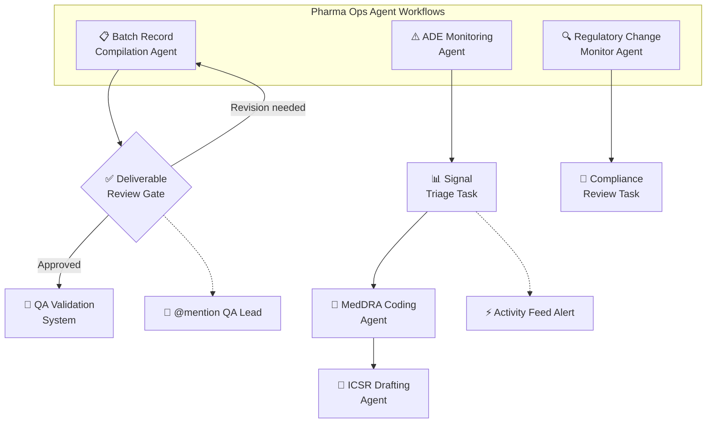

Pharmaceutical operations teams have started running AI agents for batch record compilation, adverse event monitoring, and regulatory change tracking. The agents work. The problem is you can't tell which one silently failed until the QA team finds the gap three days later.

That's not an agent problem. It's a visibility problem.

## What Breaks Without a Control Plane

Pharma ops runs some of the highest-stakes AI agent workflows outside finance. A batch record agent producing incomplete output isn't just a nuisance. It's a deviation that can delay batch release.

Three patterns show up most often when teams outgrow manual tracking:

**Outputs that land nowhere.** Your adverse event (ADE) monitoring agent ran overnight, flagged 14 signals, and wrote results to a shared folder. Nobody checks that folder before the morning standup. Three of those signals need 15-day expedited reporting. By the time someone looks, you're at four days.

**Chains that fail silently.** Your signal detection agent feeds a MedDRA coding agent, which feeds an ICSR drafting agent. The MedDRA step hits a timeout at 2am. Nobody notices. The ICSR draft generates output based on partial coding, which looks plausible but isn't. It gets routed to medical writing.

**No cost attribution.** Three compliance documentation agents ran this week across four product lines. Month end: the LLM bill is $847 higher than projected. You can't attribute the overage to any batch, product, or program.

## How AgentCenter Fits Pharmaceutical Operations

### Deliverable Review Gates

The batch record compilation agent completes. In AgentCenter, a mandatory [deliverable review task](/features/task-orchestration) is created automatically, the QA lead gets @mentioned, and the record stays blocked until the lead approves it. Nothing moves downstream unreviewed.

This doesn't require extra tooling or a custom workflow. The review gate is a first-class feature, not a workaround.

### Real-Time Agent Status

AgentCenter's [agent monitoring dashboard](/features/agent-monitoring) shows each agent's current state on a live Kanban board: online, working, idle, blocked, or complete.

When the ADE monitoring agent completes at 2am and flags 14 signals, that output surfaces in the activity feed immediately. On-call sees it before the 9am standup, not three days later when QA starts asking questions.

"Completed" tells you the agent ran. AgentCenter tells you what it produced and whether anything needs review.

### Task Dependencies for Chained Pipelines

For the MedDRA coding failure pattern, you configure task dependencies in AgentCenter. If the MedDRA coding task doesn't complete with a verified output, the ICSR drafting task stays blocked. You see it on the board as a blocked task before it becomes a regulatory submission problem.

This is the difference between chaining scripts together and managing a pipeline. When one step fails, everything downstream stops visibly, not silently.

### Per-Agent Cost Tracking

Every task records its token usage. You see cost per agent, per run, and per project. When month end comes, the $847 overage traces to a large batch on the new biologics line, not to a mystery across your entire program.

This matters in pharma operations because cost centers are real. Different product lines have separate budgets. You need attribution, not aggregates.

## The Numbers

Typical pharmaceutical operations teams run 8 to 20 agents. The work spans quality documentation, regulatory monitoring, and manufacturing batch management.

A team of 6 to 12 people managing that fleet fits the Pro plan ($29/month, up to 15 agents). Larger programs with multiple product lines or clinical divisions fit Scale ($79/month, up to 50 agents).

What AgentCenter replaces: Slack threads for tracking which agent ran, shared drives with outputs nobody reviews systematically, and monthly surprises in the LLM bill with no per-program breakdown.

## Before and After

| | Without AgentCenter | With AgentCenter |
|---|---|---|
| Visibility | Slack threads and shared notes | Live Kanban board with status per agent and task |
| Task handoffs | Manual file drops and Slack pings | Enforced dependencies, downstream blocked until upstream verified |
| Error detection | QA finds the gap 2-3 days later | Blocked task visible on the board before review cycle |
| Cost tracking | Monthly bill, no breakdown | Per-agent, per-batch, per-product-line attribution |
| Debugging time | Dig through logs, ask the agent owner | Activity feed shows task chain, timing, and output summary |

## Where to Start

Set up the deliverable review workflow for your batch record compilation agent first.

That's the highest-risk output in pharmaceutical operations. It goes into validation-ready documents. A missing deviation note doesn't show up in token costs or latency metrics. It shows up when a batch gets rejected.

Once you have a review gate and @mentions for your QA lead, you'll catch the first problem before it reaches the batch review meeting. Everything else builds from there.

---

*Pharmaceutical operations teams that add a control plane early spend less time firefighting later. [Start your 7-day free trial](/pricing).*
