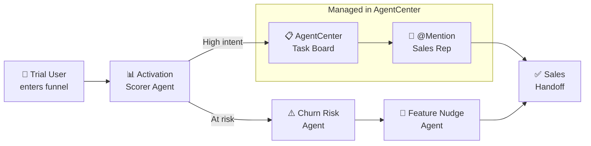

There's a pattern PLG teams hit around month three. An engineer wired up a trial activation agent over a weekend. Then someone added a churn risk scorer. Then a feature nudge agent for users who hit the product wall. Then a handoff alerter for sales when high-intent signals appeared. Now there are nine agents running on real users, and nobody has a clear picture of what any of them are doing on a given Tuesday.

Product-led growth teams build agent fleets faster than almost any other team in a company. The agents are cheap to spin up, they're clearly useful, and the wins are easy to point to. The problem isn't the agents. It's that they become invisible almost immediately.

## How PLG Teams Manage AI Agents

Before getting into specifics, here's the flow most PLG teams end up building:

Without a control plane, each of those agents is its own island. With one, they're a coordinated fleet.

## What Breaks Without Coordination

**The duplicate contact problem.** Your activation agent, your feature nudge agent, and your churn risk agent are all targeting the same trial cohort. Without shared visibility, the same user gets three automated touchpoints in 24 hours. You find out when they complain in support.

**The stale data problem.** Your activation scorer ran on last week's cohort because the data feed wasn't refreshed. The agent completed, reported success, and you had no idea it was working on the wrong users until conversion rates dipped two weeks later and someone went digging.

**The silent failure problem.** Your trial-to-paid upgrade agent failed on a Friday evening. No alert. No error visible anywhere. The conversion window closed. You found out Monday morning when you checked the numbers and nothing made sense.

These aren't engineering bugs. They're coordination failures. They happen because PLG teams instrument their agents one at a time, not as a fleet.

## Which AgentCenter Features Matter for PLG Teams

### Real-Time Status Across the Whole Fleet

AgentCenter's [agent monitoring](/features/agent-monitoring) shows every agent's current state: active, idle, blocked, or erroring. When your trial upgrade agent stalls on Thursday afternoon, you see it in the dashboard before the conversion window closes, not Monday morning after reviewing the weekly numbers.

For PLG teams, this changes how you operate. You stop asking "is the activation agent running?" and start asking "which users did it process today and what did it flag?"

### Kanban Board for the Trial Funnel

The [task orchestration board](/features/task-orchestration) lets you organize agent work by activation stage. Create a column for each phase — new trial, product wall hit, activated, handoff ready, converted — and route each agent's task output into the right column.

When an activation agent scores a user as high-intent, the task lands in the "handoff ready" column. A sales rep picks it up. The agent's work doesn't disappear into a webhook. It becomes a trackable card with full context attached.

### @Mentions for Human-Agent Handoffs

PLG workflows need human judgment at specific moments, particularly when an agent identifies a trial user who's ready for a sales conversation. AgentCenter's @mention system lets you tag a sales rep or account executive directly inside the task the agent created.

That person gets notified, sees the full context the agent collected, and responds in the same thread. No copying data into Slack. No separate CRM entry. The handoff is documented where the work happened.

### Per-Task Cost Tracking

Your churn prediction agent runs against 800 trial users every morning. AgentCenter shows what each run costs, broken down by task. If cost per prediction creeps up because you added more context to the prompt, you see it the same day, not at the end of the month when the LLM bill lands.

For PLG teams running multiple agents across multiple cohorts, per-task cost visibility is how you make trade-off decisions. Is the expansion revenue spotter worth $0.40 per qualified user, or should you trim its prompts?

### Recurring Task Automation

Weekly cohort analysis, daily activation scoring, monthly churn reports — these are repeating operations. AgentCenter's recurring task automation (available on Pro and above) runs them on schedule without a cron job or manual kick-off. When a run completes, the results surface on the task board.

## The Numbers for PLG Teams

A typical PLG team at a growing SaaS company runs 8 to 15 agents: trial monitor, activation scorer, feature nudge generator, in-app message writer, churn predictor, NPS response agent, handoff alerter, and an expansion spotter for existing accounts.

The **Pro plan** at $29 per month covers up to 15 agents and 15 projects — the right fit for most PLG setups. If your agent count is growing fast, see the full [pricing breakdown](/pricing) for the Scale plan.

What AgentCenter replaces: scattered cron jobs, Google Sheets cohort tracking, Slack-based manual alerts, and whatever informal system the team built to remember which agent ran last Tuesday.

## Before vs After

| | Without AgentCenter | With AgentCenter |
|---|---|---|
| Visibility | Ask the engineer who built the agent | Real-time status: active, idle, blocked, error |
| Task handoffs | Slack message to sales when high-intent user flagged | @mention inside task, full context, tracked thread |
| Error detection | Found Monday when conversion numbers look wrong | Error visible on dashboard within minutes |
| Cost tracking | LLM bill at end of month, no breakdown by agent | Per-task cost visible in real time |
| Debugging time | Reproduce from logs, wait for engineer availability | Task history and agent output in the dashboard |

## Where to Start

Set up the [Kanban board](/features/task-orchestration) for your trial funnel first. Create a column for each activation stage and assign each agent's tasks to the right column. Run it for two weeks.

You'll see exactly where trials are stalling, which agents are producing output, and which ones are running silently with nothing showing up anywhere useful. That visibility alone changes how you manage the fleet — and it's the foundation everything else builds on.

---

*Product-led growth teams that add a control plane early spend less time firefighting later. [Start your 7-day free trial](/pricing).*
