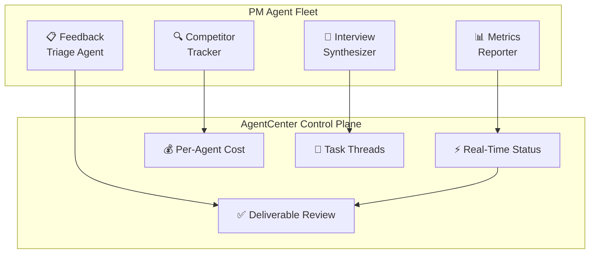

Product management teams are running AI agents now. Not the engineering team on their behalf. PMs themselves, with a few agents handling user research synthesis, competitor tracking, and feature request triage. The agents go live fast. The control plane comes later, if at all.

By the time a PM team has 8 agents running across different workflows, nobody has a clear picture of what actually ran last night, what it cost, or whether the output landed anywhere useful.

## What Breaks for Product Management Teams Without a Control Plane

Three specific failures show up early when PMs run agents without visibility.

**Silent failures before planning sessions.** You set a user feedback synthesis agent to run overnight and produce a summary before Monday's planning call. It fails at 2am. You find out when you sit down for the meeting and the doc is empty, or worse, the doc exists but the agent only processed 40 of 380 tickets because it timed out halfway. Without status tracking, you can't tell the difference between "ran fine" and "ran halfway."

**Cost surprises from uncapped agents.** A competitive intel agent that monitors 15 product landing pages sounds manageable. Then you check your API invoice and see it ran for 11 hours on a Friday because no page limit was set. Tracking spend via end-of-month invoices is not cost visibility.

**Broken task handoffs with no trace.** A common PM setup chains two agents: one categorizes incoming feature requests, a second ranks them by priority. When the ranker fails, there's nothing showing you which step broke, whether step one's output was valid, or why the Notion page is half-empty. You end up digging through logs instead of preparing the roadmap.

## How Product Management Teams Use AgentCenter

A typical PM agent fleet has 6 to 12 agents: a feedback triage agent, a user interview synthesizer, a competitor tracker, a metrics reporter, a release notes generator, and a few research agents tied to specific product areas. The [agent dashboard](/features/agent-dashboard) shows all of them in one view.

Here is how the core features map to PM workflows:

**Real-time agent status** tells you before your morning standup whether the overnight research agent finished, stalled, or failed. You see the exact state: online, working, idle, blocked. No Slack message to the engineer who built it asking if it ran.

**Deliverable review and approval** is where PM teams get the clearest return. When an agent produces a feature priority ranking or a user research summary, it lands in AgentCenter for review before the team acts on it. You can approve it, reject it, or flag specific sections. This stops bad agent output from quietly becoming product decisions.

**@Mentions and task threads** let you tag a designer or engineer on a specific agent output without copy-pasting from a tool they can't access. "The competitor feature analysis landed. Take a look at section 2." with a direct link to the deliverable.

**Cost tracking per agent** shows what each workflow costs per week. A feedback triage agent running four times a day costs far less than a deep research agent crawling dozens of URLs hourly. You can see this broken down by agent, not as a single line item on an invoice.

**Recurring task automation** (Pro and above) lets you schedule agents on a fixed cadence without manual triggers. Set the interview synthesizer to run every Tuesday at 6am, the competitor monitor every Friday at noon. The [task orchestration feature](/features/task-orchestration) handles the scheduling so PMs don't babysit cron jobs.

## The Numbers for Product Management Teams

| Detail | Info |
|--------|------|
| Typical agent count | 6–12 agents |
| Recommended plan | Pro at $29/mo (up to 15 agents, 15 projects) |
| What it replaces | Cron jobs, Slack bots, scattered Notion automations, weekly manual reviews |
| Getting started | 7-day free trial on all monthly plans |

The Starter plan at $14/mo works if you're running 5 or fewer agents. If your product org has multiple teams or business units, Scale at $79/mo covers up to 50 agents across 50 projects. Check [pricing](/pricing) for the full breakdown.

## Before vs After

| | Without AgentCenter | With AgentCenter |
|---|---|---|
| Visibility | No idea if agents ran or what they produced | Real-time status per agent: completed, working, blocked |
| Task handoffs | Manual check between agent outputs | Chained task delivery with full trace |
| Error detection | Find out when the prep agent failed at the meeting | Error visible immediately with log access |
| Cost tracking | End-of-month API invoice | Per-agent cost by week in the dashboard |
| Debugging time | 45 minutes through raw logs | Activity feed shows exactly what each agent did and when |

## Where to Start

Start with the real-time status dashboard. Add each existing PM agent to AgentCenter as a named agent, one per workflow. Group them by project area: user research, competitive intel, planning support.

After one week you will have a clear picture of which agents run reliably, which ones fail quietly, and which ones are producing output anyone actually uses. That picture is worth more than adding another agent before you have it.

---

*Product management teams that add a control plane early spend less time firefighting later. [Start your 7-day free trial](/pricing).*
