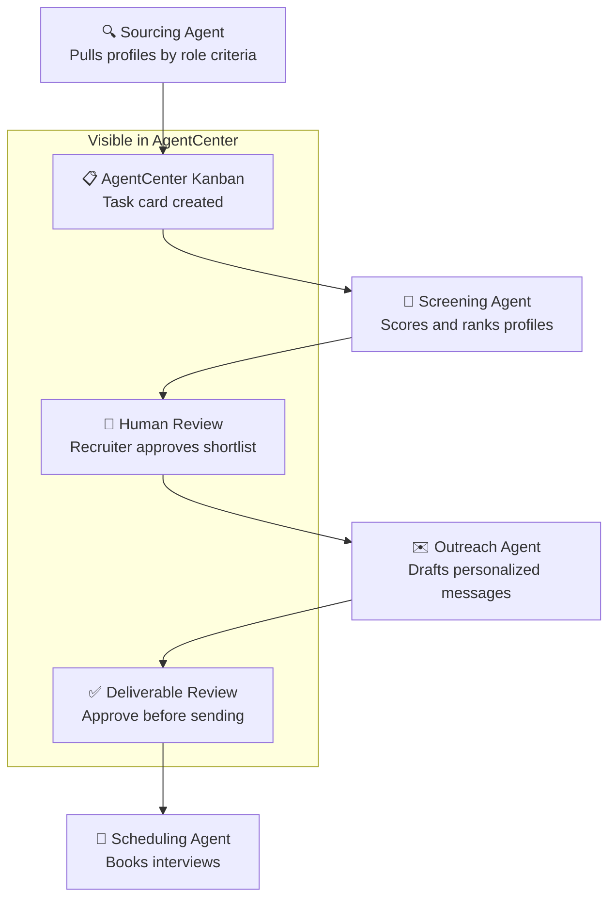

Recruiting teams are often the first non-engineering teams to run AI agents in production at scale. A sourcing agent pulls profiles. A screening agent scores them. An outreach agent drafts personalized messages. A scheduling agent handles calendar coordination.

It sounds clean. In practice, it isn't. Once you have 4 agents running across 10 open roles, the pipeline breaks in ways that are hard to see until something goes visibly wrong.

## The Bottleneck Nobody Warns You About

The problem isn't that the agents fail. It's that they fail quietly, and recruiting teams have no control plane to catch it.

Here's what that looks like day-to-day:

**Sourcing completes, but screening never starts.** A config change two weeks ago broke the handoff between your sourcing and screening agents. Sourcing ran, returned 300 profiles, and stopped. Screening never received them. Your recruiter waits. The hiring manager asks. The role sits open for another week before anyone traces the log.

**Outreach agents go off-script.** You're running one outreach agent per open role. One of them drifts — maybe a prompt got edited by someone who didn't realize the impact, or the model returned something outside your expected format. You find out when a candidate replies asking why the message makes no sense. It went to 40 people before anyone noticed.

**Costs are invisible until they're not.** Every screening pass, every profile lookup, every message draft burns tokens. At the end of the month, you get a bill. It doesn't tell you which role, which agent, or which batch was responsible. Trying to calculate cost-per-hire by AI agent becomes a spreadsheet nightmare.

## How AgentCenter Works for Recruiting Pipelines

Here's what changes when you put your recruiting agents behind a control plane.

### Kanban Board for Agent Tasks

Every agent task shows up as a card on a board your recruiters can actually read: "Source — Senior Backend Engineer," "Screen Batch 4 — Product Manager," "Draft Outreach — Design Lead." You can see in real time whether an agent is working, idle, blocked, or waiting on human review.

When sourcing finishes, the card moves. Screening picks it up. No one has to check logs or ask Slack. The board is the source of truth.

### Task Orchestration for Agent Handoffs

The [task orchestration layer](/features/task-orchestration) handles the sequencing between agents. Screening waits until sourcing is done. Outreach waits until the shortlist is approved. You define the rules once — the platform enforces them on every run.

This is what prevents the "screening never started" problem. The handoff is tracked, not assumed.

### Deliverable Review Before Outreach Goes Out

Before any message leaves the outreach agent, it sits in a review queue. A recruiter sees it, approves it, or sends it back with notes. The agent waits in a hold state until the approval clears.

This is the one step that prevents mass-sending a broken message. It takes 30 seconds per batch. The alternative is a reply thread explaining why 40 candidates got a confusing email.

### Real-Time Agent Monitoring

The [agent monitoring dashboard](/features/agent-monitoring) shows which agents are running, their error rates, and their cost per run. If a screening agent starts rejecting 90% of candidates on a role that's normally 40%, you'll see the anomaly before it kills the pipeline.

You're not watching logs. You're watching a dashboard built for this.

### @Mentions for Mid-Run Context

When a recruiter needs to adjust what an agent does mid-run — "skip candidates with less than 5 years of experience for this batch" — they drop a comment in the task thread with an @mention to the agent. No config files. No redeployment. The agent reads the thread and adjusts.

The thread also doubles as a full audit log. What the agent received, what it returned, what the human said. When something goes wrong, you're not tracing 4 separate log files.

## The Numbers for Recruiting Teams

A talent acquisition team running agents for 10–15 open roles typically runs:

- 1 sourcing agent per active role (10–15 agents)
- 1–2 shared screening agents
- 1 outreach agent per role
- 1 scheduling agent

That's 25–35 agent slots in active use. Most recruiting teams start on the **Pro plan at $29/month** (up to 15 agents) and move to **Scale at $79/month** when they're covering more than 15 concurrent roles.

What it replaces: Slack threads tracking agent status, manual log dives after every pipeline gap, and spreadsheets trying to reconcile LLM spend per open role. See [plan details and pricing](/pricing).

## Before vs. After AgentCenter

| | Without AgentCenter | With AgentCenter |
|---|---|---|
| Visibility | No idea which agent is sourcing, screening, or stuck | Live status per task — one board covers all roles |
| Task handoffs | Agents desynced, pipeline gaps surface days later | Automatic handoffs via task orchestration |
| Error detection | Agents fail silently, recruiters notice when pipelines go dry | Blocked agents flagged in real time |
| Cost tracking | Monthly bill arrives, impossible to attribute by role or agent | Per-agent cost breakdown — know what each run costs |
| Debugging time | 30–45 minutes tracing logs to find where a pipeline broke | 5 minutes with threaded task history per card |

## Where to Start

Set up the Kanban board first. Create columns that match your recruiting stages: Sourcing, Screening, Review, Outreach, Scheduled. Connect your sourcing agent to one role and get that pipeline visible end-to-end.

Once you can see one role move through the board from sourcing to scheduling, the monitoring and review steps become obvious additions. You don't need everything wired on day one. One visible pipeline tells you more than five invisible ones.

---

*Recruiting teams that add a control plane early spend less time firefighting later. [Start your 7-day free trial](/pricing).*
