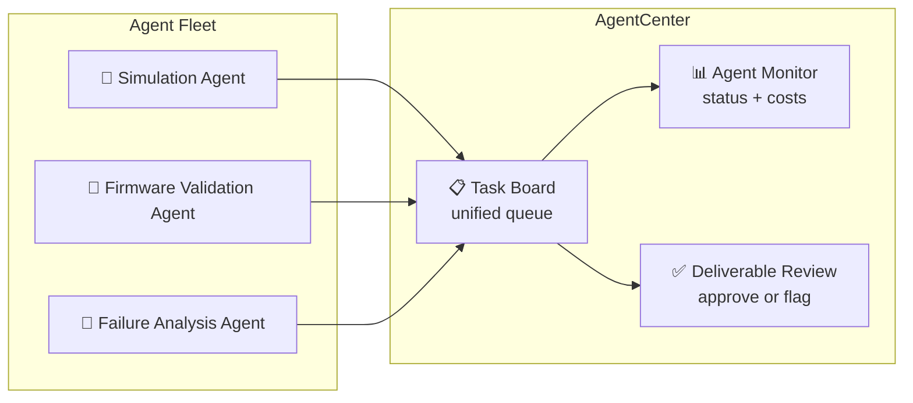

Running robots in production and running AI agents in production share one uncomfortable trait: when something goes wrong, you don't always know right away.

Robotics engineering teams are deeply technical. They model physical constraints, failure modes, tolerance stacks. They know how to reason about complex state. What they're less prepared for is the operational overhead of AI agents at scale.

An agent for simulation data processing here. A script that became an agent for firmware test automation there. A failure log analyzer someone spun up after a frustrating test cycle. Suddenly 8–12 agents are running in parallel and no one's entirely sure which one produced the output that caused last Tuesday's test regression.

This post is for robotics software teams managing AI agents in production and trying to get some visibility into what's actually happening.

## The Daily Problem

The agents themselves usually aren't the problem. The problem is coordination.

You have a simulation testing agent running overnight batch jobs against a dozen environment configs. You have a firmware validation agent checking build artifacts against hardware specs. You have a failure analysis agent processing sensor logs and flagging anomalies. None of these agents talks to the others. They dump outputs to shared folders, Slack channels, or an internal dashboard someone built on a weekend and hasn't touched since.

When the failure analysis agent flags something, who picks it up? When the firmware validation agent errors out mid-run, does anyone notice before the next test cycle starts? When two agents produce conflicting outputs about the same test run, how do you reconcile them?

## What Breaks Without a Control Plane

**Outputs pile up with no review process.** A simulation testing agent produces 40 reports per night. The team reviews 3 of them. The other 37 sit in a bucket. Nobody knows which ones contain the anomalies until a robot behavior issue surfaces two weeks later and someone backtracks through the logs.

**Failed agents disappear silently.** The firmware validation agent errored at 2am because of a config mismatch. Nobody knew. The morning standup started without that data. The team made a call based on an incomplete picture. This happens more than teams realize.

**Cost attribution is impossible.** The robotics team shares infrastructure with the broader engineering org. The AI agents running against the simulation platform are burning through tokens. Someone asks how much the agent layer costs to run. Nobody knows. Finance gets a single consolidated bill. Engineering shrugs.

## How AgentCenter Fixes This for Robotics Teams

### Task orchestration for simulation pipelines

AgentCenter's [Kanban board and task orchestration](/features/task-orchestration) gives your simulation agents a shared work queue. Instead of agents writing to disconnected outputs, each simulation run is a task. The agent works it. You see the status: queued, in progress, blocked, done.

When the failure analysis agent needs to review the output of a simulation run, that dependency is visible before either agent starts. For a team running 15 simulation environments overnight, morning review starts with a board showing what completed, what's blocked, and what needs a human decision — not a pile of files in an S3 bucket.

### Real-time agent status and error visibility

AgentCenter shows every agent's live status. When the firmware validation agent errors at 2am, it shows as blocked in the [agent dashboard](/features/agent-dashboard). The on-call engineer sees it. They fix the config. The agent resumes. No lost test cycles, no gaps in the next day's data.

Over time, [agent monitoring](/features/agent-monitoring) captures performance, error rates, and runtime per agent. You can see which agents consistently run slow, which ones error most often, and which hardware configurations surface the most failures.

### Deliverable review for firmware and test outputs

When an agent produces a firmware validation report or a failure analysis summary, that output needs human review before it influences a decision. AgentCenter has a built-in deliverable review workflow: the agent submits the output, a team member reviews and approves or flags it, and there's a record of who reviewed what and when.

For robotics teams with safety-adjacent work, this matters. You want a record of every output that was reviewed, who reviewed it, and what they decided. That record matters when something goes wrong in the physical system downstream.

### Per-agent cost tracking

AgentCenter breaks down token costs by agent and by project. The simulation testing agent costs $X per run. The firmware validation agent costs $Y per build. At the end of the month, you know where the spend is going. Finance gets an actual number instead of a shrug.

## The Numbers

A mid-sized robotics engineering team typically runs 8–15 agents: simulation validation, sensor log analysis, firmware build testing, defect classification, hardware changelog parsing, and a few internal tooling agents.

That puts most teams on the **Pro plan** ($29/month for 15 agents). Teams running agents across multiple hardware platforms or product lines will want the **Scale plan** ($79/month for 50 agents). See the full breakdown at [agentcenter.cloud/pricing](/pricing).

What AgentCenter replaces: custom Slack bots, half-finished internal dashboards, spreadsheet-based output tracking, and Slack threads that serve as informal task queues.

## Before vs After AgentCenter

| | Without AgentCenter | With AgentCenter |
|---|---|---|
| Visibility | Outputs scattered across S3, Slack, and CSVs | Single board showing all agents and task status |
| Task handoffs | Manual — someone checks output and pings the next person | Structured — task moves through states, handoff is logged |
| Error detection | Error surfaces when someone notices a missing output | Blocked agent shows in the dashboard immediately |
| Cost tracking | One shared cloud bill with no agent-level breakdown | Per-agent cost tracking, visible by project |
| Debugging time | Hours of log-hunting when something looks off | Agent history and output timeline in one place |

## Where to Start

Set up [agent monitoring](/features/agent-monitoring) first. Before you change your workflow, connect your agents and get a week of baseline data. You'll see which agents error most often, which ones are slow, and where costs are coming from. That data tells you where to focus next.

From there, move your highest-stakes agent — firmware validation or failure analysis — onto AgentCenter's task board and deliverable review. That's where safety-adjacent work lives. That's where human oversight matters most.

---

*Robotics teams that add a control plane early spend less time firefighting later. [Start your 7-day free trial](/pricing).*
